# IgKnighted — Unreal Engine Gameplay Architecture Master Reference

> **Document type:** Internal technical design, retrospective reconstruction, and portfolio publication backbone  
> **Prepared:** 22 October 2026  
> **Original game:** IgKnighted, a two-player stylized twin-stick/bullet-hell arena shooter (Unreal Engine 5, Windows, 2024)  
> **Scope:** Gameplay Framework, local multiplayer, input, player mechanics, combat, enemies, abilities, progression, difficulty, UI, engineering practices, technical storytelling, and CV positioning  
> **Status:** Planning and reference architecture; **not recovered project source code**

---

## How to use this document

This is a comprehensive working specification for producing a technically substantial IgKnighted portfolio case study. It is **not** a statement that every described C++ class, system, or design pattern existed in the shipped game. The original source project is unavailable. The document combines documented contributions, game behavior recalled by the developer, and a proposed modern Unreal Engine architecture that could implement that behavior.

**Evidence/provenance labels** appear throughout:

- **[ORIGINAL DOCUMENTED]** — explicitly described in the archived 2024 portfolio Markdown, independently found in the published portfolio, or on the itch.io release page. This can support historical contribution statements to the extent that the original portfolio attributes it to the developer.
- **[DEVELOPER-RECALLED]** — concrete gameplay behavior or project detail supplied in the October 2026 planning conversation. Treat as firsthand recollection, not recovered implementation evidence.
- **[REFERENCE DESIGN]** — proposed architecture, classes, API, diagrams, optimizations, and ideal engineering implementation. This should be presented as a **retrospective architecture/reimplementation design**, not as historical source code or proof that the original game used it.
- **[UNVERIFIED]** — mechanics or design details needing confirmation. Do not silently promote these to facts.

**Publication rule:** Describe historical work accurately; present reconstructed explanations as reconstructions and reference code as new examples. Do not claim that C++ classes, Behavior Trees, Gameplay Ability System (GAS), benchmark results, automated tests, or fixes were in the shipped version unless separate evidence is obtained. A polished architecture can show engineering knowledge without fictional implementation history.

**Suggested visible portfolio disclaimer (brief):**

> The original game was built primarily with Unreal Engine Blueprints as a multidisciplinary student project. The original source is no longer available. Alongside footage and documentation of my shipped contributions, I include a retrospective Unreal C++/Blueprint reference architecture showing how I would organize the game's systems today. Diagrams and sample code in this section are reconstructed designs, not recovered source files.

---

# Part I — Project identity and source-of-truth

## 1. Project identity

| Field | Value | Provenance |
|---|---|---|
| Project | IgKnighted | [ORIGINAL DOCUMENTED] |
| Genre | Stylized top-down/twin-stick arena shooter / bullet hell | [ORIGINAL DOCUMENTED] |
| Engine | Unreal Engine 5; original implementation described as Blueprints | [ORIGINAL DOCUMENTED] |
| Platform | Windows | [ORIGINAL DOCUMENTED] |
| Players | 1–2 local players | [ORIGINAL DOCUMENTED] |
| Original duration | 8 weeks, May–June 2024 | [ORIGINAL DOCUMENTED] |
| Team | 4 programmers, 3 designers, 5 artists (as in original portfolio metadata) | [ORIGINAL DOCUMENTED] |
| Individual role | Programmer / gameplay programming contributions | [ORIGINAL DOCUMENTED] |
| Setting | Flooded temple; fire knights confronting water-themed enemies | [ORIGINAL DOCUMENTED] |
| Delivery | Public downloadable game on BUAS itch.io | [ORIGINAL DOCUMENTED] |
| Source availability | Original Unreal project files lost/unavailable | [DEVELOPER-RECALLED] |

**Primary project links:**

- Existing portfolio: https://jon-gear.github.io/projects/year-1-block-d/
- Published release: https://buas.itch.io/igknighted
- Epic tutorial: https://dev.epicgames.com/community/learning/tutorials/lMr9/unreal-engine-begin-play-programming
- Epic tutorial: https://dev.epicgames.com/community/learning/tutorials/l21z/unreal-engine-begin-play-gameplay

The Epic pages are topical references; their full tutorial content was not accessible in the web text extraction for this document. Class responsibilities below are a proposed design based on Unreal Engine concepts, not a transcription of those tutorials.

## 2. Historical contribution inventory

The original `TEXTS.zip` contains `_projects/year-1-block-d.markdown`. Its seven contribution headings and descriptions are:

1. **Enhanced Input:** Input Action Mapping for controller/keyboard movement and shooting; replacing deprecated input; accounting for multiple local controllers.
2. **Local Multiplayer:** Custom **GameMode Blueprint** logic, spawning, possession, UI differentiation; controller indexing and player handling were significant challenges (original says roughly two days).
3. **Base Enemy Attack:** Player detection, aiming, projectile firing, enemy perception logic refactoring, animation trigger integration.
4. **Player Damage:** Projectile hit detection, player death, visual/audio feedback, balancing.
5. **Collectables:** Procedural spawning during waves, score tracking, dynamic HUD integration.
6. **Power-Ups:** Restrictions on duplicate power-up pickups, stacking effects, timed buffs.
7. **Player Animations:** Animation Blueprints for idle/walk/shoot/death and transitions linked to gameplay.

The original portfolio described a functional health system, but **[DEVELOPER-RECALLED] confirms a specific gameplay rule: water damage is lethal in one hit when unshielded and not dashing**. The publication should prefer the specific gameplay rule rather than casually implying a conventional multi-hit health bar.

### Original asset pointers from archived Markdown

| Feature | Image path in original Jekyll site |
|---|---|
| Project hero | `/assets/images/Y1D/main.jpg` |
| Input mapping | `/assets/images/Y1D/4.png` |
| Local multiplayer | `/assets/images/Y1D/1.png` |
| Enemy attack | `/assets/images/Y1D/5.png` |
| Player damage | `/assets/images/Y1D/2.png` |
| Collectables | `/assets/images/Y1D/3.png` |
| Power-ups | `/assets/images/Y1D/6.png` |
| Animation | `/assets/images/Y1D/7.png` |

Use the actual assets from the portfolio repository. These image paths are references, not files supplied in the ZIP itself. Do not replace original gameplay images with unrelated artwork while implying it is IgKnighted gameplay.

## 3. Game behavior — developer-confirmed

### Menus and configuration

1. Launch presents **PLAY**, **OPTIONS**, **ART DISPLAY**, **EXIT GAME**.
2. Play leads to player-count selection: **one or two players**.
3. Difficulty selection: **EASY**, **MEDIUM**, **HARD**, plus enable/disable **dynamic difficulty**.
4. The game asks whether the player wants to complete the tutorial.
5. Optional tutorial level explains the mechanics; main gameplay follows.

### Player mechanics

- Player movement and directional shooting.
- Dash with damage invulnerability during the dash window; dash has a cooldown.
- Pickups: **Shield**, **Power Shot** (adds two additional bullets / three-shot firing), **Enhanced Dash** (double/triple dash and defeat enemies dashed through), and **matchsticks** for score.
- Player has a score and score multiplier. The **team** has a common pool of **five lives**.
- Unshielded water hit outside invulnerable dash instantly kills the affected player. If shielded, the shield breaks and the player does not die from that hit.
- On death, the affected player loses one **shared** life and respawns if the match remains active.
- If the shared pool reaches zero, **the run ends even if the other player is still physically alive**.

### Enemy mechanics

- **Crawler:** common melee pursuer; approaches player and kills on contact.
- **Scorpion:** ranged enemy; seeks/maintains distance, shoots water balls.
- **Water mollusk:** stationary; fires a straight water stream/line that blocks ordinary crossing, while properly timed dash can traverse it.

### Level mechanics

- Separate tutorial level.
- **One persistent main gameplay map with three combat zones**.
- Zone progression requires defeating all enemies in the current zone, then moving forward.
- Clearing the three zones gives victory if the run has not already ended in defeat.
- Difficulty and dynamic difficulty exist, but the *exact original tuning formula* and whether it modifies count, health, spawn cadence, or other metrics are not established.

### Open questions / avoid invented specifics

- The player camera is shared; when one of the players goes farther away, the camera zooms out.
- Death respawn the Pawn after a VFX with the fire puffing out, with a short delay.
- The game respawn locations are fixed at the entrance of the level, when the player dies, the wave of enemies reset (there is no spawn camping)- All three zones have multiple sub-waves.

## 4. Published release details and caveats

The BUAS itch.io release lists local multiplayer (1–2 players), Windows, Unreal Engine, keyboard/gamepad/joystick inputs, and the released download. Its public known-bugs section states:

- Collectable count may appear doubled on the Game Over screen.
- Controls may stop working after a specific secondary-map/art-gym sequence.
- Certain invisible walls/barriers incorrectly despawn after killing certain enemies.

These are excellent **retrospective debugging case-study prompts**, not a basis to assert that the developer personally fixed them. A public player comment notes auto-shooting, a three-bullet power-up, and input/readability issues. Treat comments as player feedback, not source-level documentation.

---

# Part II — Portfolio positioning and reviewer journey

## 5. What the portfolio must demonstrate

### Question A — Can this developer implement gameplay?

Demonstrate input, player control, combat, collision and damage, AI, pickups and status effects, scoring, match loops, respawning, win/loss, game feel, UI and animation integration.

### Question B — Does this developer understand Unreal Engine?

Demonstrate correct object lifetimes and responsibilities of GameInstance, GameMode, GameState, LocalPlayer, PlayerController, PlayerState, Pawn/Character, AIController, components, subsystems, data assets, Blueprint communication, and C++/Blueprint boundaries.

### Question C — Do they think and work like a gameplay engineer?

Demonstrate class/interface design, event-driven communication, state ownership, edge-case handling, debug methodology, testing strategies, performance trade-offs, deliberate complexity choices, team integration and limitations.

### Special requirement for Unreal C++ roles

Blueprint-only released work is not conclusive evidence of C++ implementation experience. Add independently authored, compilable C++ sample code or a separate small demonstrator if available. Reference design snippets *explain* technical knowledge but should not be described as recovered shipped C++ code.

## 6. Suggested final publication outline

1. Hero, trailer, playable release, project metadata and individual role.
2. **At a Glance:** game loop + five gameplay pillars.
3. **What I Built in the Original Game:** documented seven contributions.
4. **Retrospective Architecture Overview:** full Gameplay Framework diagram, ownership/lifecycle explanation.
5. **Application and Match Lifecycle:** menus, GameInstance, difficulty configuration, tutorial, GameMode, GameState.
6. **Local Multiplayer and Input:** LocalPlayer, PlayerController, Enhanced Input, Pawn possession.
7. **Player Character Architecture:** movement, shooting, dash, shield, shared lives, respawn.
8. **Combat and Instant-Death Damage:** projectiles, hazards, immunity ordering, event flow.
9. **Enemy AI:** crawler pursuit, scorpion ranged spacing, mollusk area denial.
10. **Pickups, Abilities and Effects:** matchsticks, score, multiplier, shield, multishot, enhanced dash; custom-components versus GAS comparison.
11. **Difficulty and Zone Progression:** three persistent-map zones, encounters, spawn tracking, barriers, dynamic difficulty reference design.
12. **Animation and HUD:** Animation Blueprint, UMG, gameplay signals.
13. **C++ and Blueprint Design:** explicit reference implementation of one or more components and designer configuration.
14. **Debugging/Testing/Performance:** controller assignment, double-score, barriers, repeated hits, profiling strategy.
15. **Retrospective and Links:** lessons, limitations, original game and future improvements.

**Page readability principle:** the publication can combine sections into 7–9 major visual chapters. This master file is intentionally much more detailed than the public page.

## 7. Technical story arc

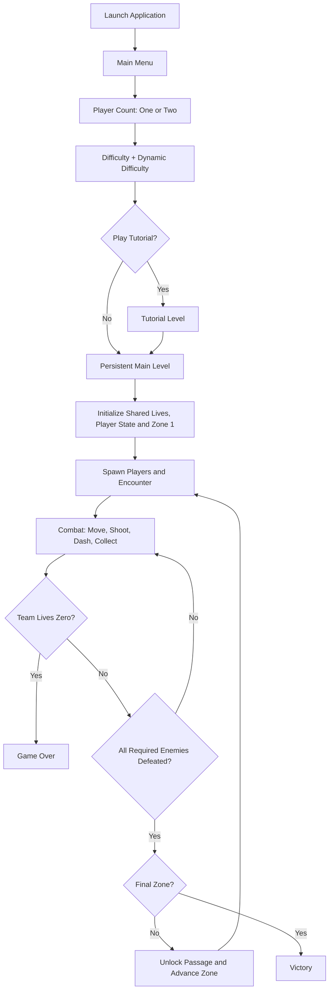

This flow is conceptual. The exact level transition after the tutorial, enemy wave subdivisions and game-over UI ordering should be confirmed if publishing low-level implementation claims.

---

# Part III — Unreal Gameplay Framework (reference design)

## 8. Fundamental lifetimes and ownership

| Framework element | Lifetime / creation | Ideal IgKnighted role | Avoid |
|---|---|---|---|
| `UGameInstance` | Created for application/game instance, persists across ordinary level travel | Selected player count, difficulty, tutorial preference, settings | Storing live enemy actors or per-world wave state |
| `AGameModeBase` or `AGameMode` | Created for active world/match; authoritative rules | Initialize run, manage shared life deductions, respawn, progress zones, decide victory/defeat | Keeping persistent menu settings across level loads |
| `AGameStateBase` or `AGameState` | World/match lifetime; shared match state | Shared team lives, zone index, match phase, enemy count | Owning every spawned enemy's AI behavior |
| `ULocalPlayer` | Per local participating user | Own Enhanced Input local-player subsystem; identify input user | Confusing local player count with Pawn count |
| `APlayerController` | One runtime controller per player in the local game | Player-specific input routing, possession, presentation | Directly owning persistent match state like team lives |
| `APlayerState` | Individual player/match identity and stats | Individual score and multiplier (if individual) | Storing *shared* team lives here |
| `APawn` / `ACharacter` | Spawned/possessed actor in level | Physical movement, targeting/aim, dash, hit handling and visual representation | Treating Pawn destruction as removal of the PlayerController |
| `AAIController` | Per possessed AI actor, often spawned with Pawn | Select player target, execute pursuit/attack behavior | Putting all AI decisions in GameMode |
| `UActorComponent` | Owned by actor | Reusable combat, dash, pickup/status behavior | Creating many components with duplicated authoritative state |
| `UWorldSubsystem` | World lifecycle | Optional coordinated world services | Making a subsystem just to avoid clear actor responsibilities |

**Important correction:** GameInstance does not literally *contain* a GameMode or GameState; those are world-scoped framework actors. Likewise, GameMode does not usually directly instantiate PlayerState by hand; the engine/framework creates the appropriate classes through configured defaults and player initialization paths.

**Local versus online multiplayer:** IgKnighted supports local multiplayer; controller allocation, splitscreen/shared camera and LocalPlayer subsystems are relevant. Do not describe the original game as replicated multiplayer or claim RPC, network prediction, client/server synchronization or server-authoritative security without evidence. GameMode's authority-role semantics remain useful background knowledge.

## 9. Architecture at a glance

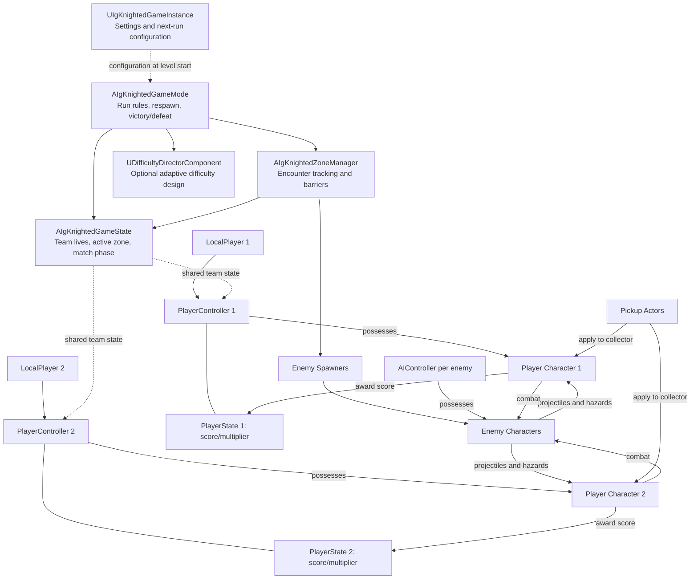

**Diagram caveat:** Mermaid is an architectural relationship map, **not a strict UObject containment tree**. Dashed connections denote logical communication/configuration, and multiple runtime players/enemies are shown as examples.

## 10. Canonical candidate class and asset tree

```text
Source/IgKnighted/                       [REFERENCE DESIGN]
  Core/
    IgKnightedGameInstance.h/.cpp
    IgKnightedGameMode.h/.cpp
    IgKnightedGameState.h/.cpp
    IgKnightedPlayerState.h/.cpp
    IgKnightedTypes.h                    (enums and structs)
  Player/
    IgKnightedPlayerController.h/.cpp
    IgKnightedPlayerCharacter.h/.cpp
    IgKnightedDashComponent.h/.cpp
    IgKnightedCombatComponent.h/.cpp
  Combat/
    IgKnightedProjectile.h/.cpp
    IgKnightedDamageResolver.h/.cpp      (optional helper/component)
    IgKnightedWeaponData.h               (UPrimaryDataAsset or UDataAsset)
  AI/
    IgKnightedEnemyCharacter.h/.cpp
    IgKnightedEnemyAIController.h/.cpp
    IgKnightedTargetingComponent.h/.cpp  (if useful)
    IgKnightedEnemyAttackComponent.h/.cpp
  World/
    IgKnightedZoneManager.h/.cpp
    IgKnightedEnemySpawner.h/.cpp
    IgKnightedPickup.h/.cpp
    IgKnightedDifficultyDirector.h/.cpp  (optional)
  UI/
    IgKnightedHUDWidget.h/.cpp           (optional C++ widget base)
  Abilities_Optional_GAS/
    IgKnightedAttributeSet.h/.cpp
    GA_Dash.h/.cpp
    GA_Fire.h/.cpp
    GE_*.uasset                            (configured in editor)

Content/IgKnighted/                     [REFERENCE DESIGN]
  Maps/L_MainMenu, L_Tutorial, L_Temple
  Blueprints/Core/BP_IgKnightedGameMode, BP_IgKnightedGameState
  Blueprints/Player/BP_PlayerCharacter, BP_PlayerController
  Blueprints/AI/BP_Crawler, BP_Scorpion, BP_Mollusk
  Blueprints/World/BP_ZoneManager, BP_EnemySpawner, BP_Pickup
  Input/IA_Move, IA_Aim, IA_Dash, IA_Pause, IMC_Gameplay, IMC_Menu
  AI/BT_*, BB_*, Tasks_*, Services_*
  Data/DA_Difficulty_Easy, DA_Difficulty_Medium, DA_Difficulty_Hard
  Data/DA_Weapon_*, DA_Encounter_Zone1..3, DA_PowerUp_*
  UI/WBP_MainMenu, WBP_DifficultySelect, WBP_TutorialPrompt,
     WBP_PlayerHUD, WBP_GameOver, WBP_Victory
  Animations/ABP_Player, ABP_Enemy_*
```

**Do not overengineer:** This is a comprehensive reference option, not a mandate to instantiate every class. A small Blueprint project may reasonably place some logic in fewer actors. A reviewer should see *why* boundaries are chosen, not only a giant tree of class names.

---

# Part IV — Match setup, GameInstance, GameMode, GameState

## 11. GameInstance and front-end workflow

### Responsibilities [REFERENCE DESIGN]

`UIgKnightedGameInstance` holds configuration that must survive movement between menu, tutorial and gameplay maps:

```cpp
// Illustrative design interface. Not recovered or compiled original source.
UENUM(BlueprintType)
enum class EIgDifficulty : uint8 { Easy, Medium, Hard };

USTRUCT(BlueprintType)
struct FIgRunSettings
{
    GENERATED_BODY()

    UPROPERTY(EditAnywhere, BlueprintReadWrite)
    int32 LocalPlayerCount = 1;

    UPROPERTY(EditAnywhere, BlueprintReadWrite)
    EIgDifficulty Difficulty = EIgDifficulty::Medium;

    UPROPERTY(EditAnywhere, BlueprintReadWrite)
    bool bDynamicDifficulty = false;

    UPROPERTY(EditAnywhere, BlueprintReadWrite)
    bool bPlayTutorial = true;
};

UCLASS()
class UIgKnightedGameInstance : public UGameInstance
{
    GENERATED_BODY()
public:
    UPROPERTY(BlueprintReadWrite, Category="Session")
    FIgRunSettings PendingRunSettings;
};
```

**Implementation note:** This snippet presumes project-specific module exports, includes and generated header naming are added in a real UE C++ project. It illustrates an API, not a drop-in standalone build.

### Menu flow

- `WBP_MainMenu` displays Play, Options, Art Display, Exit.
- `WBP_PlayerCount` selects 1 or 2 players.
- `WBP_Difficulty` selects Easy, Medium, Hard and dynamic setting.
- `WBP_TutorialPrompt` decides the next level. Tutorial may load separately then return to the main gameplay map.
- UI writes settings into GameInstance, which the gameplay GameMode reads during initialization.
- **Art Display** is a separate menu/map feature. Do not conflate it with the gameplay map; published bug history suggests handling travel and controller/input restoration matters.

### Relevant engineering decision

Store only small persistent configuration and save preferences in GameInstance. Do not store raw pointers to enemies, level barriers, world timers or PlayerCharacter Pawns across map travel. Unbind callbacks and restore mapping contexts appropriately on transitions.

## 12. GameMode: authoritative game rules in local play

### Proposed responsibilities

- Load/validate run configuration from GameInstance.
- Set match phase to initializing, active, victory or defeat.
- Initialize shared team lives to 5 in GameState.
- Ensure correct local player count at gameplay start.
- Select valid PlayerStarts and create/possess Pawns.
- React to a verified player death exactly once; decrement **one shared life**.
- If lives remain, schedule respawn of dead player's Pawn.
- If shared lives reach zero, end run **regardless of whether other Pawn remains alive**.
- On ZoneManager encounter completion, unlock progression or trigger victory after Zone 3.

### Potential public methods [REFERENCE DESIGN]

```text
StartConfiguredRun(Settings)
InitializeLocalPlayers()
HandlePlayerEliminated(Controller, Pawn)
CanConsumeTeamLife() -> bool
RequestRespawn(Controller)
HandleZoneCleared(ZoneIndex)
CheckMatchConclusion()
FinishMatch(Result)
```

### Key invariants

1. Shared lives are in `[0, 5]` (or validated configurable max) and never negative.
2. One Pawn death event deducts a maximum of one shared life.
3. No respawn after Game Over has been committed.
4. Game Over triggered at zero even if second Pawn remains alive.
5. No further zone progression after match ends.
6. A victory transition cannot race a simultaneous lethal hit into an inconsistent result. Specify event precedence.

## 13. GameState: shared match data

### Suggested state

```text
MatchPhase: MainMenu / Initializing / Active / ZoneTransition / Victory / Defeat
SharedLivesRemaining: int32 (initialized to 5)
CurrentZoneIndex: 0..2 or 1..3 consistently
ActiveEnemiesRemaining: int32
PendingEnemySpawns: int32
CurrentDifficultyScalar: float (optional)
OnTeamLivesChanged event
OnMatchPhaseChanged event
OnZoneChanged event
OnEnemyCountChanged event
```

**Authority model:** The GameMode mutates match state under its rules; GameState exposes observable values. With local multiplayer everything may be in one process, but using these responsibilities correctly enables cleaner reasoning and a network-ready mental model without claiming network support.

### Separate team and individual state

| Data | Owner in reference design |
|---|---|
| Shared lives | `GameState` |
| Current zone and encounter count | `GameState`/ZoneManager |
| Player 1 score | `PlayerState` 1 |
| Player 2 score | `PlayerState` 2 |
| Score multiplier | Per-player `PlayerState` if individual; otherwise `GameState` if shared **[UNVERIFIED]** |
| Current shield | PlayerCharacter or Ability System Component |
| Dash state/cooldown | PlayerCharacter DashComponent or GAS |
| Enemy target | AIController/targeting component |

## 14. PlayerState and Controller/Pawn distinction

A single custom `AIgKnightedPlayerState` class has two runtime instances in a two-player match. Suggested per-player properties include `Score`, `ScoreMultiplier`, collectables acquired, unique player ID/color. **Do not give each PlayerState 5 lives**: the game has one team pool.

Controller lives across a character death/respawn; the Pawn is replaceable. PlayerState survives Pawn replacement within the ongoing match. The GameMode can respawn or re-possess without losing player identity or score.

---

# Part V — Local multiplayer and Enhanced Input

## 15. Local player setup

### Intended two-player object model

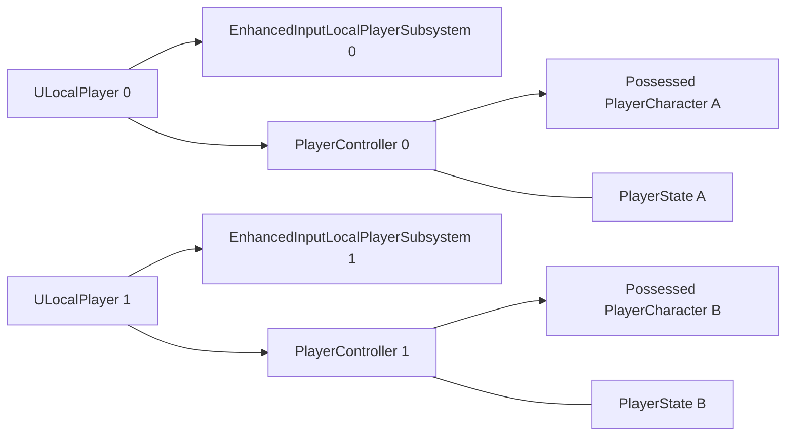

The engine manages creation and initialization. One PlayerController **class** can back both players, with separate instances and LocalPlayer input contexts. Actual device-to-player assignment on a given Unreal version/platform may require explicitly tested settings/API choices. Do not promise universal keyboard-plus-gamepad permutations without confirming the shipped game's behavior.

### Proposed initialization sequence

1. Main menu stores `LocalPlayerCount` (1 or 2).
2. On main-level start, GameMode validates player count.
3. Create missing local players through supported UE player APIs (`UGameplayStatics::CreatePlayer` or equivalent flow, with version-dependent parameters).
4. Framework associates each LocalPlayer with a distinct PlayerController.
5. Spawn Pawns using selected PlayerStarts, account for non-overlapping spawn positions.
6. Controllers possess corresponding Pawns.
7. On each LocalPlayer, install required Enhanced Input Mapping Context through the `UEnhancedInputLocalPlayerSubsystem`.
8. Create player-specific UI or a shared HUD that observes both PlayerStates and GameState.
9. On Pawn respawn, ensure possession and relevant input/camera bindings are restored.

### Common mistakes to discuss

- Controller index ≠ arbitrary PlayerStart tag without explicit mapping.
- Input Mapping Context attached to the wrong LocalPlayer.
- Assuming `GetPlayerController(0)` identifies whichever player generated an event.
- New Pawn not possessed after death.
- Recreating the second player after a map travel, causing duplicate controllers.
- Menu mapping context left active during combat or gameplay mapping removed unintentionally after opening Art Display.
- Handling gamepad IDs and keyboard ownership without testing.

## 16. Enhanced Input design

Proposed assets:

```text
IA_Move       Axis2D
IA_Aim        Axis2D or mouse-position-derived direction
IA_Dash       Boolean
IA_Attack     Boolean (only if player-controlled firing is applicable)
IA_Pause      Boolean
IA_Confirm    Boolean (UI)
IA_Cancel     Boolean (UI)

IMC_Gameplay_KeyboardMouse
IMC_Gameplay_Gamepad
IMC_Menu
```

The game might use automatic firing; if so, represent `IA_Attack` as an optional reference design rather than a claimed original binding.

### Movement and aim mathematics

Given a 2D input `v = (x, y)`, transform the planar input into world-relative movement based on arena orientation, then normalize/clamp magnitude as needed.

```text
MovementDirection = Normalize(Forward * InputY + Right * InputX)
AimDirection = Normalize(TargetLocation - MuzzleLocation)
ShotRotation = AimDirection.Rotation()
```

Never normalize an approximately zero vector without checking. For controller thumbsticks, apply dead zones via Enhanced Input modifiers and account for sensitivity. For mouse aiming, project cursor to the game plane (trace or deprojection) and compute character-to-cursor direction.

### Input lifecycle sketch

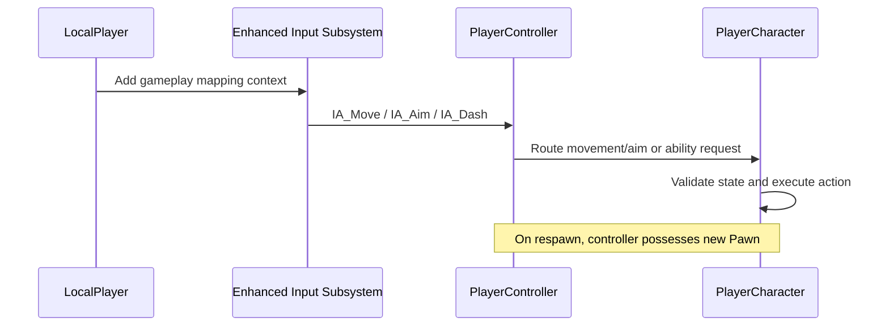

## 17. Camera architecture [UNVERIFIED]

Two plausible options:

- **Shared camera:** one camera observes both players, follows midpoint/bounds, zooms based on separation, enforces arena bounds. Needs deliberate view-target handling so both inputs remain independent despite one viewport.
- **Split-screen:** each PlayerController has its own viewpoint. Needs split-screen layout and individual UI attachment.

Do not assert either until the original footage is inspected or developer memory confirms it. The reference code architecture can document both options and choose one later.

---

# Part VI — Player mechanics and life cycle

## 18. Player Character component composition

```text
AIgKnightedPlayerCharacter
  CapsuleComponent / Collision
  Visual Mesh + Animation Blueprint
  CharacterMovementComponent
  IgKnightedCombatComponent        [REFERENCE DESIGN]
  IgKnightedDashComponent          [REFERENCE DESIGN]
  Status/Shield state or ASC       [REFERENCE DESIGN]
  Gameplay event dispatchers

AIgKnightedPlayerController
  Input context setup
  Possession / camera ownership

AIgKnightedPlayerState
  Score / multiplier / identity

AIgKnightedGameState
  Shared team lives = 5
```

The original game mechanics are [DEVELOPER-RECALLED]. The component decomposition is [REFERENCE DESIGN].

## 19. Player runtime state machine

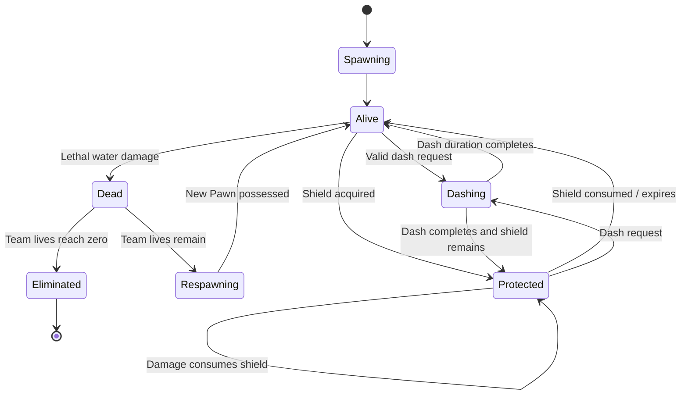

State diagrams here abstract overlapping conditions. A robust implementation should **not** necessarily encode Shielded and Dashing as mutually exclusive states; shield and dash immunity can coexist as independent flags/tags, while movement/death state is orthogonal. The diagram is a communication aid, not a direct instruction to implement a single exclusive enum.

## 20. Shooting

### Requirements

- Player aims/shoots toward a direction.
- Fire attacks can interact with enemies and visual effects.
- Power Shot adds two projectiles, yielding a three-projectile pattern.
- Shooting input may be automatic per published feedback; verify technical trigger method before claiming original implementation details.

### Reference weapon flow

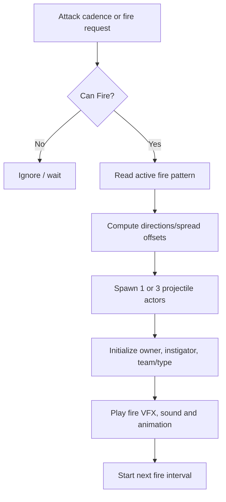

A `UCombatComponent` may own cooldown/timing and a `UWeaponDataAsset` may define projectile speed, lifespan, spread, base fire rate, VFX, projectile class and collision profile.

### Multishot formula

For a symmetric three-shot spread around facing/aim direction `θ`, compute rotations `{θ - α, θ, θ + α}`. Set `α` from data/config rather than hard-coding multiple separate firing graphs.

## 21. Dash, immunity, cooldown and enhanced dash

### Confirmed behavior

- Dash has cooldown.
- Dash grants water-damage immunity for the dash window.
- Enhanced dash enables double/triple dashes and kills enemies passed through.

### Reference state model

```text
DashAvailability: Ready / Active / Cooldown
DashCharges: int32
MaxDashCharges: int32 (modified by enhanced dash)
DashDirection: FVector
InvulnerableTag or bDamageImmune: bool
HitEnemiesThisDash: Set<WeakActorReference>
CooldownEndTime: float
```

Whether double/triple dash means *charges*, *distance*, or *consecutive dash ability* is **[UNVERIFIED]**. Design examples here assume additional charges, but public prose should say only the mechanic confirmed by the developer until exact semantics are clarified.

### Dash algorithm [REFERENCE DESIGN]

1. Validate alive, not already dashing, and charge/cooldown rules.
2. Resolve dash direction (latest movement vector, aim, or facing according to game rules).
3. Activate temporary damage immunity **before** moving into hazards.
4. Execute movement with a duration, curve, movement mode, launch, or controlled velocity appropriate for top-down play.
5. For enhanced dash, sweep or process overlap events while moving and apply lethal damage once per enemy per dash.
6. Finish dash on timer/completion/interruption; remove *dash-granted* invulnerability (without accidentally clearing shield or another immunity source).
7. Consume or regenerate dash charges according to cooldown policy.
8. Broadcast dash state for VFX, animation and HUD.

### Edge cases

- Overlap/hit callback fires multiple times while crossing one enemy.
- Player dies or match ends during a dash.
- Dash starts at same instant a water projectile reaches player.
- Immunity ends one frame before/after movement completes.
- Two different immunity sources coexist (dash and a separate effect).
- Dash enters a water-mollusk hazard volume, receives sustained overlap ticks, then exits.
- Respawning character inherits no stale dash timers or immunity from dead Pawn.

### Avoid a fragile immunity flag

A single manually toggled `bInvulnerable` may be acceptable for this small game, but stacking protection sources requires care. A reference design can use a Gameplay Tag count or explicit protection-source enum/set so ending one effect does not remove another.

## 22. Damage resolution, shield and instant death

**Confirmed rule precedence:** If dashing, water damage should not kill. Otherwise if a shield is active, the shield breaks. Otherwise the player dies instantly and one shared life is consumed.

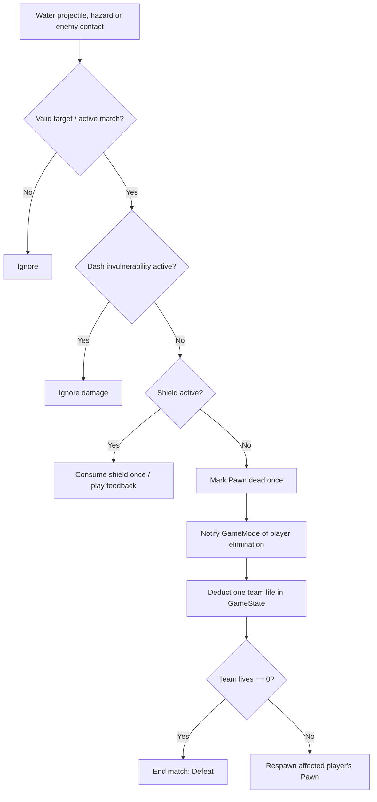

**Important:** A Crawler kills on contact; the diagram title says “water projectile, hazard or enemy contact.” Whether dash immunity also nullifies crawler contact under all circumstances should be confirmed if this distinction matters.

### Idempotency guard

```cpp
// Illustrative pseudocode; do not claim historical implementation.
void AIgKnightedPlayerCharacter::HandleLethalHit(const FIgDamageContext& Context)
{
    if (bDeathProcessed || !IsGameplayActive()) return;
    if (IsImmuneTo(Context.DamageType)) return;
    if (ConsumeShieldIfPresent()) return;

    bDeathProcessed = true; // Set BEFORE broadcasting events.
    OnPlayerEliminated.Broadcast(GetController());
    // GameMode consumes one team life exactly once and handles respawn/game over.
}
```

The method names and `FIgDamageContext` are illustrative. A production implementation must handle Pawn/controller lifetime and event binding safety; a destroyed Pawn may not retain a valid controller when callbacks occur. Cache it and pass stable context before destruction.

## 23. Shared lives and respawn lifecycle

### Absolute design invariant

**Both players consume the same five-life pool. At zero, end the game even if a second player remains alive.** This overrides any earlier draft that stored lives in each PlayerState.

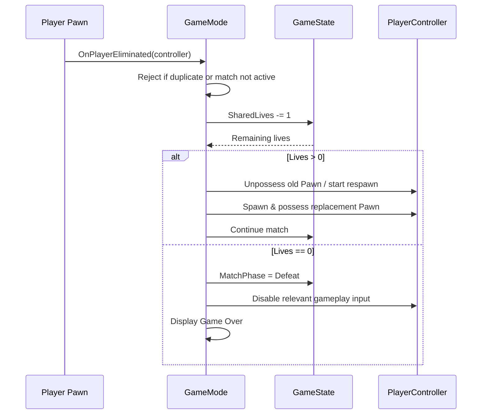

The respawn timer/animation, location and any respawn grace period are unverified. The reference design should deliberately describe them as adjustable options.

### Respawn acceptance tests

1. Solo game: one unshielded water hit subtracts one shared life and respawns, until last life causes Game Over.
2. Two-player game: Player 1 dies three times and Player 2 twice -> Game Over at zero.
3. Two-player game: Player 2 is alive when Player 1 consumes last team life -> Game Over for both.
4. Shielded player hit -> shield breaks, no life decrement.
5. Player dashing through mollusk stream -> no life decrement.
6. Repeated water overlap while already dead -> no additional life decrement.
7. Both players receive lethal hits nearly simultaneously at one remaining life -> one clean defeat, never negative lives.
8. After respawn, correct controller input and score association remain intact.

---

# Part VII — Enemy AI and combat

## 24. Reusable enemy framework

Proposed common objects:

```text
AIgKnightedEnemyCharacter
  Collision and visual mesh
  Damage/death behavior
  Team/faction identifier
  Optional ranged-attack component
  OnEnemyDefeated event

AIgKnightedEnemyAIController
  Select/reselect living player target
  Run per-archetype behavior
  Avoid invalid/respawning player targets

Data-driven per-archetype configuration
  Movement speed, range, attack frequency
  Projectile type, danger volume, VFX
```

The historical portfolio supports enemy detection/aiming/shooting and perception refactoring. It does not establish that every archetype used a custom C++ AIController, Behavior Tree, Blackboard or EQS. These are reference options.

## 25. Crawler — pursuit/contact enemy

### Functional behavior

Common enemy moves toward a player; collision with player causes lethal contact damage unless applicable protection rules prevent it.

### Decision outline

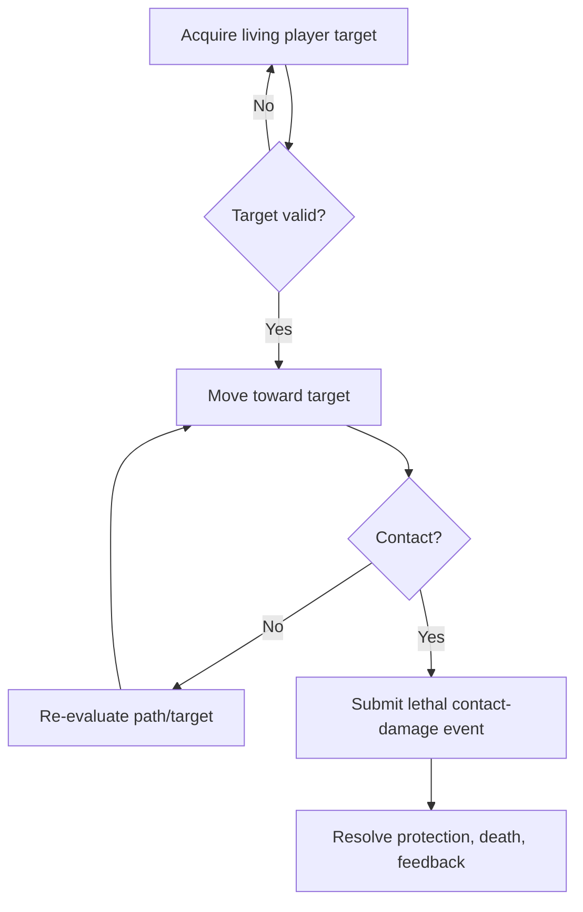

Consider direct steering versus NavMesh pathfinding depending on level obstacles. For a small top-down arena, simple pursuit is adequate where obstruction behavior is straightforward. Use Behavior Tree or a dedicated Controller only if complexity warrants it.

### Engineering discussion

- Do not trigger permanent repeated death events from `OnComponentBeginOverlap` or persistent overlaps.
- Distinguish a hit event from a valid damage transaction.
- Retarget if a player dies or respawns.
- If both players are alive, deterministic nearest-player or priority selection is a possible design, not confirmed original logic.

## 26. Scorpion — ranged kiting enemy

### Functional behavior

Fires water-ball projectiles and tries to maintain spacing from players.

### Proposed high-level state machine

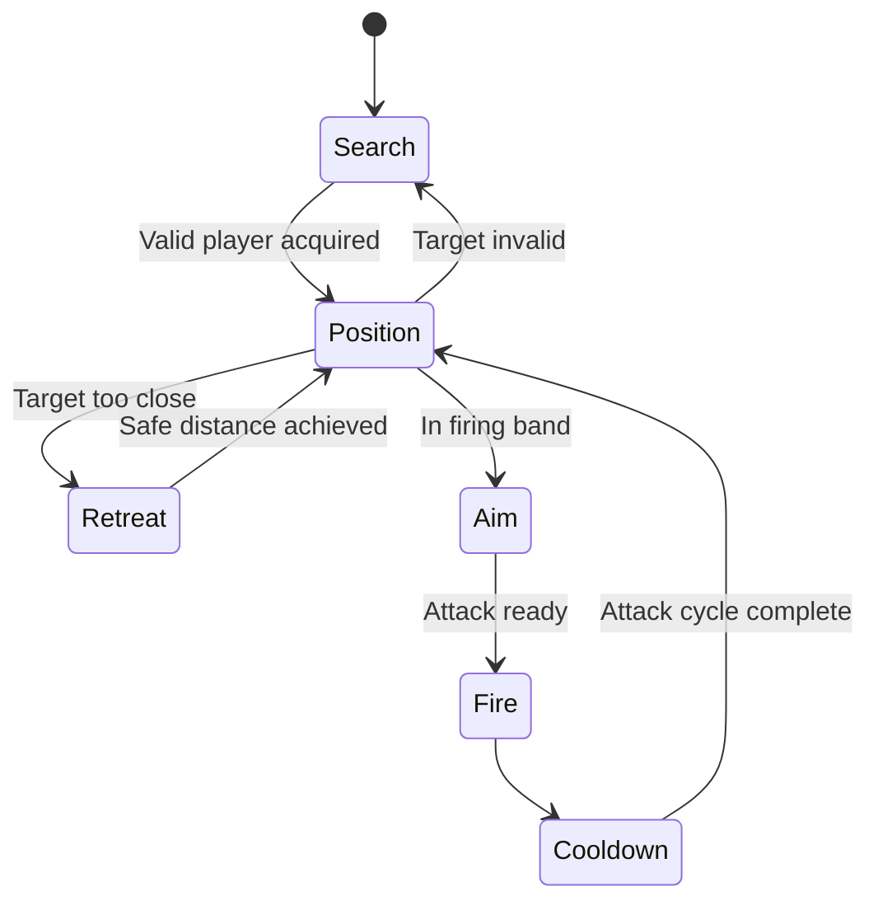

Candidate configurable values: `PreferredRange`, `MinimumRange`, `AttackInterval`, `ProjectileClass`, `ProjectileSpeed`, `LineOfSightRequired`. Whether LOS and projectile arc apply to the shipped Scorpion is unverified.

### Aiming calculation

For straightforward aiming use `(TargetLocation - ProjectileOrigin).GetSafeNormal()`. Aiming at current player location is not the same as predictive intercept; only discuss predictive aiming as an optional improvement unless established in shipped game.

For predictive interception with constant target velocity and constant projectile speed, solve `|r + v t| = s t` for positive `t`; fallback to direct aim if no valid solution. This is advanced optional analysis, not a required shipped mechanic.

## 27. Water mollusk — stationary line hazard

### Functional behavior

Stationary enemy fires a straight stream/line of water that players generally cannot cross unless they dash through it.

### Reference architecture options

1. `AHazardVolume` with timed activate/deactivate and overlap callbacks.
2. Trace/sweep driven continuous beam (requires careful tick frequency and damage idempotency).
3. Spawned row of projectiles or persistent segments depending on desired art/mechanics.

A **hazard actor or component** can communicate with the common damage resolver. The dash's invulnerability state permits traversal, while normal movement takes lethal damage.

### Technical considerations

- Telegraph/activation window versus continuously active barrier (**exact original timing unverified**).
- Keep visual beam and collision volume synchronized.
- No duplicate life deductions during long overlaps.
- Proper cleanup when mollusk dies, zone clears or match ends.
- Distinguish hazard blocking damage from physical collision so dash can cross while respecting world boundaries.

## 28. Target selection in a two-player game

Potential target validity conditions:

```text
Target != null
Target is controlled PlayerCharacter
Target is alive and eligible
Target belongs to current match/world
Target is not pending respawn
```

Possible policies: nearest valid target, weighted aggro, last attacker, round-robin or fixed priority. No policy should be stated as historical without evidence.

To reduce unnecessary work: cache player references, subscribe to death/respawn signals, reevaluate on interval/event, and only use per-frame targeting checks where responsiveness requires them. Discuss performance measurement rather than claiming a specific optimization gain.

## 29. Enemy defeated event contract

```text
EnemyCharacter resolves its death exactly once
       ↓
OnEnemyDefeated(EnemyID, EncounterID) emitted
       ↓
ZoneManager removes enemy from active registry
       ↓
Recompute active+pending enemy count
       ↓
When encounter truly complete -> OnZoneCleared
       ↓
GameMode advances match progression
```

This event contract also helps explain the published barrier-despawn issue: level gates should respond to the active zone's **confirmed encounter completion**, not an arbitrary particular enemy death event. This is a hypothetical fix proposal, not proof of the historical bug's root cause.

---

# Part VIII — Projectiles, collision and damage

## 30. Common projectile design

Potential `AIgKnightedProjectile` properties:

```text
ProjectileMovementComponent
CollisionComponent
ProjectileKind: Fire / Water / Other
DamageKind: LethalToPlayer / EnemyDamage / Other
OwningActor / Instigator
LifetimeSeconds
bHasImpacted
OnImpact feedback event
```

### Fire projectiles

Spawned from player. Apply appropriate enemy hit/kill effect and cleanup.

### Water balls

Spawned by Scorpion and possibly other enemies. If they contact a vulnerable player, trigger the one-hit lethal path; shield/dash may negate it.

### Water stream

Mollusk area denial can be modeled as a hazard actor rather than a conventional moving projectile.

### Common flow

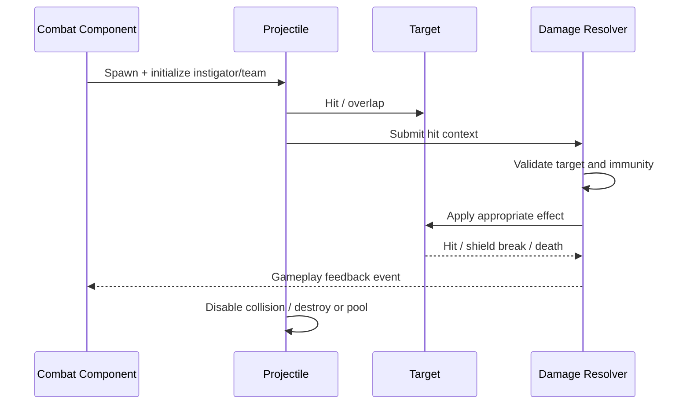

### Collision concerns

- Use collision channels/profiles to prevent friendly fire if not intended.
- Ignore projectile owner/instigator where appropriate.
- Validate target type before applying damage.
- Set an impact guard before triggering event chains.
- Protect against collision callbacks occurring during actor destruction.
- Use a reasonable lifespan for projectiles leaving the play area.
- Keep trace/overlap logic separate from animation and UI.
- Consider pools only if profiler evidence warrants complexity; pooling is not inherently superior for a small student arena game.

---

# Part IX — Pickups, scoring, buffs and GAS comparison

## 31. Pickup types

| Pickup | Confirmed behavior | Possible representation |
|---|---|---|
| Shield | Absorbs one otherwise lethal water hit | One-charge status/effect on collecting Pawn |
| Power Shot | Adds two bullets to normal shot | Fire-pattern modifier with three projectiles |
| Enhanced Dash | Multi-dash and enemy kills while crossing | Dash modifier and damage-on-traverse behavior |
| Matchstick | Increases score | Pickup event forwarded to scoring owner |

Some durations and stacking semantics are documented generally in the original portfolio; the exact duration/stacking of each *specific* pickup is not established.

## 32. Pickup flow

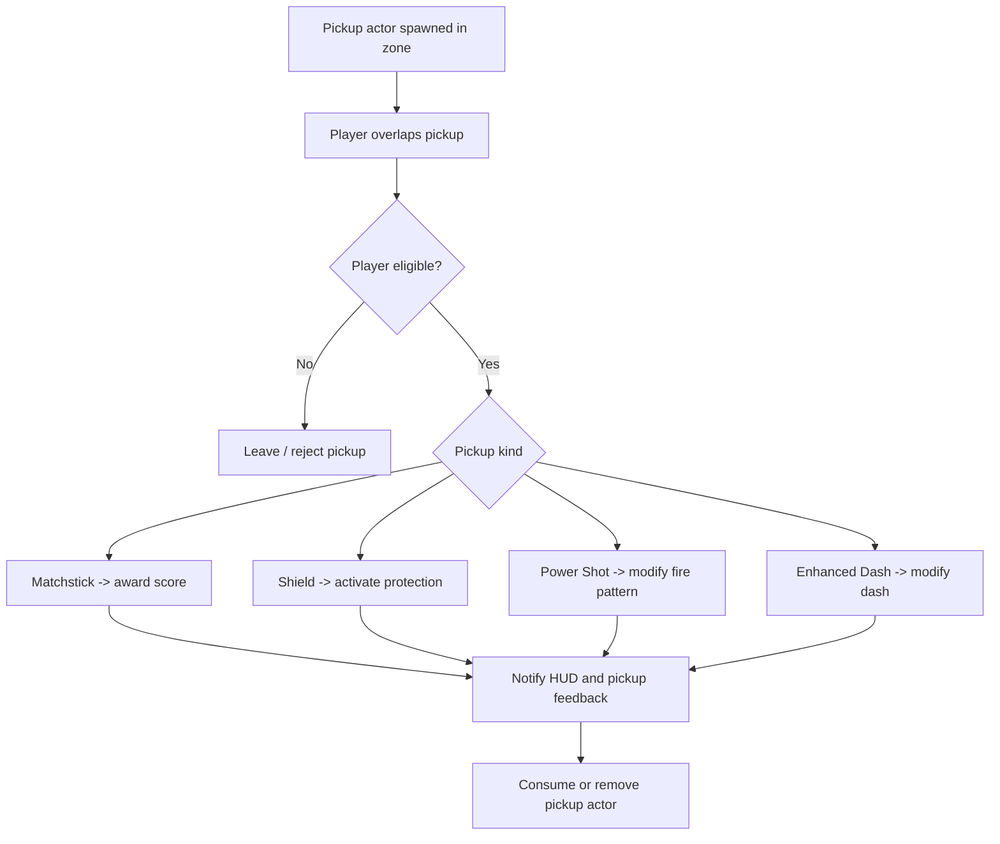

`OnComponentBeginOverlap` is a trigger, not sufficient proof that an award is eligible. Validate match phase, target type, ownership, duplicate pickup rule, and whether pickup already consumed (avoid double-awards).

## 33. Score and multiplier

The player has a score and multiplier. The exact multiplier formula, whether it is per-player or shared, and how it resets remain **[UNVERIFIED]**. Since a two-player run can plausibly display separate scores, proposed architecture places individual score in PlayerState, but final publication should confirm HUD behavior.

### Reference example

```text
OnMatchstickCollected(Player, PickupValue)
  EffectiveValue = PickupValue * Player.ScoreMultiplier
  PlayerState.Score += EffectiveValue
  PlayerHUD.UpdateScore(NewScore)
```

**Warning:** This is pseudocode and not the original score formula. Avoid claiming exact multiplier values/timing without confirmation.

### Preventing duplicated collectable tally

- Pickup uses `bConsumed` guard before broadcasting reward.
- Score awarded in one central method.
- Widget binds to authoritative PlayerState rather than incrementing its own hidden counter.
- Result screen reads score/collectables from state, not replays pickup events.
- Unsubscribe old widget observers after map/UI transitions.

These address plausible causes for the public doubled-collectables bug, not a verified root-cause report.

## 34. Two sound approaches to abilities

### Approach A — Lightweight component-based effects

Recommended if documenting what a small game **could** do without GAS complexity.

```text
PlayerCharacter
  DashComponent
  CombatComponent
  StatusEffectComponent
    ShieldCharges
    ActiveFirePattern
    DashModifier
    Timers / GameplayTags / EffectHandles
```

Pros: small API surface, easy to reason about, minimal setup, good for a few pickups.

Cons: more bespoke work for complex stacking, attributes, tags, cues and ability lifecycles.

### Approach B — Gameplay Ability System (GAS) [REFERENCE DESIGN ONLY]

```text
PlayerCharacter (or PlayerState, depending on lifecycle/net design)
  AbilitySystemComponent
  IgKnightedAttributeSet
    (optional health/other numeric attributes)
  Granted Abilities
    GA_Dash
    GA_Fire
    GA_EnhancedDash (or modify GA_Dash via effect/tag)
  Gameplay Effects
    GE_Shield
    GE_PowerShot
    GE_DashCharges
    GE_DashCooldown
  Gameplay Tags
    State.Dashing
    State.Invulnerable
    Status.Shielded
    Buff.PowerShot
  Gameplay Cues
    Cue.ShieldBreak
    Cue.DashTrail
    Cue.ProjectileImpact
```

**Do not represent a simultaneous custom HealthComponent and GAS AttributeSet as two independent sources of health.** For one-hit mechanics, use a death/damage transaction system with shield/immunity or represent health through attributes; choose one authoritative model.

### GAS flow: example shield

```text
Overlap pickup -> ASC applies GE_Shield
GE_Shield grants shield status/stack/charge according to design
Water hit -> damage resolver checks invulnerability, then shield
Shield blocks hit -> consumes/removes effect -> broadcasts Cue.ShieldBreak
HUD observes effect/tag change
```

A Gameplay Effect alone may not automatically implement a consumable one-charge shield; custom execution/application/removal logic or tag/stack handling is still needed.

### GAS flow: example dash

```text
Input dash -> ASC TryActivateAbility(GA_Dash)
GA_Dash checks cooldown/cost/state
Ability activates movement and grants State.Dashing/Invulnerable
Optional enhanced effect changes charges/traverse damage
Ability ends -> remove temporary tags/effects; cooldown continues
```

### Placement of ASC

- On `PlayerCharacter`: straightforward for local-only abilities tied to one physical life.
- On `PlayerState`: useful for persistent abilities across Pawn respawn, common in certain networked game designs; more initialization complexity.

No placement is universally correct. IgKnighted's instant-respawn behavior makes explicit ability-reset policy important.

### How to present this publicly

> **Design retrospective — GAS alternative:** The shipped game implemented its power-ups in Blueprints. As a C++/Blueprint architectural exercise, I mapped its shield, triple-shot and enhanced-dash behavior into GAS abilities, effects and tags, comparing the complexity of GAS against a smaller component-based system.

This is both honest and informative.

---

# Part X — Main level, three zones and difficulty

## 35. World structure

```text
L_MainMenu [separate world]
L_Tutorial [separate tutorial level]
L_Temple [ONE PERSISTENT MAIN MAP]
  ZoneManager
    Zone01
      Encounter configuration
      Spawn points
      Zone exit barrier
    Zone02
      Encounter configuration
      Spawn points
      Zone exit barrier
    Zone03
      Encounter configuration
      Spawn points
      Victory trigger
  Shared PlayerStarts
  Player Pawns
  World lighting/VFX/geometry
```

No mandatory map travel between main zones. This is important: the original statement “three zones” should not become “three maps” or “level streaming” without evidence.

## 36. ZoneManager responsibilities

- Current zone reference/index.
- Active enemy registry for current encounter.
- Pending/scheduled spawns count.
- Assign encounter ID to spawned enemies.
- Receive enemy defeated events once.
- Determine clear condition when **no registered active enemies AND no pending spawns** remain.
- Broadcast `OnZoneCleared(ZoneIndex)`.
- Unlock current zone barrier/transition and activate next zone when appropriate.
- Notify GameMode when Zone 3 is cleared.

### Reference zone state

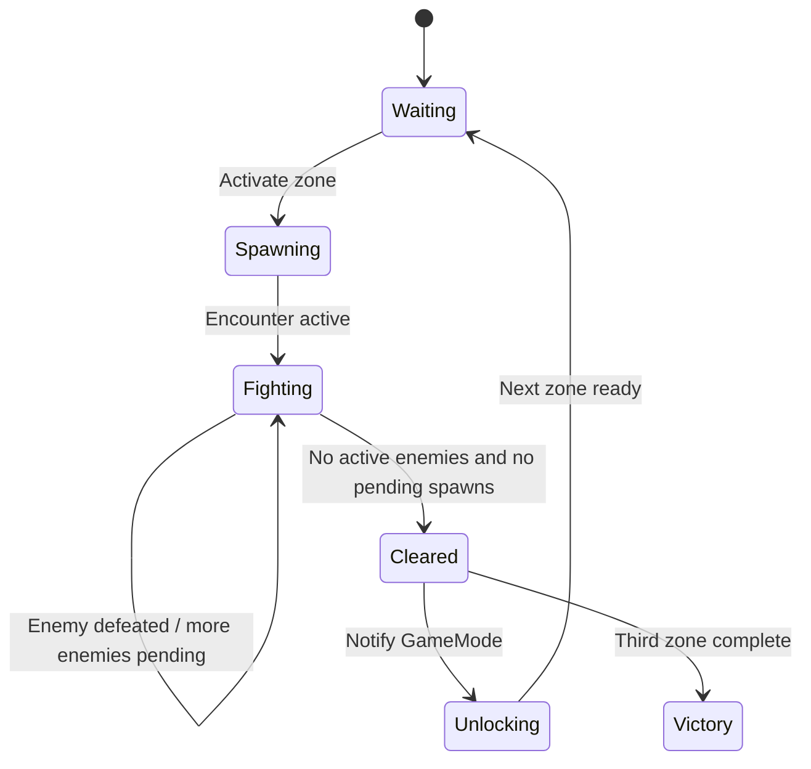

The exact number of spawned waves per zone is unverified; define per-zone encounter configurations flexibly.

## 37. Encounter spawn data [REFERENCE DESIGN]

```text
UEncounterDataAsset
  ZoneId
  EnemyEntries[]
    EnemyClass
    SpawnCount
    SpawnPointSet
    SpawnInterval
    StartDelay
  BarrierActors[] (soft/level references as appropriate)
  DifficultyOverrides
  PickupSpawnRules
  OnCompleteActions
```

Separate content data from match rules. Blueprint designers can tune compositions without editing C++.

## 38. Static difficulty selection

Selection occurs before tutorial/main game. Proposed design stores a difficulty enum in GameInstance and applies a `UDifficultyDataAsset` at game start.

| Candidate setting | Easy | Medium | Hard |
|---|---|---|---|
| Enemy count | Configured | Configured | Configured |
| Ranged fire interval | Configured | Configured | Configured |
| Scorpion preferred range | Configured | Configured | Configured |
| Mollusk hazard uptime | Configured | Configured | Configured |
| Encounter pacing | Configured | Configured | Configured |

**No numerical values inserted:** The original balancing parameters are not known. The matrix illustrates what data-driven tuning could expose.

## 39. Dynamic difficulty design [REFERENCE DESIGN]

The original game offers an optional dynamic-difficulty toggle, but its algorithm is not established. A credible reference design could use a difficulty director updated *between encounters*, not every frame:

Inputs (candidate metrics):

- Recent team life loss.
- Time spent clearing zone/encounter.
- Current score/multiplier trends.
- Frequency of damage near misses, if instrumented.

Proposed pipeline:

```text
Encounter completed
   ↓
Gather normalized performance metrics
   ↓
Compute target challenge adjustment
   ↓
Clamp to min/max allowed by selected base preset
   ↓
Smooth adjustment / avoid oscillation
   ↓
Apply to next encounter data
```

Candidate formula (illustrative, **not original**):

```text
performance = clamp(w1 * clearSpeed - w2 * livesLost, -1, 1)
targetScalar = clamp(baseScalar + k * performance, minScalar, maxScalar)
nextScalar = lerp(currentScalar, targetScalar, smoothing)
```

Do not claim dynamic difficulty implementation specifics, fair-play testing, or balancing results without historical evidence.

## 40. Barrier lifecycle and published bug analysis

Original release mentions invisible walls wrongly despawning when certain enemies die. A more robust reference design would:

1. Assign each enemy to a specific zone/encounter ID.
2. Register newly spawned enemies before possible defeat callbacks.
3. Deduct/mark defeated once.
4. Keep pending-spawn count separate from living-enemy count.
5. Trigger `OnEncounterCompleted` only when both counts are zero.
6. Open the barrier belonging to that exact active zone.
7. Ignore stale deaths from a previous zone.
8. Unsubscribe delegates when zone ends.

This is a valuable debugging thought experiment, but root cause was not established from the public page.

---

# Part XI — Animation, feedback, and UI

## 41. Player Animation Blueprint

Original documentation says animations for **idle, walk, shoot, death** were integrated via Animation Blueprints.

Reference separation:

```text
Gameplay state / events
    Movement velocity
    Aim direction
    Attack started
    Dash started/stopped
    Shield broken
    Death
        ↓
Animation Blueprint / Montages / Notifies
        ↓
Rendered pose and event-aligned visuals
```

Choose state machine for locomotion and discrete montage/event-driven animations for attack/death if appropriate. Do not claim montages or notifies were historically used without evidence.

### Recommended technical discussion

- Animation should represent authoritative gameplay state, not independently decide whether damage happened.
- Locomotion speed derived from CharacterMovement rather than duplicated arbitrary booleans where possible.
- Death visuals must not trigger duplicate life deductions.
- Player can aim independently of movement in twin-stick context.
- The animation system should not silently block mandatory combat functionality unless designed to do so.

## 42. HUD and menu widgets

Candidate screens:

```text
WBP_MainMenu
WBP_PlayerCountSelect
WBP_DifficultySelect
WBP_TutorialPrompt
WBP_PlayerHUD
WBP_PowerUpIndicator
WBP_ZoneAnnouncement
WBP_GameOver
WBP_Victory
```

Candidate HUD data:

| UI element | Source of truth |
|---|---|
| Team lives | GameState |
| Active zone | GameState/ZoneManager |
| Individual score | PlayerState |
| Score multiplier | PlayerState or GameState after validation |
| Shield indicator | PlayerCharacter status/ASC |
| Dash cooldown/charges | DashComponent or ASC |
| Power Shot indicator | Combat/status component or ASC |
| Difficulty indicator | GameInstance configured selection + current GameState scalar if needed |

### Event-driven communication

Prefer events/delegates when meaningful state changes occur over polling every frame (especially for score/lives/zone), while acknowledging animation/cooldown progress bars may legitimately update on tick/interpolation.

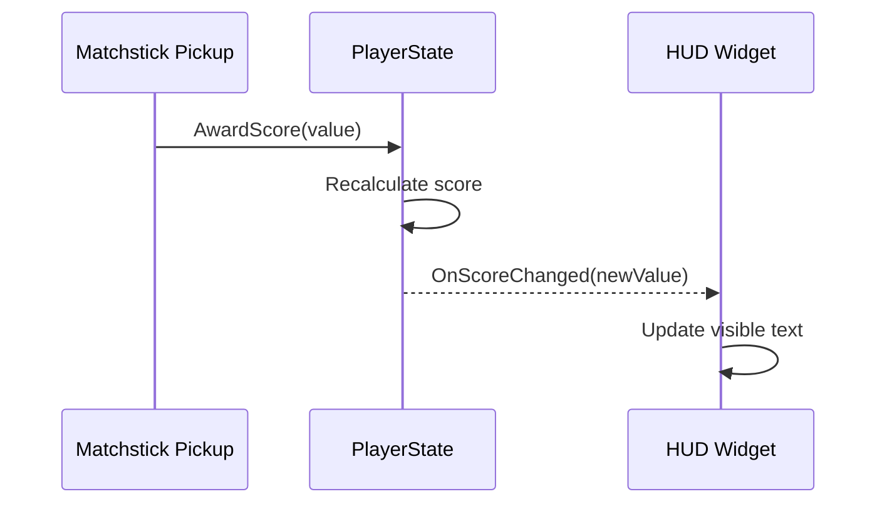

For local two-player UI, use correct references for each player; do not accidentally show Player 0 score for both players. If there is one shared screen, a central HUD may host separate player panels.

## 43. Gameplay cues and visual feedback

Effects to document with footage/screenshots:

- Shooting fire projectiles.
- Water projectile hit and player elimination.
- Shield breaking.
- Dash motion and invulnerable traversal.
- Enhanced dash hit feedback.
- Matchstick collection and score increment.
- Zone complete barrier change.
- Respawn/death animation.

If using GAS in a reference design, Gameplay Cues can decouple VFX/SFX from effect definitions. In the shipped Blueprint-only project, the current original documentation establishes animation/VFX integration but not GAS gameplay cues.

---

# Part XII — C++ / Blueprint design and representative code

## 44. Division of responsibility

| Prefer native C++ when | Prefer Blueprints/data when |
|---|---|
| Reusable gameplay logic or common validation | Assigning meshes/particles/audio and designer defaults |
| Object lifecycle and state transitions | Wiring presentation and cutscene events |
| Combat/damage core and event contracts | Creating enemy variations using exposed parameters |
| Components and interfaces shared by actors | Behavior Tree content and tuning data |
| Custom algorithms and profiling-critical code | UI layouts and animation graphs |
| Stronger compile-time API guarantees | Fast iteration on artwork and game feel |

Hybrid Unreal projects commonly use both. C++ is not inherently more correct for every gameplay graph; the important skill is selecting clean boundaries.

## 45. Useful Unreal C++ constructs to explain

- `UCLASS`, `USTRUCT`, `UENUM` for reflection and editor exposure.
- `UPROPERTY` for reflected fields and UObject reference tracking.
- `UFUNCTION(BlueprintCallable)` for functions called from Blueprints.
- `UFUNCTION(BlueprintImplementableEvent)` / `BlueprintNativeEvent` for designer-facing hooks.
- `BlueprintReadOnly`, `EditDefaultsOnly`, `EditAnywhere` for controlled data exposure.
- Dynamic multicast delegates (`DECLARE_DYNAMIC_MULTICAST_DELEGATE...`) for state-change notifications.
- `TObjectPtr` for UObject properties in UE5 code and `TWeakObjectPtr` for transient non-owning references.
- `TSubclassOf<AActor>` for class-based spawning.
- `UDataAsset` / `UPrimaryDataAsset` for structured content tuning.
- `GetWorldTimerManager()` instead of unnecessary per-frame polling for fixed-duration actions.
- `OnComponentBeginOverlap`, `OnComponentHit` and collision channels/profiles.
- Player input via `UEnhancedInputComponent` and `UEnhancedInputLocalPlayerSubsystem`.

These are educational topics. Only list them as project implementation experience when you have implemented or can show them independently.

## 46. Minimal illustrative team-life API

```cpp
// Illustrative header fragment; add game module exports/includes in a real project.
UCLASS()
class AIgKnightedGameState : public AGameStateBase
{
    GENERATED_BODY()
public:
    UPROPERTY(BlueprintReadOnly, Category="Match")
    int32 SharedLivesRemaining = 5;

    UPROPERTY(BlueprintReadOnly, Category="Match")
    int32 CurrentZone = 1;

    UFUNCTION(BlueprintCallable, Category="Match")
    int32 GetRemainingTeamLives() const { return SharedLivesRemaining; }
};

UCLASS()
class AIgKnightedGameMode : public AGameModeBase
{
    GENERATED_BODY()
public:
    void HandlePlayerEliminated(AController* Controller, AActor* EliminatedPawn);
};
```

### GameMode pseudo-implementation

```cpp
void AIgKnightedGameMode::HandlePlayerEliminated(
    AController* Controller, AActor* EliminatedPawn)
{
    // Example only. A real implementation must validate duplicates by Pawn/death ID,
    // assert ownership, and ensure state initialization and lifetime safety.
    AIgKnightedGameState* GS = GetGameState<AIgKnightedGameState>();
    if (!GS || bMatchFinished || GS->SharedLivesRemaining <= 0)
    {
        return;
    }

    // IMPORTANT: mark the Pawn's elimination as consumed before invoking this.
    GS->SharedLivesRemaining = FMath::Max(0, GS->SharedLivesRemaining - 1);
    BroadcastTeamLivesChanged(GS->SharedLivesRemaining);

    if (GS->SharedLivesRemaining == 0)
    {
        EndMatchAsDefeat();
        return;
    }

    SchedulePlayerRespawn(Controller);
}
```

`bMatchFinished`, `BroadcastTeamLivesChanged`, `EndMatchAsDefeat`, and `SchedulePlayerRespawn` are intentionally *placeholder methods/state*. This is illustrative, **not compilable as-is**. A real C++ sample should implement these methods before being called a tested project feature.

## 47. Dash component API sketch

```cpp
UCLASS(ClassGroup=(Gameplay), meta=(BlueprintSpawnableComponent))
class UIgKnightedDashComponent : public UActorComponent
{
    GENERATED_BODY()
public:
    UPROPERTY(EditDefaultsOnly, BlueprintReadOnly, Category="Dash")
    float DashDuration = 0.2f;

    UPROPERTY(EditDefaultsOnly, BlueprintReadOnly, Category="Dash")
    float DashCooldown = 1.0f;

    UPROPERTY(BlueprintReadOnly, Category="Dash")
    bool bIsDashing = false;

    UFUNCTION(BlueprintCallable, Category="Dash")
    bool TryStartDash(const FVector& WorldDirection);

    UFUNCTION(BlueprintPure, Category="Dash")
    bool IsDamageImmuneFromDash() const { return bIsDashing; }

private:
    TSet<TWeakObjectPtr<AActor>> HitEnemiesThisDash;
    FTimerHandle DashEndTimer;
    FTimerHandle DashCooldownTimer;
};
```

The sketch communicates configuration, encapsulation, validity checks and per-dash hit tracking. Implementation details such as movement curve, dash charges and cooldown policy are intentionally unspecified until gameplay rules are confirmed.

## 48. Data-driven projectile spread example

```cpp
// Illustrative core calculation (not original source).
TArray<FRotator> BuildShotRotations(const FRotator& Aim, bool bPowerShot, float SpreadDegrees)
{
    TArray<FRotator> Rotations;
    Rotations.Add(Aim);
    if (bPowerShot)
    {
        Rotations.Add(Aim + FRotator(0.f, -SpreadDegrees, 0.f));
        Rotations.Add(Aim + FRotator(0.f,  SpreadDegrees, 0.f));
    }
    return Rotations;
}
```

In a real class, verify the game's plane, local vs world rotation basis, projectile spawn transforms, and whether the shooting system works in XY or another plane. If heading is constrained, use a direction vector and rotated axis/angle instead of assuming world yaw.

## 49. Blueprint integration contract

Example health/shield/death events:

```text
C++: ValidateHit(DamageContext)
  ↓
C++: OnShieldConsumed / OnDashStateChanged / OnPlayerEliminated delegates
  ↓
BP_PlayerCharacter: Trigger visual/audio/animation feedback
  ↓
WBP_PlayerHUD: Display life/ability state via subscribed events
```

For an actual programming sample, demonstrate one fully implemented loop from C++ to Blueprint to UMG with screenshots rather than dozens of decorative code excerpts.

---

# Part XIII — Debugging, testing, profiling and maintainability

## 50. Real documented/visible problem inventory

| Issue | Evidence status | Technical investigation angle |
|---|---|---|
| Local controller indexing and possession difficult | [ORIGINAL DOCUMENTED] | LocalPlayer association, CreatePlayer, PlayerStart mapping, possession timing |
| Enemy perception logic was redundant | [ORIGINAL DOCUMENTED] | Centralize target-acquisition logic, avoid duplicated Blueprint branches |
| Collectables doubled in Game Over readout | [ORIGINAL DOCUMENTED as published bug] | Double-award, duplicate widget subscriptions, UI count aggregation |
| Controls lost after special map/art display sequence | [ORIGINAL DOCUMENTED as published bug] | Input Mapping Context lifecycle, LocalPlayer retention, Pawn possession after travel |
| Barriers despawn after particular enemy deaths | [ORIGINAL DOCUMENTED as published bug] | Zone completion event dependencies, stale registrations, enemy count accounting |
| Player damage fairness required balancing | [ORIGINAL DOCUMENTED] | Collision accuracy, visual telegraph, immunity timing, respawn handling |

**Publication precision:** Separate personally solved issues (if remembered) from unresolved public release bugs. Say “I would investigate...” for unverified fixes.

## 51. Debugging process template

For each genuine issue:

1. **Reproduction:** scene, player count, control device, difficulty, steps.
2. **Expected behavior:** clear invariant.
3. **Actual behavior:** what visibly went wrong.
4. **Instrumentation:** logs, breakpoints, Blueprint Watch, Visual Logger, collision display, Gameplay Debugger, traces.
5. **Hypotheses:** two or three plausible causes, ranked.
6. **Isolation:** minimal test level or specific flow.
7. **Fix:** change with exact evidence, only if actually performed.
8. **Regression:** repeat under one and two local players, tutorial/main map, shield/dash states.
9. **Retrospective:** improvement to architectural design.

## 52. Detailed test matrix

| ID | Scenario | Expected result |
|---|---|---|
| T01 | Start solo on Easy | One local PlayerController/Pawn, 5 team lives |
| T02 | Start two players on Hard | Two controllers/Pawns, shared lives start at 5 |
| T03 | Player 1 water hit unshielded | One team life lost, Player 1 respawns |
| T04 | Player 2 water hit unshielded | One team life lost, Player 2 respawns |
| T05 | Last team life lost by Player 1 while Player 2 alive | Defeat occurs for whole team |
| T06 | Shielded player hit by water | Shield removed; life count unchanged |
| T07 | Player dashes across mollusk line | No damage during valid immunity window |
| T08 | Player stands in mollusk hazard without shield/dash | One death and a single life decrement |
| T09 | Enhanced dash crosses same Crawler across multiple overlap frames | Enemy defeated once; no duplicate kill event |
| T10 | Player receives two hit callbacks during same death | One shared life consumed |
| T11 | Power Shot collected | Three projectiles per firing action, subject to configuration |
| T12 | Collect matchstick | Score UI matches stored score and tally |
| T13 | Two players collect near-simultaneously | Scores attributed to correct collector |
| T14 | Last enemy of Zone 1 defeated, no more pending spawns | Zone 1 barrier unlocks; Zone 2 ready |
| T15 | Enemy from previous encounter killed late | Does not unlock wrong barrier |
| T16 | Last enemy of Zone 3 defeated with team lives > 0 | Victory |
| T17 | Both last enemy and final-life loss occur same frame | Deterministic outcome per specified precedence |
| T18 | Return from tutorial to gameplay | Input context valid, correct possession |
| T19 | Enter/leave Art Display / map | Gameplay input restores when appropriate |
| T20 | Repeated retries | No stale delegates, controllers or timers |
| T21 | Dynamic difficulty on | Settings affect selected next encounter only as designed |
| T22 | Dynamic difficulty off | Static preset stable |

This is a *recommended test plan*, not a claim these tests were executed in 2024.

## 53. Performance topics

- Avoid heavy target searches on every enemy Tick unless justified.
- Prefer timers/events for discrete attack cadence and wave progression.
- Profile large projectile counts, collision callbacks, spawn/despawn churn, VFX and UMG bindings.
- Use `stat unit`, `stat game`, `stat fps`, Unreal Insights and Blueprint profiling according to the Unreal Engine version available.
- Capture before/after metrics with identical test conditions before claiming optimizations.
- Consider projectile pooling only when spawn churn is a demonstrated bottleneck.
- Beware unnecessary hard references that load unused enemy/VFX assets.

### Example profiling evidence template

```text
Test setup: [Hardware / map / players / active enemies / resolution]
Build configuration: [Development / Shipping]
Capture method: [Unreal Insights trace / stat commands]
Baseline frame time: [MEASURED ONLY]
Issue identified: [MEASURED ONLY]
Change applied: [ACTUAL CHANGE ONLY]
Post-change frame time: [MEASURED ONLY]
Conclusion: [DATA-SUPPORTED]
```

Never fabricate numbers such as “40% faster” or “stable 60 FPS.” No performance capture is present in the available historical materials.

## 54. Maintainability / team collaboration

Historical team metadata supports multidisciplinary development. Reference engineering practices to discuss:

- Descriptive naming, Blueprint functions/macros where appropriate.
- Reusable events rather than cross-graph hard references.
- Data assets for balancing by designers.
- C++ stable contracts and Blueprint-derived variations.
- Clear ownership between AI decision logic, projectile attack execution, damage resolution, UI and zone state.
- Source control, code review and issue-tracking as *professional practices*; do not claim specific tools/workflows were used in IgKnighted unless confirmed.
- Explicit interface agreements with artists/animators: required montage events, socket names, VFX triggers and gameplay tags.

---

# Part XIV — Architecture decisions and trade-offs

## 55. Architecture decision records (ADRs)

### ADR-001 — Shared team lives in GameState

- **Context:** 1–2 players use one pool of five lives.
- **Decision:** GameMode processes elimination and writes shared lives to GameState.
- **Rejected alternative:** each PlayerState owning separate five-life counters.
- **Reason:** avoid contradictory team-defeat logic and shared HUD state.
- **Trade-off:** individual death stats can still remain in PlayerState.

### ADR-002 — One custom PlayerController class, distinct instances

- **Context:** two players use same gameplay abilities.
- **Decision:** reuse one subclass with distinct LocalPlayer/controller/Pawn instances.
- **Rejected alternative:** unique PlayerOneController and PlayerTwoController classes purely for player number.
- **Reason:** avoids duplicated input and possession logic.

### ADR-003 — Persistent map, separate ZoneManager

- **Context:** three zones exist in one main gameplay world.
- **Decision:** manage encounter activation and barrier events within one persistent level.
- **Rejected alternative:** mandatory map travel between Zone 1, 2 and 3.
- **Reason:** matches game behavior and simplifies persistent player state.

### ADR-004 — Unified damage resolution

- **Context:** shield, dash invulnerability and lethal hazards interact.
- **Decision:** centralize damage eligibility and precedence rules.
- **Rejected alternative:** each enemy independently decrements lives on overlap.
- **Reason:** ensures consistent logic and prevents duplicate death transactions.

### ADR-005 — Lightweight effects first, GAS as explicit alternative

- **Context:** only a handful of power-up types are confirmed.
- **Decision:** use small components in minimal architecture; explain GAS in a separately labeled modern redesign.
- **Reason:** GAS introduces setup and lifecycle complexity that may not be necessary for the shipped game.
- **Trade-off:** GAS offers mature tag/effect/ability tooling when variety and complexity grow.

### ADR-006 — Explicit encounter completion

- **Context:** barriers should open only when zone requirements are fulfilled.
- **Decision:** ZoneManager tracks active enemies and pending spawns, raises a single completion signal.
- **Rejected alternative:** direct binding from one enemy death to barrier removal.
- **Reason:** reduces coupling, avoids incorrect unlocks and supports arbitrary enemy compositions.

### ADR-007 — C++ core with Blueprint content [REFERENCE DESIGN]

- **Context:** portfolio target includes Unreal C++ Gameplay Programmer roles.
- **Decision:** place reusable gameplay contracts and validation in C++ and expose content tuning/presentation to Blueprints.
- **Reason:** demonstrates maintainability and designer workflows.
- **Caveat:** this is proposed, not evidence of original C++ implementation.

---

# Part XV — Publication assets and layout guidance

## 56. Recommended page opening

Suggested headline:

> **IgKnighted — Unreal Engine 5 Gameplay Programming & Systems Design**

Suggested subheading:

> A local cooperative bullet-hell shooter built in Unreal Engine 5. A technical look at my original Blueprint gameplay contributions, followed by a retrospective C++/Blueprint design of the game's player, AI, combat, ability and progression systems.

Suggested metadata strip:

`Unreal Engine 5` · `Blueprints` · `Enhanced Input` · `Local Co-op (1–2)` · `Gameplay Systems` · `2024 / 8 weeks`

Only add `C++ reference design` explicitly where the new design/code is shown.

## 57. Portfolio evidence hierarchy

1. **Primary original evidence:** screenshots and footage of shipped IgKnighted mechanics.
2. **Historical documentation:** archived portfolio contribution descriptions (attributed to author), public release and team listing.
3. **Retrospective diagrams:** accurate UML/Mermaid-style explanations of modern desired structure.
4. **Independent technical demonstrators:** real C++ examples or newly tested snippets (clearly distinguished).
5. **Design trade-offs:** why a professional might choose a component, State, GAS or event architecture.

For each system, show **Requirement → Original evidence → Retrospective architecture → Method/API → Edge cases/trade-offs → Learning**.

## 58. Suggested asset placement

| Chapter | Original asset / other |
|---|---|
| Hero | `main.jpg` and published gameplay trailer/embedded video |
| Enhanced Input | `4.png` |
| Player creation / possession | `1.png` |
| Combat / enemy aiming | `5.png` |
| Damage/death | `2.png` |
| Collectables and score | `3.png` |
| Shield/power-ups | `6.png` |
| Animation | `7.png` |
| Architecture | New diagrams generated from this file, labeled reconstructed |
| GAS/C++ section | New code snippets, labeled reference designs |

Do not present new reference diagrams as screenshots of the original Unreal editor graph. Label them clearly.

## 59. Reviewer-focused technical case study template

Copy/paste this structure for each feature:

```markdown
### [System Name]

**Gameplay requirement:** What the player sees and needs.

**My original contribution:** What the archived contribution record confirms.

**Original evidence:** [Screenshot/GIF/Release link]

**Retrospective architecture:** Which Unreal classes/components would own the behavior.

**Execution flow:** Sequence diagram, event contract, responsibilities.

**Implementation approach:** C++ API / Blueprint hookup / DataAsset structure.

**Critical edge cases:** State, input, collision, lifecycle, multiplayer.

**Engineering trade-offs:** Why this architecture, what simpler alternative exists.

**Lessons learned:** Clear separation of historical experience and proposed modernization.
```

## 60. Page size and emphasis recommendations

Approximate allocation of technical depth (writing attention, **not** verified time spent on original implementation):

- Local multiplayer + Enhanced Input: **20%**
- Player mechanics, death/respawn, shield/dash: **25%**
- Enemy AI + projectile combat: **20%**
- Pickups, score, GAS redesign: **15%**
- Gameplay Framework + match/zone progression: **15%**
- Debugging, retrospective, result: **5%**

GAS is attractive to recruiters but should not displace better-evidenced original work, especially since the original source was Blueprint-based and is unavailable.

---

# Part XVI — CV-ready language and limits

## 61. Historically grounded CV bullets

The following bullets are concise and broadly consistent with the archived portfolio; before publication ensure each is an accurate account of your individual work:

- **Implemented Unreal Engine 5 Blueprint gameplay systems** for enemy projectile attacks, player damage/death feedback, collectables, power-ups and animation integration.
- **Built local multiplayer setup using Enhanced Input and custom GameMode Blueprint logic**, handling player creation/spawning, Pawn possession and controller-index challenges.
- **Developed enemy targeting and projectile aiming logic**, refactoring perception-related Blueprint functionality to improve clarity and reduce duplication.
- **Integrated timed power-up and collectable systems** with score tracking, stacking/duplicate restrictions and dynamic HUD updates.
- **Integrated Animation Blueprints** for movement, shooting and death states with gameplay events and feedback.

Avoid turning team-level features such as dynamic difficulty, every enemy archetype, zones or entire GameInstance architecture into personal historical achievements unless personally implemented.

## 62. If independently authored C++ samples are actually completed

Only then add a separate bullet such as:

> Created a **retrospective Unreal C++/Blueprint reference implementation** of IgKnighted's [specific mechanic], exposing designer-configurable parameters and gameplay events through [actual classes/APIs used].

For example, a tested `UDashComponent` plus Blueprint subclass demonstrates C++ architecture more credibly than a page full of uncompiled pseudocode.

## 63. Technical claims to avoid without evidence

- “Implemented IgKnighted entirely in C++.”
- “Built GAS for IgKnighted's shipped power-ups.”
- “Implemented multiplayer replication/RPCs” (the game is local multiplayer).
- “Designed sophisticated Behavior Trees/EQS” without demonstration.
- “Increased frame rate by X%” without profiling captures.
- “Built a custom C++ GameInstance/GameState/PlayerController hierarchy in 2024” without source or contemporaneous proof.
- “Fixed the listed release bugs” without evidence.
- “Developed every gameplay feature myself” when the team shared responsibilities.

## 64. Safe and technically impressive alternatives

- “Retrospectively mapped the released game's mechanics to Unreal's Gameplay Framework.”
- “Designed a C++/Blueprint reference architecture separating match, player, AI and world-state responsibilities.”
- “Explained local player setup, Pawn possession and shared team-state design using detailed sequence diagrams.”
- “Analyzed shield, dash immunity, one-hit elimination and team respawning as a unified damage-state workflow.”
- “Compared a lightweight status-component design with a GAS-based approach for scalable effects and abilities.”
- “Documented possible root causes and regression tests for publicly recorded UI, input and barrier bugs.”

---

# Part XVII — Implementation and publishing checklist

## 65. Accuracy checklist

- [ ] Distinguish original shipped Blueprint work from reference C++ design.
- [ ] Link to released itch.io build.
- [ ] Verify or qualify player camera type.
- [ ] Confirm exact shooting trigger and input binding if describing it in code.
- [ ] Keep shared five lives in GameState, **not** per-player PlayerState.
- [ ] Preserve instant-death water damage and shield/dash ordering.
- [ ] Show one persistent map with three combat zones.
- [ ] Make Game Over global when shared lives are zero.
- [ ] Avoid implying three separate main game maps.
- [ ] Distinguish original enemy logic from optional Behavior Tree redesign.
- [ ] Distinguish original power-ups from optional GAS redesign.
- [ ] Do not fabricate profiler statistics or debugging fix outcomes.
- [ ] Credit multidisciplinary team and describe individual contributions.

## 66. Production checklist

### Architecture package

- [ ] Full class responsibility/ownership diagram.
- [ ] Game lifecycle and menu-to-match flow.
- [ ] Solo/two-player LocalPlayer–Controller–Pawn diagram.
- [ ] Team lives and death/respawn flow.
- [ ] Dash invulnerability and shield damage decision tree.
- [ ] Crawler, Scorpion and Mollusk behavior diagrams.
- [ ] Projectile spawn/impact/damage sequence.
- [ ] Pickup and power-up workflow.
- [ ] Three-zone encounter completion sequence.
- [ ] GAS versus lightweight-component comparison.
- [ ] HUD and Animation Blueprint event map.
- [ ] Difficulty and optional adaptation model.

### Evidence package

- [ ] Original main gameplay screenshot and/or embedded gameplay video.
- [ ] Original seven feature screenshots with meaningful captions.
- [ ] Original contribution metadata and release links.
- [ ] A clear source-availability and reconstruction notice.
- [ ] At least one authentic debugging challenge from archived portfolio.
- [ ] Known release bugs described as known, not falsely fixed.
- [ ] Optional genuine C++ sample that compiles and can be explained.

### CV and interview package

- [ ] Three to five concise CV bullets on documented implemented work.
- [ ] Able to explain why GameInstance vs GameMode vs GameState.
- [ ] Able to explain why shared lives should not belong to PlayerState.
- [ ] Able to explain local Controller/Pawn possession and input mapping contexts.
- [ ] Able to explain dash immunity ordering and repeated-overlap safeguards.
- [ ] Able to explain why ZoneManager waits for pending spawns as well as live enemies.
- [ ] Able to explain why a small game may not need GAS.
- [ ] Able to walk through one C++/Blueprint integration example truthfully.

---

# Part XVIII — Interview preparation questions

## 67. Gameplay Framework

1. Why isn't GameInstance the right location for active enemy state?
2. How does GameMode differ from GameState? Why keep shared lives in one and decisions in the other?
3. What survives a Pawn death? What survives an ordinary level transition?
4. Would you choose `AGameModeBase` or `AGameMode` here, and why?
5. What would change if IgKnighted later supported online multiplayer?

## 68. Local multiplayer and input

1. How does Unreal represent two local players in one executable?
2. Why not create a separate C++ PlayerController class for each player?
3. How do Input Mapping Contexts associate with specific LocalPlayers?
4. What can break input after switching maps or visiting an art-display level?
5. How do you ensure a respawned Pawn belongs to the correct controller?

## 69. Combat and state

1. How do you ensure a sustained water hazard deducts one life, not one life per overlap tick?
2. Why check dash invulnerability before consuming shield?
3. How would you handle an interrupted dash without leaving immunity active?
4. How do you separate combat state from VFX, animation and UMG?
5. How would you implement triple-shot without duplicating the attack logic three times?

## 70. AI and progression

1. Does a simple Crawler need a Behavior Tree? When would you add one?
2. How do Scorpions choose whether to approach or retreat?
3. How would the mollusk hazard permit dash crossing but still cause normal damage?
4. How should ZoneManager handle enemies spawned late or defeated simultaneously?
5. How could killing one enemy accidentally open the wrong barrier?

## 71. Advanced design

1. GAS versus custom effect component: which would you choose for four power-ups?
2. Where should an AbilitySystemComponent live if the Pawn respawns?
3. What is a Gameplay Tag's advantage over several loosely related booleans?
4. How would you expose base C++ mechanics safely to Blueprint designers?
5. What profiler evidence would justify adding projectile pooling?

---

# Part XIX — Source ledger

## 72. Source A: archived original portfolio Markdown

Archive: user-provided `/mnt/data/TEXTS.zip`  
Entry: `_projects/year-1-block-d.markdown`

Established: project metadata, team composition, duration, explicitly claimed original seven contributions, screenshot file paths, Blueprint focus, original stated technical challenges. This archived document is provided by the project owner and is not independently recovered Unreal source.

## 73. Source B: current published portfolio

https://jon-gear.github.io/projects/year-1-block-d/

Established: same project description and seven contributions, including Enhanced Input, GameMode Blueprint local multiplayer logic, enemy attacks, player damage, collectables, power-ups, Animation Blueprints.

## 74. Source C: BUAS public itch.io release

https://buas.itch.io/igknighted

Established: released Windows Unreal game, local 1–2 players, keyboard/gamepad/joystick, stylized shooter premise, team listing, playable build and known bugs. Player comments mention auto-shooting and three-bullet power-up. This page **does not** reveal underlying code/class implementation.

## 75. Source D: user gameplay clarification (October 2026)

Developer firsthand recollection of menu sequence, difficulty/toggle, tutorial, movement/shoot/dash, four pickup categories, three enemy types, shared five lives, instant death, shield protection, dash invulnerability, one persistent map with three zones, respawn and victory condition.

## 76. Source E: Unreal documentation entry points

- https://dev.epicgames.com/community/learning/tutorials/lMr9/unreal-engine-begin-play-programming
- https://dev.epicgames.com/community/learning/tutorials/l21z/unreal-engine-begin-play-gameplay
- https://dev.epicgames.com/documentation/en-us/unreal-engine/gameplay-framework-in-unreal-engine
- https://dev.epicgames.com/documentation/en-us/unreal-engine/enhanced-input-in-unreal-engine
- https://dev.epicgames.com/documentation/en-us/unreal-engine/gameplay-ability-system-for-unreal-engine

Documentation can explain engine concepts. It does not validate which implementation IgKnighted historically used. For actual C++ implementation, double-check signatures and APIs against the chosen UE5 version.

---

# Part XX — One-page architectural executive summary

**IgKnighted is a local 1–2-player Unreal Engine 5 arena shooter in which fire-based player characters battle water enemies through three zones in one main map.** The team begins with five shared lives. Water damage or lethal contact kills an unprotected player instantly; a shield absorbs a hit, and dashing grants temporary immunity. Death consumes a shared life and normally respawns the affected player. Losing the fifth shared life causes team defeat even if a second player remains standing. Completing all three zones results in victory.

**Proposed Unreal Gameplay Framework design:**

- **GameInstance:** carries player count, selected static difficulty, dynamic-difficulty toggle and tutorial preference between menu and gameplay level.
- **GameMode:** initializes a run, coordinates local-player spawning and possession, processes one life deduction per death, schedules respawns, advances zones and evaluates victory/defeat.
- **GameState:** holds the shared five-life pool, active zone, match phase, enemy/encounter progress and relevant visible match-wide state.
- **PlayerControllers / LocalPlayers:** separate input owners for player 1 and player 2, usually instances of the same custom class, with Enhanced Input contexts and correct Pawn possession.
- **PlayerStates:** per-player score, multiplier and identity; *not* independent team lives.
- **PlayerCharacters and components:** movement, aim/shoot, combat effects, dash, shield, death feedback and animation. One shared damage pipeline resolves dash immunity before shield consumption before player death.
- **AIControllers and EnemyCharacters:** Crawler pursuit/contact attacks, Scorpion keep-distance projectile attacks and stationary Mollusk area-denial water streams.
- **Projectiles / hazards:** team-filtered collision, idempotent hit handling, damage requests and lifecycle cleanup.
- **Pickups / abilities:** matchsticks, shield, three-shot Power Shot and enhanced multi-dash as modular effects; optionally modeled in GAS as a *modern redesign*.
- **ZoneManager:** runs three persistent-world encounter zones, tracks living and pending enemies, and emits authoritative completion events so barriers unlock only at the correct time.
- **Difficulty Director (optional reference):** uses chosen Easy/Medium/Hard preset and, if enabled, bounded adjustments between encounters based on measurable play metrics.
- **UI and animation:** event-driven UMG panels and Animation Blueprints reflecting authoritative game state, with distinct sources for team lives, player scores and temporary effects.

**Original work versus reference:** The original contribution record supports Enhanced Input, local multiplayer, enemy projectile aiming, player damage, pickup/score UI, power-ups and Animation Blueprints. The extensive C++ class architecture, GAS systems, Behavior Trees, performance/testing plans and formal diagrams in this document are proposed retrospective design material unless independently implemented and verified.

**Portfolio strategy:** Present the shipped game and original contributions first. Use deep technical case studies on local multiplayer, dash/invulnerability and shared lives, three enemy behaviors, zone progression, and power-ups to show programming judgment. Offer the C++/Blueprint design as an explicitly reconstructed solution that can be explained confidently in an interview. Do not let the desire for a “perfect” architecture obscure the most persuasive part: a real released game paired with technically defensible analysis.

---

*End of master reference. Future edits should preserve the provenance distinction and update gameplay facts only when newly confirmed.*
