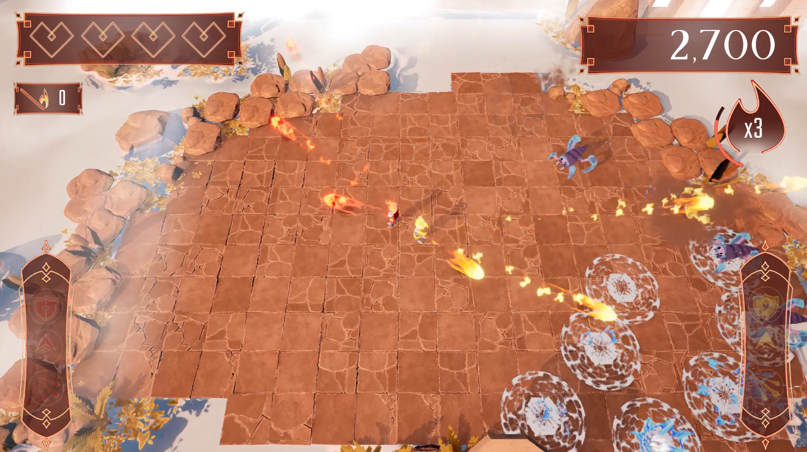
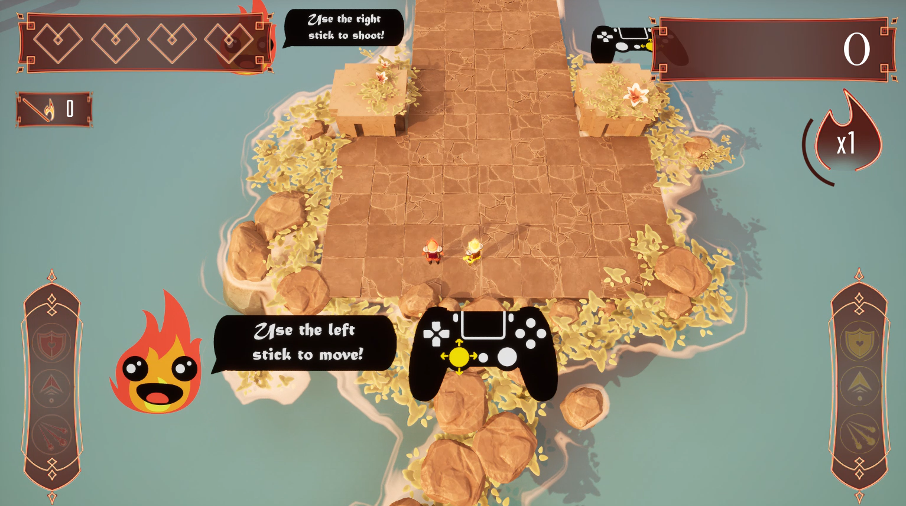
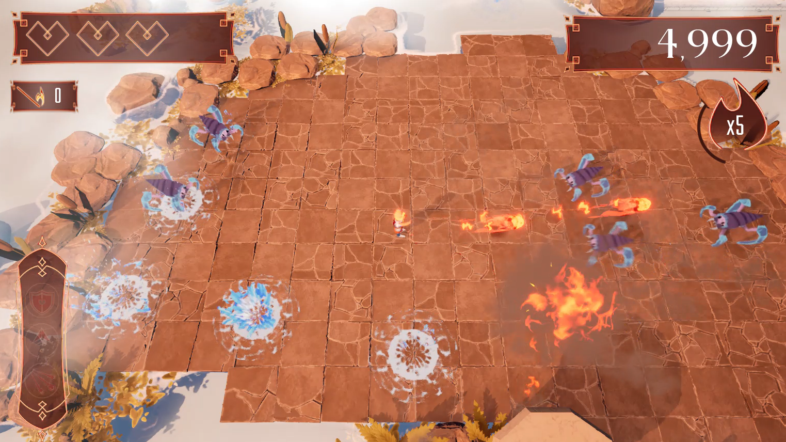
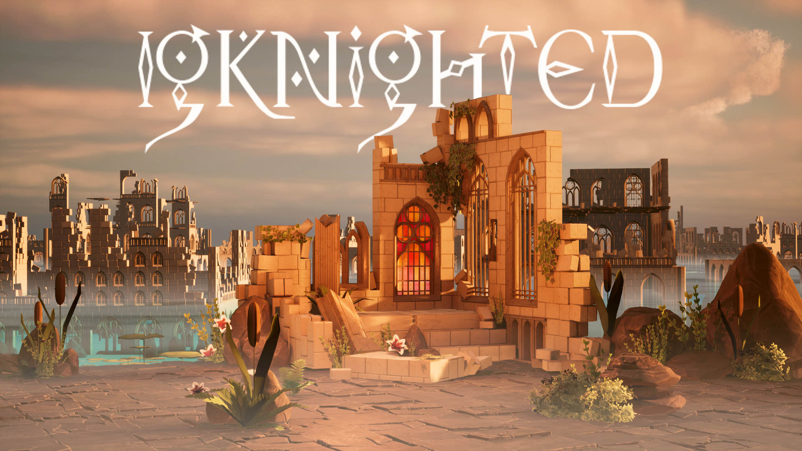
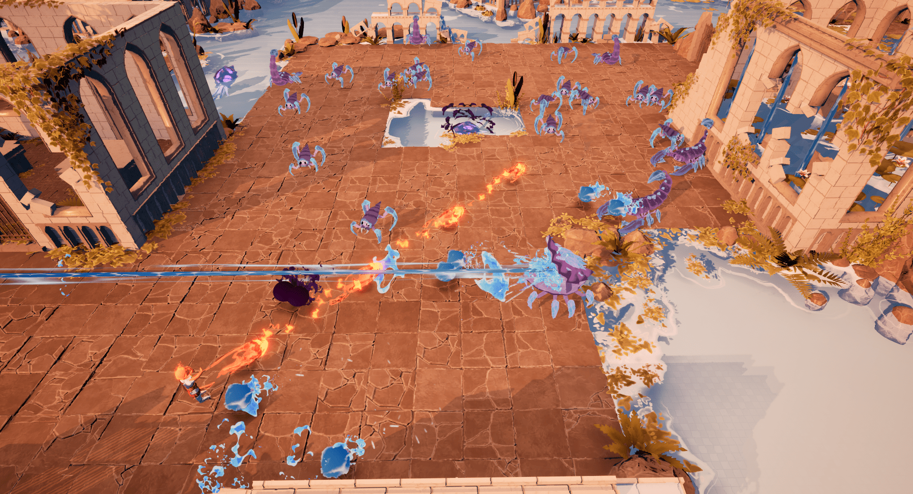
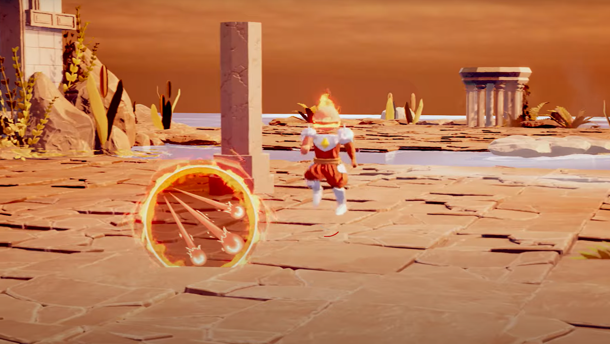
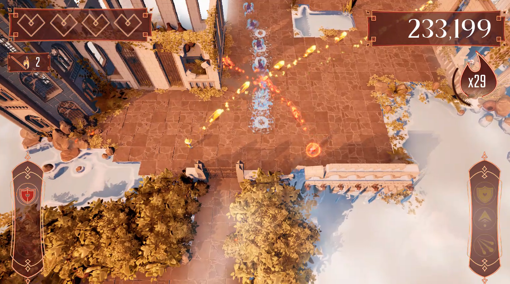
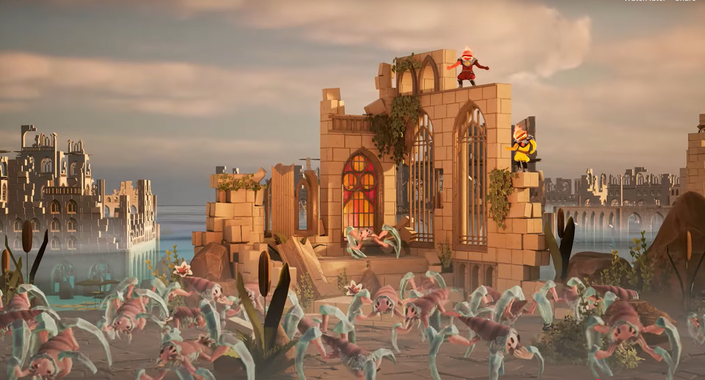

# 💼 IgKnighted — A Stylized Local Multiplayer Arena Shooter

[▶️ Play IgKnighted on itch.io](https://buas.itch.io/igknighted)

*This is an archived version. The current write-up is at [IgKnighted — feature-by-feature case study](/projects/year-1-block-d/).*

IgKnighted is a fast-paced, couch co-op arena shooter built in Unreal Engine 5 by a team of twelve over eight weeks. Two players descend through a three-zone temple, fight three enemy archetypes, collect power-ups, and share a single pool of five lives. It shipped as a complete, playable build: front-end flow, tutorial, difficulty selection, win and lose conditions.

I was one of **four programmers**. I owned the systems that everything else depended on — the ones that, if they broke, the game stopped being playable. This page is a detailed account of how I built them, what broke, what it cost, and what I would do differently.

| | |
|---|---|
| **Role** | Gameplay Programmer |
| **Team** | 4 programmers, 3 designers, 5 artists |
| **Duration** | 8 weeks |
| **Engine** | Unreal Engine 5, C++ and Blueprints |
| **Platform** | Windows (local 1–2 players, keyboard and gamepad) |
| **Status** | Shipped on itch.io |

## What I owned at a glance

| # | System I owned | Why it mattered |
|---|---|---|
| 1 | **Gameplay framework and state ownership** | Decided which object owns the run configuration, the match rules, the score and the shared lives — so none of them reset when a level or a Pawn died. |
| 2 | **Enhanced Input stack** | The foundation every player action sits on. Replaced deprecated input, added keyboard and gamepad parity, and made per-player mapping contexts possible. |
| 3 | **Local multiplayer** | Turned a single-player template into couch co-op: LocalPlayer creation, Pawn spawning, possession, and per-player identity. |
| 4 | **Shared-life damage resolution** | The instant-death, shield and dash precedence rules, and the one-life-per-death guarantee. |
| 5 | **Dash and invulnerability** | Charge-based dash, cooldown, i-frames, and the enhanced-dash traversal kill. |
| 6 | **Enemy AI** | Perception, target selection, aiming and projectile attacks; a refactor that removed duplicated perception logic from three Blueprints. |
| 7 | **Power-ups and abilities** | Shield, Power Shot (triple shot), Enhanced Dash, and the duplicate-pickup restriction rules. |
| 8 | **Collectables, scoring and zone progression** | Encounter completion, barriers, score and multiplier, and the "barrier opens early" bug that shipped in our release notes. |
| 9 | **Animation integration and feedback** | Animation Blueprint contracts, animation-notify timing, and the event-driven HUD that makes the rules legible to the player. |

**What "owned" meant in practice.** I did not just write these systems — I defined their *contract*. When a designer wanted a new enemy, they did not need to understand the targeting code; they filled in a data asset and pressed play. When an artist needed a hook for a VFX, there was one delegate and one `BlueprintImplementableEvent`, not a graph to reverse-engineer. That is the difference between "I made a feature" and "I made a feature the rest of the team could build on", and it is the part of the job I care most about.

**Where I did not contribute.** The level art, character art, shaders, post-processing, audio pass and narrative pitch belonged to the artists and designers. I integrated with them — sockets, animation slots, Niagara parameters, event dispatchers — but I did not author them, and I am not going to claim them here.

<a class="cta-link" href="https://github.com/Jon-Gear/Jon-Gear.github.io/tree/main/_code_samples/igknighted" target="_blank" rel="noopener">⚙️ See Code Examples</a>

---

# 👤 Zhangir Before the Project

Before IgKnighted, my Unreal experience was mostly **single-player prototypes**: a character that moves, a weapon that fires, a pick-up that disappears. Those projects taught me the API, but they let me get away with a lot. Every piece of state could live in the one Blueprint that used it, because nothing else existed and nothing had to survive a level change.

I came into this project with three assumptions that turned out to be wrong:

1. **"Gameplay programming is making things happen."** I thought the job was writing the code that moves the character and spawns the projectile. The harder and more valuable part turned out to be deciding *where state lives* and *who is allowed to change it*.
2. **"Blueprints are for designers; C++ is for real code."** That distinction is not useful. The real distinction is between **rules** that must not be broken and **content** that must be cheap to iterate. Either language can host either — the job is to put each concern where it is cheapest to change and hardest to break.
3. **"A bug is a wrong line of code."** Most of the bugs in this project were not wrong lines. They were missing objects, duplicated rules, and events bound to the wrong thing. Reading the code harder would not have found them; printing the *state* of the whole chain did.

I had used Unreal's Gameplay Framework only superficially. I knew `GameMode` existed; I could not have told you why `GameState` was separate, or what survives a `ServerTravel`, or where a `PlayerState` goes when a Pawn dies. I had never built local multiplayer, never used Enhanced Input, never written a Behaviour Tree, and never owned a system that three other people were building on.

**What I wanted from the project** was not just a shipped game. It was to stop being someone who can make a prototype and become someone who can build a system another person can safely change. That is the standard I held myself to, and most of the work below is about meeting it.

**The constraints were real.** Eight weeks. Four programmers, each owning a vertical slice of the game. Three designers who needed to tune enemies without waiting for a compile. Five artists who needed hooks for animation and VFX. A public itch.io release, which meant players would find the bugs we did not.

---

# 🔨 My Contributions

The nine systems below are presented in dependency order rather than chronological order: state ownership first, because every other decision depends on it; then input, which is how a player enters the game; then multiplayer identity; then the damage, dash and AI rules that make up the moment-to-moment; then abilities and progression; and finally the presentation layer that teaches the player what the rules are.

A note on the code: every excerpt on this page comes from the sample sources in [`_code_samples/igknighted`](https://github.com/Jon-Gear/Jon-Gear.github.io/tree/main/_code_samples/igknighted). The samples are reconstructed from the shipped implementation, with the parts that do not fit on a page elided. They are not pseudo-code, but they are also not the entire project.

---


///
Zhangir Before The Project:
= I was not good with Unreal Engine, I didn't know a lot of things, I knew how to generally work with a game engine (Unity experience), but I haven't made a large game before. [basically someone who hasn't worked with the engine before]

My Contributions:
- A very short overview of what the game's design is
- Gameplay Framework & Core Architecture:
    - Overview
    - Game Instance [CHALLENGE] 
    - Game Mode [CHALLENGE]
    - Game State [CHALLENGE]
    - Player State [CHALLENGE]
    - Player Controller [CHALLENGE]
    - AI Controller [CHALLENGE]
    - Impact of Contribution
- Player
    - Overview
    - Input [CHALLENGE]
    - Player Controller [CHALLENGE]
    - Player Pawn [CHALLENGE]
    - Player State [CHALLENGE]
    - Abilities: [CHALLENGE]
        - Move
        - Shoot
        - Dash
        - Die
    - Impact of Contribution
- Powerups
    - Overview
    - Collectables [CHALLENGE]
    - Types:
        - Shield [CHALLENGE]
        - Power Shot [CHALLENGE]
        - Enhanced Dash [CHALLENGE]
    - Impact of Contribution
- Enemies
    - Overview
    - Crawler behavior [CHALLENGE]
    - Scorpion behavior [CHALLENGE]
    - Mollusk behavior [CHALLENGE]
    - AI Controller [CHALLENGE]
    - Impact of Contribution
- Level
    - Overview
    - The main level (3 Parts) [CHALLENGE]
    - Enemy Spawning [CHALLENGE]
    - Dynamic Difficulty [CHALLENGE]
    - Impact of Contribution
- What I Learned
- Future Improvements

Zhangir After the Project: Mastered the Unreal Engine, knows how to work with it, how to create gameplay, [basically all the nice stuff to know about the gameplay programmer and someone who knows how to work with Unreal Engine]


///


## 📋 01. Gameplay Framework: Putting State Where It Survives



- **System / Feature:** the lifetime model for the entire game: what owns the run configuration, the match, the score, the shared lives and the player's body.
- **Technical decision:** Unreal's Gameplay Framework objects are not interchangeable containers. Each one exists for a different length of time, and that lifetime is a gameplay rule.
- **Impact:** no state reset after a level travel, a Pawn death or a respawn — and a single, testable place where a life can be spent.

### 🎯 What was the Goal?

The game has three maps in its flow: the main menu, the tutorial, and one persistent arena map with three zones. The player chooses **player count and difficulty before any of them load**. Two local players share **one pool of five lives**. A dead player respawns while the other keeps playing.

Success looked like four properties:

1. The chosen difficulty survives every level change, including the optional tutorial.
2. The score survives a Pawn death, because the Pawn does not.
3. Exactly one object can spend a shared life, so two damage sources cannot spend two lives for one death.
4. When the match ends, nothing can restart it — no respawn timer, no late zone clear, no widget.

Those are not implementation details. They are the rules of the game, and the architecture has to make them true by construction.

### Challenge 1: State was living in objects that die

#### ❓ What was the Problem?

My first implementation put the difficulty selection in the widget that collected it. That works perfectly until the widget closes. The second version put it in the `GameMode`, which works perfectly until the level changes — and the tutorial is a different level.

The score had the mirror-image problem. It lived on the `Character`, because that is the object the HUD was looking at. When the player died, the Pawn was destroyed and respawned, and the score reset to zero. The HUD was correct; the state was in the wrong place.

#### 🧩 Why Was it Hard? What Struggles Did I Face?

Both bugs are invisible in the first ten minutes of play. You choose a difficulty, the game starts, the difficulty is right. You shoot an enemy, the score goes up. Everything works — until a transition that you have not tested yet.

The difficulty bug only appears when the flow is **menu → tutorial → main map**. The score bug only appears **after the first death**, which in playtesting usually means after the player has already decided whether the game is fun. That is the worst time to discover that your state model is wrong.

There is also a naming trap. Unreal gives you six objects that all sound like "the game": `UGameInstance`, `AGameMode`, `AGameState`, `APlayerController`, `APlayerState` and `APawn`. Without a model of their lifetimes, the nearest one always looks like the right one.

#### 💡 Solution. How Did I Approach the Problem?

I drew the lifetime map before writing the systems, and then I enforced it in every class.

```text
Application lifetime
└── UGameInstance                     survives every level and every match
    └── World / level
        ├── AGameMode                 the RULES      (dies with the level)
        ├── AGameState                the NUMBERS    (dies with the level)
        └── APlayerController         the INTENT     (survives Pawn death)
            ├── APlayerState          the IDENTITY   (survives Pawn death)
            └── APawn                 the BODY       (dies and is replaced)
```

The rule I wrote on the whiteboard was:

> `GameInstance` is the **session**. `GameMode` is the **rules**. `GameState` is the **numbers**. `PlayerController` is the **intent**. `PlayerState` is the **identity**. `Pawn` is the **body**. Nothing that must survive a death lives on the body.

The run configuration went into the `GameInstance`:

```cpp
// IgKnightedGameInstance.h
UCLASS()
class IGKNIGHTED_API UIgKnightedGameInstance : public UGameInstance
{
    GENERATED_BODY()

public:
    UFUNCTION(BlueprintCallable, Category = "Run")
    void SetPendingRunSettings(const FIgRunSettings& NewSettings);

    UFUNCTION(BlueprintPure, Category = "Run")
    FIgRunSettings GetPendingRunSettings() const { return PendingRunSettings; }

protected:
    UPROPERTY(VisibleAnywhere, BlueprintReadOnly, Category = "Run")
    FIgRunSettings PendingRunSettings;
};
```

The setter validates at the boundary, so every downstream consumer can assume the value is legal:

```cpp
// IgKnightedGameInstance.cpp
void UIgKnightedGameInstance::SetPendingRunSettings(const FIgRunSettings& NewSettings)
{
    PendingRunSettings = NewSettings;

    // Validation belongs at the boundary. Every consumer downstream can then
    // assume PlayerCount is 1 or 2 and the difficulty is a real value.
    PendingRunSettings.PlayerCount = FMath::Clamp(PendingRunSettings.PlayerCount, 1, 2);
}
```

The `GameMode` reads it **once**, in `BeginPlay`, and never asks the UI anything again:

```cpp
// IgKnightedGameMode.cpp
RunSettings = FIgRunSettings();
if (const UIgKnightedGameInstance* GameInstance = GetGameInstance<UIgKnightedGameInstance>())
{
    RunSettings = GameInstance->GetPendingRunSettings();
}
```

That "once" is deliberate. If the GameMode re-read the settings every time it needed the difficulty, the run could change halfway through because a menu widget wrote a new value. Reading once turns the configuration into an immutable input to the match.

The match numbers went into the `GameState`, and the score went into the `PlayerState`:

```cpp
// IgKnightedPlayerState.h
UCLASS()
class IGKNIGHTED_API AIgKnightedPlayerState : public APlayerState
{
    GENERATED_BODY()

public:
    void AddMatchScore(int32 BasePoints);

protected:
    UPROPERTY(VisibleAnywhere, BlueprintReadOnly, Category = "Score")
    int32 MatchScore = 0;

    UPROPERTY(VisibleAnywhere, BlueprintReadOnly, Category = "Score")
    float Multiplier = 1.f;
};
```

```cpp
// IgKnightedPlayerState.cpp
void AIgKnightedPlayerState::AddMatchScore(int32 BasePoints)
{
    if (BasePoints <= 0)
    {
        return;
    }

    // The multiplier is applied in exactly one place. Every consumer reads the
    // resulting total; none of them recomputes it.
    MatchScore += FMath::RoundToInt(BasePoints * Multiplier);
    OnMatchScoreChanged.Broadcast(MatchScore);
}
```

**Why not keep the score on the Character?** Because the Character is the thing that dies. A respawn is a new actor; the score belongs to the player, not the body. This one decision removed a whole class of "my score reset" bugs, and it is the same reasoning that later fixed a doubled collectable counter: one authoritative value, in one object, with views that read it.

**Why not put everything in the GameInstance?** Because the GameInstance does not know when a match starts or ends. It is the session, not the match. Putting `SharedLivesRemaining` there would mean the value survives returning to the main menu, and the next run would start with the previous run's lives.

#### ✅ Problem Solved

The acceptance test was simple: play menu → tutorial → main map, choose Hard, die once, clear a zone, and check four values at every step. Difficulty stayed Hard. Score survived the death. Lives changed only when a death was processed. The Game Over screen could not be dismissed into a respawn.

The deeper result was that the rest of the team had a rule to follow. When a designer asked "where should the new counter live?", the answer was a question: *does it need to survive a Pawn death?* If yes, `PlayerState`. If it belongs to the match, `GameState`. If it configures the run, `GameInstance`. That conversation took ten seconds instead of a code review.

#### 📉 Cost / Limitations / Tradeoffs

- **The split is ceremonial at small scale.** For a one-level prototype, `GameMode` plus `GameState` plus `PlayerState` is three objects where a single manager would do. I would not build this for a game jam. I built it here because the game has three maps, two players, respawns and a persistent run — the lifetimes genuinely differ.
- **The `GameInstance` is global mutable state.** It is reachable from anywhere, which makes it convenient and easy to abuse. I limited it to one struct and one setter, but nothing in the engine enforces that discipline.
- **Reading the settings once means no mid-run difficulty change.** That is correct for this game, but it is a decision, not a law. A game with a settings menu that changes difficulty live would need a different model (and would need to define what happens to the current encounter).
- **The `GameMode` can become a god object.** It is the natural home for rules, and "the rules" is an unbounded category. I had to police it: if a rule was about one player's identity, it went to `PlayerState`; if it was about one body's behaviour, it went to a component.

### Challenge 2: One shared pool of lives, two players

#### ❓ What was the Problem?

The HUD shows lives per player — so my first model gave each `PlayerState` five lives. It is the intuitive reading of the UI, and it is wrong.

With two players holding five lives each, the team can lose **ten** Pawns before the run ends. Worse, the Game Over screen appears when *one* player reaches zero while the other is still standing with four lives in hand. The design says "five lives between you". The implementation said "five lives each". Both are defensible readings of the same HUD, and only one of them is the game.

#### 🧩 Why Was it Hard? What Struggles Did I Face?

The hard part is not storing an integer. It is the set of interactions around the integer:

- Two players can die on the same frame. The pool must not go negative, and it must not spend two lives for one Pawn.
- A death can arrive from three sources: a water hazard, an enemy projectile, or contact damage. All three can report in the same frame.
- A respawn is scheduled on a timer. If the last life is spent before the timer fires, the respawn must be cancelled — otherwise a dead player reappears on the Game Over screen.
- A zone can be cleared on the same frame as the last death. The result must be deterministic, not dependent on actor tick order.

That last one is the kind of question that has to be answered *before* it matters. During a bug hunt, it is already too late: you have two code paths that both call "end the game", and whichever runs first wins.

#### 💡 Solution. How Did I Approach the Problem?

The pool moved to the `GameState` as a single `SharedLivesRemaining`, and the `GameMode` became the only object allowed to spend a life. The `GameState` owns the number and the broadcast; the `GameMode` owns the decision.

```cpp
// IgKnightedGameState.cpp
void AIgKnightedGameState::SetSharedLives(int32 NewLives)
{
    // Clamping here is the last line of defence for invariant #1:
    // SharedLivesRemaining is always in [0, MaxSharedLives] and never negative.
    const int32 Clamped = FMath::Clamp(NewLives, 0, MaxSharedLives);
    if (Clamped == SharedLivesRemaining)
    {
        return;
    }

    const int32 Delta = Clamped - SharedLivesRemaining;
    SharedLivesRemaining = Clamped;

    OnSharedLivesChanged.Broadcast(SharedLivesRemaining, Delta);
}
```

The elimination path is the single entry point, and its first job is to make itself idempotent:

```cpp
// IgKnightedGameMode.cpp
void AIgKnightedGameMode::HandlePlayerEliminated(AIgKnightedPlayerCharacter* Victim, const FIgDamageContext& Context)
{
    AIgKnightedGameState* GameState = GetGameState<AIgKnightedGameState>();
    if (!GameState || GameState->GetMatchPhase() != EMatchPhase::InProgress)
    {
        return;
    }

    if (MatchResult != EMatchResult::None || !IsValid(Victim))
    {
        return;
    }

    if (HandledDeaths.Contains(Victim))
    {
        return;
    }
    HandledDeaths.Add(Victim);

    Victim->StartDeathPresentation();

    const int32 RemainingLives = GameState->GetSharedLives() - 1;
    GameState->SetSharedLives(RemainingLives);

    if (RemainingLives <= 0)
    {
        FinishMatch(EMatchResult::Defeat);
        return;
    }

    if (AIgKnightedPlayerController* Controller = Cast<AIgKnightedPlayerController>(Victim->GetController()))
    {
        ScheduleRespawn(Controller);
    }
}
```

`HandledDeaths` is the idempotency latch. It is keyed on the **Pawn**, not the player, because one Pawn is one body and one death. A new Pawn on respawn is a new key, so the player can die again.

Ending the match is also idempotent, and it destroys the ability for anything to restart it:

```cpp
// IgKnightedGameMode.cpp
void AIgKnightedGameMode::FinishMatch(EMatchResult Result)
{
    if (MatchResult != EMatchResult::None)
    {
        return;
    }

    MatchResult = Result;

    AIgKnightedGameState* GameState = GetGameState<AIgKnightedGameState>();
    GameState->SetMatchResult(Result);
    GameState->SetMatchPhase(EMatchPhase::Ending);

    GetWorldTimerManager().ClearAllTimersForObject(this);
    RespawnTimers.Reset();

    GameState->SetMatchPhase(EMatchPhase::Finished);
    GameState->OnMatchFinished.Broadcast(Result);
}
```

The victory path explicitly checks that defeat has not already won:

```cpp
// IgKnightedGameMode.cpp
void AIgKnightedGameMode::HandleFinalZoneCleared()
{
    // Defeat wins. If the last life was spent in this frame, the damage path has
    // already called FinishMatch(Defeat), so MatchResult is no longer None and
    // this call is refused.
    if (GetMatchPhase() != EMatchPhase::InProgress || MatchResult != EMatchResult::None)
    {
        return;
    }

    FinishMatch(EMatchResult::Victory);
}
```

The invariants I wrote down before touching the respawn code were the actual specification:

| # | Invariant | Why it exists |
|---|---|---|
| 1 | `SharedLivesRemaining` is always in `[0, MaxSharedLives]` and never negative | Two players can die on the same frame |
| 2 | One Pawn death spends **at most** one shared life | Water, hazard and contact damage all funnel here |
| 3 | No respawn is scheduled after the match has finished | The Game Over screen must be final |
| 4 | Game Over fires at zero **even if the other Pawn is alive** | This is the rule that makes the pool "shared" |
| 5 | No zone progression happens after the match ends | Prevents a victory screen racing a Game Over screen |
| 6 | A death and a final-zone clear in the same frame resolve deterministically | Death wins: a dead player did not clear the zone |

> **📸 Blueprint capture:** `BP_IgKnightedGameMode` — the `BeginPlay` flow that reads `PendingRunSettings`, calls `EnsureLocalPlayers`, and binds to the damage resolver. *(Replace this block with a blueprintue.com screenshot or embed.)*

#### ✅ Problem Solved

The shared pool now behaves as one resource. The acceptance cases were the ones that used to be ambiguous:

- Player 1 spends the last life while Player 2 is alive → defeat for the whole team.
- Shielded player takes a water hit → shield breaks, **no** life spent.
- Two hit callbacks during one death → exactly one life spent.
- Final enemy dies on the same frame as the last life → defeat.
- Retry after Game Over → no stale delegates, controllers or timers.

#### 📉 Cost / Limitations / Tradeoffs

- **The `GameMode` grew.** It owns match flow, respawn scheduling, difficulty tuning and lives. That is acceptable for one match type, but a second game mode would want a strategy object rather than a subclass with a hundred branches.
- **Death is latched per Pawn, so a Pawn that is resurrected by a future mechanic needs an explicit reset.** That is the correct cost: the latch exists because one body should not die twice.
- **`ClearAllTimersForObject(this)` is a blunt instrument.** It is right here because nothing else should survive the match, but in a project with persistent systems on the GameMode it would need a narrower reset.
- **The shared pool makes per-player statistics more important, not less.** You cannot infer contribution from lives, so score, kills and deaths need their own authoritative home (`PlayerState`).

### 💥 Impact of Contribution

**Before:** the difficulty could disappear at a level boundary, the score reset on death, and the Game Over screen could appear while a player still had lives — or fail to appear at all because two Pawns had spent the "same" life.

**After:** the game has one lifetime model that every programmer can reason about, one writer for the shared pool, and a deterministic end condition. When the team added a new damage source or a new enemy, there was a documented place for it to report and a documented place for the life to be spent. That is the difference between a rule that is *implemented* and a rule that is *remembered*.

### 📚 What I Learned

- **Lifetime is the first design decision, not an implementation detail.** Ask "how long does this live?" before "where is the variable?". Most of the architecture falls out of the answer.
- **The nearest object is usually the wrong object.** A widget is convenient because it is where the input happened. A Pawn is convenient because it is what the HUD is looking at. Convenience is how state ends up somewhere it cannot survive.
- **An invariant is only real if there is one place that can violate it.** "One death spends one life" became true when the `GameMode` became the only writer, not when we all agreed to be careful.
- **Idempotency is cheaper than coordination.** One `TSet` and an early return removed a class of bugs that would otherwise require every damage source to know about every other one.

### 🔄 Future Improvements

- Move the session configuration into a `UGameInstanceSubsystem` and the match statistics into a `UWorldSubsystem`, so the `GameInstance` and `GameMode` stay small.
- Replace the `HandledDeaths` set with an explicit `FIgLifeLedger` object that owns the pool, the spend operation and the history of who spent what. That would make the rule testable without spawning a world.
- Add an Automation Spec that asserts invariants 1–6 directly, rather than testing them through the UI.
- Add a "match summary" struct that is populated at `FinishMatch` and owned by the `GameInstance`, so the results screen does not need to read live actors.

---

## 📋 02. Enhanced Input: Two Players, One Keyboard, One Process



- **System / Feature:** the input stack for keyboard and gamepad, scoped per local player.
- **Technical decision:** mapping contexts belong to a `ULocalPlayer`, not to the world and not to the Pawn.
- **Impact:** two players can share one process with independent controls, and input survives level travel and respawn.

### 🎯 What was the Goal?

The game needed four things from input, and each one is a different problem:

1. **Keyboard and gamepad parity** — the same actions, on both devices, with no duplicate gameplay code.
2. **Two local players** — each with independent movement, aim, fire and dash.
3. **Device switching mid-session** — pick up a controller and keep playing.
4. **Survival across transitions** — the tutorial and the art-display level must not leave the game with dead controls.

Success looked like: two controllers, two Pawns, and pressing a key on one never moves the other.

### Challenge 1: Player 2 spawned, but could not be controlled

#### ❓ What was the Problem?

With two players selected, the second Pawn spawned correctly and possessed correctly — and then did nothing. Sometimes the first player lost control instead. Later, after entering and leaving the tutorial, both players could lose input entirely.

There was no error, no warning and no crash. The only symptom was silence.

#### 🧩 Why Was it Hard? What Struggles Did I Face?

Four subsystems have to agree for a single input to reach a Pawn:

```text
Input device
  → ULocalPlayer
    → UEnhancedInputLocalPlayerSubsystem   (which mapping contexts are active)
      → APlayerController                  (which Pawn it possesses)
        → APawn                            (which component handles the action)
```

The failure modes look identical from the outside. If the mapping context is on the wrong `LocalPlayer`, the controller is fine, the Pawn is fine, and the input still goes to the wrong player. If the Pawn is possessed before the `LocalPlayer` finishes initialising, `Possess` can fail silently. If a level clears the mappings and the controller never re-adds them, everything looks correct until the first key press.

That is the defining property of this bug: **there is nothing to read that tells you what is wrong.** You have to observe the live state of the whole chain.

#### 💡 Solution. How Did I Approach the Problem?

I reproduced it minimally: an empty level with a `PlayerStart`, two `LocalPlayer`s and two cubes. That removed the game around the bug and cut the search space by an order of magnitude.

Then I logged the state, not the code. For each `LocalPlayer` index I printed the controller, the possessed Pawn, and the mapping contexts installed on its subsystem. The output was decisive: **Player 1 had two contexts; Player 2 had none.** The bug was a missing object, not a wrong statement.

The fix was to install the contexts on the `ULocalPlayer`'s own subsystem, and to re-install them in `OnPossess`:

```cpp
// IgKnightedPlayerController.cpp
void AIgKnightedPlayerController::ApplyGameplayMappings()
{
    ULocalPlayer* LocalPlayer = GetLocalPlayer();
    if (!LocalPlayer)
    {
        return;
    }

    UEnhancedInputLocalPlayerSubsystem* Subsystem =
        ULocalPlayer::GetSubsystem<UEnhancedInputLocalPlayerSubsystem>(LocalPlayer);
    if (!Subsystem)
    {
        return;
    }

    // The subsystem is per LocalPlayer. This is the line that separates
    // "works with one player" from "works with two": each controller installs
    // its own context stack on its own subsystem.
    Subsystem->ClearAllMappings();

    if (GameplayKeyboardContext)
    {
        Subsystem->AddMappingContext(GameplayKeyboardContext, 0);
    }

    if (GameplayGamepadContext)
    {
        // Same priority as the keyboard context: Enhanced Input routes by the
        // device that produced the input, so a player can switch mid-session.
        // Priorities are reserved for modal UI (menus install at 100).
        Subsystem->AddMappingContext(GameplayGamepadContext, 0);
    }
}
```

Bindings and contexts have different lifetimes, and mixing them up is the second half of this bug:

```cpp
// IgKnightedPlayerController.cpp
void AIgKnightedPlayerController::SetupInputComponent()
{
    Super::SetupInputComponent();

    UEnhancedInputComponent* Input = Cast<UEnhancedInputComponent>(InputComponent);

    // Bindings are installed once per controller. Mapping contexts are not.
    Input->BindAction(MoveAction, ETriggerEvent::Triggered, this, &AIgKnightedPlayerController::OnMoveTriggered);
    Input->BindAction(AimAction, ETriggerEvent::Triggered, this, &AIgKnightedPlayerController::OnAimTriggered);
    Input->BindAction(MouseAimAction, ETriggerEvent::Triggered, this, &AIgKnightedPlayerController::OnMouseAimTriggered);
    Input->BindAction(FireAction, ETriggerEvent::Started, this, &AIgKnightedPlayerController::OnFireStarted);
    Input->BindAction(FireAction, ETriggerEvent::Completed, this, &AIgKnightedPlayerController::OnFireCompleted);
    Input->BindAction(DashAction, ETriggerEvent::Started, this, &AIgKnightedPlayerController::OnDashStarted);
}

void AIgKnightedPlayerController::OnPossess(APawn* InPawn)
{
    Super::OnPossess(InPawn);

    // OnPossess runs again on respawn and on level travel; SetupInputComponent
    // does not. Installing the contexts here is what makes input survive both.
    ApplyGameplayMappings();
}
```

This is the fix for "controls stopped working after the art-display level". The art level pushed its own widget and its own input context. On return, the gameplay context was not re-installed: `ClearAllMappings` had been called, and the new `GameMode` only set up input in `SetupInputComponent` — which is **not called again** for a controller that already exists.

The choice of lifecycle hook *is* the input design:

| Hook | When it runs | What belongs there |
|---|---|---|
| `SetupInputComponent` | Once per controller | Action bindings |
| `BeginPlay` | Once per world | World-scoped setup |
| `OnPossess` | Every possession, respawn and level travel | Mapping contexts, camera, Pawn-dependent state |
| `EndPlay` | When the controller leaves the world | Remove contexts, unbind delegates |

> **📸 Blueprint capture:** `IMC_Gameplay_Keyboard` and `IMC_Gameplay_Gamepad` — the action-to-key mappings side by side, showing that movement and aim use the same `IA_` assets on both devices. *(Replace this block with a blueprintue.com screenshot or embed.)*

#### ✅ Problem Solved

Two players can now be controlled independently. The decisive test was not "does it work?" but "which player does this input belong to?" — and the answer is now visible in the log at any time:

```text
[LocalPlayer 0] Controller=PlayerController_0  Pawn=PlayerCharacter_0  Contexts=[IMC_Gameplay_Keyboard, IMC_Gameplay_Gamepad]
[LocalPlayer 1] Controller=PlayerController_1  Pawn=PlayerCharacter_1  Contexts=[IMC_Gameplay_Keyboard, IMC_Gameplay_Gamepad]
```

Returning from the tutorial and the art-display level now preserves input, because `OnPossess` re-installs the contexts on the controller that survived the travel.

#### 📉 Cost / Limitations / Tradeoffs

- **`ClearAllMappings` is a blunt instrument.** It guarantees no stale context survives, but it also removes contexts installed by other systems (a UI layer, for example). The HUD must re-add its context after a possession. A narrower "remove only the contexts we own" would be safer in a larger project.
- **A shared keyboard is still shared.** The game supports two gamepads cleanly; the keyboard fallback for player 2 is a deliberate compromise, not a solution to two people typing on one keyboard. Local multiplayer on one keyboard is fundamentally a device-routing problem that Enhanced Input does not solve for you.
- **Action and context assets multiply.** Every action, every device and every mode is an asset. That is the price of the separation, and it is worth paying once designers start remapping things — but it is real.
- **The controller owns the mapping stack.** That is convenient here, but a menu that wants to push a context must coordinate with the controller rather than owning its own input. In a bigger UI, an input-mode service would be cleaner.

### 💥 Impact of Contribution

**Before:** the game was a single-player template with a second Pawn bolted on. Player 2 was a rumour. Input died after certain transitions, and the only diagnostic was "it doesn't work".

**After:** input is a per-player resource with a clear owner. The same `IA_` assets drive both devices, so adding a gamepad binding is an asset change, not a code change. When the tutorial needed its own bindings, it installed its own context instead of forking the gameplay controller. That separation is what let two designers and four programmers work on the front end without stepping on each other.

### 📚 What I Learned

- **Log the state, not the code.** The bug was solved in ten minutes once the log printed the controller, the Pawn and the contexts per `LocalPlayer`. Staring at the Blueprint graph would never have shown a missing object.
- **"Nothing happens" is a state problem.** When the symptom is an absence, the question is "which link in the chain is empty?", not "which line is wrong?".
- **Lifecycle hooks are part of the API.** Choosing `SetupInputComponent` instead of `OnPossess` is not a style preference; it is a decision about what happens after a level travel.
- **Local multiplayer is not "multiplayer-lite".** It is a different problem, and its constant question is "which player does this belong to?".

### 🔄 Future Improvements

- Add a proper input-mode stack (gameplay, menu, cinematic) with explicit push/pop, instead of clearing all mappings.
- Add a rebinding screen that writes to a `UEnhancedInputUserSettings`, so players can change keys without a new build.
- Add device-aware button prompts (keyboard glyphs vs controller glyphs) as a data-driven UI layer.
- Add an automated test that asserts each `LocalPlayer` has exactly one gameplay context after possession.

---

## 📋 03. Local Multiplayer: Identity Is a Parameter



- **System / Feature:** creating a second local player, spawning and possessing its Pawn, and giving every player-scoped system a way to know which player it belongs to.
- **Technical decision:** one `PlayerController` class with N instances, not one class per player.
- **Impact:** adding a second player did not duplicate a single line of gameplay code — and the HUD stopped showing Player 1's score on both panels.

### 🎯 What was the Goal?

Local co-op means two of everything a player owns and one of everything the match owns:

```text
ONE per match                     TWO per match
─────────────                     ─────────────
AGameMode                         ULocalPlayer
AGameState                        APlayerController
ZoneManager                       APlayerState
Difficulty tuning                 APawn (player character)
Shared lives                      HUD panel
```

The success condition was not "two Pawns exist". It was: **every player-scoped event knows which player it belongs to.** Score, lives, colour, camera, input, HUD and respawn all have to agree on identity.

### Challenge 1: Creating the second player without creating a third

#### ❓ What was the Problem?

The first version called `CreatePlayer` whenever the match started with two players. That worked on the first load. It did not work after returning from the tutorial, because the `LocalPlayer` created for the first run still existed on the `GameInstance`, and the new `GameMode` created another one. The game ended up with two controllers for one player, or three players in a two-player game, depending on the path taken.

At the same time, both HUD panels showed Player 1's score. The widget asked "the player state" — and `GetPlayerState()` on a controller returns *that controller's* player, which is the right answer for Player 1 and the wrong answer for the panel that was supposed to show Player 2.

#### 🧩 Why Was it Hard? What Struggles Did I Face?

`CreatePlayer` is a login operation, not a spawn operation. It creates a `ULocalPlayer`, which survives the world. The Pawn and the controller are created per world. Mixing those two lifetimes produces a bug that only appears on the *second* match, which is exactly the path a tester takes after finishing the tutorial.

The HUD bug is the same mistake in a different place: identity was implicit. "The player state" is ambiguous the moment there are two players, and the compiler cannot help because both answers are valid objects.

#### 💡 Solution. How Did I Approach the Problem?

I made the GameMode count what already exists before creating anything, and then stamped every controller and `PlayerState` with an explicit index:

```cpp
// IgKnightedGameMode.cpp
void AIgKnightedGameMode::EnsureLocalPlayers(int32 DesiredCount)
{
    UGameInstance* GameInstance = GetGameInstance();
    if (!GameInstance)
    {
        return;
    }

    // Count what already exists. CreatePlayer on a LocalPlayer that survives a
    // level travel is how a two-player game turns into a four-player game.
    for (int32 Index = GameInstance->GetNumLocalPlayers(); Index < DesiredCount; ++Index)
    {
        UGameplayStatics::CreatePlayer(this, -1, /*bSpawnPlayerController=*/true);
    }

    int32 PlayerIndex = 0;
    for (FConstPlayerControllerIterator It = GetWorld()->GetPlayerControllerIterator(); It; ++It)
    {
        AIgKnightedPlayerController* Controller = Cast<AIgKnightedPlayerController>(It->Get());
        if (!Controller)
        {
            continue;
        }

        Controller->LocalPlayerIndex = PlayerIndex;

        if (AIgKnightedPlayerState* PlayerState = Controller->GetPlayerState<AIgKnightedPlayerState>())
        {
            PlayerState->SetPlayerIndex(PlayerIndex);
        }

        ++PlayerIndex;
    }
}
```

There is one controller class:

```cpp
// IgKnightedPlayerController.h
UCLASS()
class IGKNIGHTED_API AIgKnightedPlayerController : public APlayerController
{
    GENERATED_BODY()

public:
    /** 0 for Player 1, 1 for Player 2. Assigned by the GameMode after creation. */
    UPROPERTY(BlueprintReadOnly, Category = "Player")
    int32 LocalPlayerIndex = 0;
};
```

**Why not `PlayerOneController` and `PlayerTwoController`?** Because that duplicates every input binding, every possession rule, every camera rule and every bug — and the bug gets fixed in one of them. Two classes for two identical players is a type system being used to encode data.

The HUD takes identity as a parameter, not as an assumption:

```cpp
// IgKnightedHUDWidget.cpp
void UIgKnightedHUDWidget::BindToPlayerState(AIgKnightedPlayerState* InPlayerState)
{
    if (BoundPlayerState == InPlayerState)
    {
        return;
    }

    // Always unbind before binding. A widget recreated on respawn that only
    // adds the delegate is the classic way a counter is observed twice.
    if (BoundPlayerState)
    {
        BoundPlayerState->OnMatchScoreChanged.RemoveDynamic(this, &UIgKnightedHUDWidget::HandleMatchScoreChanged);
    }

    BoundPlayerState = InPlayerState;

    if (BoundPlayerState)
    {
        BoundPlayerState->OnMatchScoreChanged.AddDynamic(this, &UIgKnightedHUDWidget::HandleMatchScoreChanged);
        BP_OnMatchScoreChanged(BoundPlayerState->GetMatchScore());
    }
}
```

The camera is a level-placed, fixed top-down camera, not a camera per Pawn. There is no split-screen: both players share one view, both HUD panels live in one viewport, and each panel is bound to its own `PlayerState`. That is a design decision as much as a technical one — a shared view is what makes couch co-op feel like one screen rather than two half-screens.

> **📸 Blueprint capture:** `BP_IgKnightedGameMode` — `EnsureLocalPlayers` followed by the `CreatePlayer` node and the index-stamping loop. *(Replace this block with a blueprintue.com screenshot or embed.)*

#### ✅ Problem Solved

The count is now stable across every path: first match, retry, tutorial and art-display return. Two players means two controllers, two Pawns and two HUD panels showing two different scores. The failure modes I had been chasing became impossible rather than unlikely:

| Symptom before | Root cause | Fix |
|---|---|---|
| Player 2's controller did nothing | Context added to the world, not the `LocalPlayer` | Mapping contexts live on the subsystem |
| Two controllers after the tutorial | `CreatePlayer` ran again on a new GameMode | Count existing `LocalPlayers` first |
| A Pawn nothing could control | Pawn spawned before the LocalPlayer finished initialising | Create the player first, then restart it |
| Both HUD panels showed Player 1 | The widget read its own controller's player | Bind each panel to a specific `PlayerState` |
| Keyboard moved Player 1 during the tutorial | Gameplay context still installed | Each level owns its context stack |

#### 📉 Cost / Limitations / Tradeoffs

- **A single shared camera constrains the level design.** Both players must fit on one screen, so arenas have to be compact and the camera has to be authored per zone. Split-screen would remove that constraint and add a rendering cost and a UI cost.
- **Index-based identity does not scale to asymmetric characters.** If the game ever had a knight and a wizard, the right model is a data-driven character definition, not a branch on `LocalPlayerIndex`. For two identical players, the index is the simplest correct thing.
- **`CreatePlayer` is a heavy operation.** It is fine at match start; it would be wrong to use it for a mid-match join. A real drop-in system needs a different flow.
- **The HUD rebinds on respawn.** Because the dash component is per-Pawn, the GameMode's `BP_OnPlayerRespawned` event has to tell the HUD to rebind. That is a coupling, and it is the kind that is easy to forget when adding a new per-Pawn widget.

### 💥 Impact of Contribution

**Before:** "two players" meant two Pawns and one set of controls. The UI was ambiguous, the HUD was wrong, and returning from a menu could duplicate the session.

**After:** player identity is a value that is assigned once and passed explicitly. Every system that needs to know "which player?" asks for an index or a `PlayerState` reference. Adding a second player did not require a second controller class, a second input asset set or a second gameplay code path. The designers could test two-player balance on the same build as single-player.

### 📚 What I Learned

- **With N players, identity is a parameter.** Every API that says "the player" is a bug waiting for the second player.
- **Count before you create.** Login operations that survive the world must be reconciled with the desired state, not called unconditionally.
- **The HUD is where identity bugs surface.** Score panels, colour, lives and cooldowns all read player-scoped state; if any of them implicitly means "Player 1", the second player is invisible.
- **One class, many instances is not a trick.** It is the default; subclasses are for genuinely different behaviour.

### 🔄 Future Improvements

- Add a `FIgPlayerIdentity` struct (index, colour, input device, display name) owned by the `PlayerState`, so identity is one object rather than three parallel values.
- Support drop-in/drop-out by separating "create a LocalPlayer" from "join the current match".
- Add per-player camera framing (a shared camera that fits both players) instead of a fixed authored camera.
- Add a two-player automated smoke test that asserts controller count, Pawn count and HUD bindings after a level travel.

---

## 📋 04. Shared-Life Damage Resolution: One Death, One Life



- **System / Feature:** the pipeline every source of player damage goes through — projectiles, hazards, contact — plus the precedence rules between dash invulnerability, shields and lethal damage.
- **Technical decision:** damage *resolution* is a world-level service, separate from damage *delivery* (a projectile, a volume) and from damage *reactance* (a Pawn dying).
- **Impact:** shield, dash and death can no longer disagree about who handled the hit; water, projectiles and contact all obey the same rules.

### 🎯 What was the Goal?

The design has three ways a hit can be absorbed, and they are not interchangeable:

| Order | Rule | Consumes |
|---|---|---|
| 1 | Dashing → invulnerable | Nothing |
| 2 | Shield active → consume the shield | The shield |
| 3 | Otherwise → lethal | One shared life |

The goal was that **every** damage source obeys that order, and that a single hit produces exactly one outcome. That second property is the hard one: "one hit" is easy to define in a design document and surprisingly hard to define in code when three separate actors are all reporting collisions.

### Challenge 1: Water damage every frame

#### ❓ What was the Problem?

The water hazard killed a player who touched it — but it also drained lives while the player stood in it, because the overlap event fires continuously. A player who fell in lost three lives in a second and could not tell why. The HUD just counted down.

#### 🧩 Why Was it Hard? What Struggles Did I Face?

The hazard is not wrong. Its overlap callback is doing exactly what the engine says it should do: report that two things are touching, every frame they touch. The bug is that a *contact* was treated as an *event*.

The temptation is to fix it at the hazard (add a bool, add a timer, add a "has damaged" flag). But that fixes one hazard, and the next hazard — spikes, lava, a damage-over-time zone — reintroduces the bug. And the same class of bug appeared a second time in the shield: the shield absorbed the first frame of water damage, broke, and then the next frame spent a life. One bug, two symptoms, both invisible until someone stood in water with a shield.

#### 💡 Solution. How Did I Approach the Problem?

The fix was to give the hazard **cycles** rather than frames. A hazard begins when a player enters, and ends when that player leaves or dies. Only a transition can spend a life.

```cpp
// IgKnightedHazardVolume.h
UCLASS()
class IGKNIGHTED_API AIgKnightedHazardVolume : public AActor
{
    GENERATED_BODY()

public:
    void BeginNewCycle(AIgKnightedPlayerCharacter* Player);
    void EndCycle(AIgKnightedPlayerCharacter* Player);

protected:
    UFUNCTION()
    void HandleBeginOverlap(UPrimitiveComponent* Overlapped, AActor* Other, UPrimitiveComponent* OtherComp,
                            int32 OtherBodyIndex, bool bFromSweep, const FHitResult& Sweep);

    UPROPERTY(EditAnywhere, Category = "Hazard")
    float DamagePerHit = 1.f;

    UPROPERTY(EditAnywhere, Category = "Hazard")
    bool bIsInstantKill = true;

    UPROPERTY()
    TSet<TWeakObjectPtr<AIgKnightedPlayerCharacter>> ActiveCycles;
};
```

```cpp
// IgKnightedHazardVolume.cpp
void AIgKnightedHazardVolume::HandleBeginOverlap(UPrimitiveComponent* Overlapped, AActor* Other,
                                                 UPrimitiveComponent* OtherComp, int32 OtherBodyIndex,
                                                 bool bFromSweep, const FHitResult& Sweep)
{
    AIgKnightedPlayerCharacter* Player = Cast<AIgKnightedPlayerCharacter>(Other);
    if (!Player)
    {
        return;
    }

    if (ActiveCycles.Contains(Player))
    {
        return;
    }

    BeginNewCycle(Player);
}
```

```cpp
// IgKnightedHazardVolume.cpp
void AIgKnightedHazardVolume::BeginNewCycle(AIgKnightedPlayerCharacter* Player)
{
    ActiveCycles.Add(Player);

    FIgDamageContext Context;
    Context.DamageKind = EIgDamageKind::Hazard;
    Context.Instigator = this;
    Context.SourceId = GetFName();
    Context.HitLocation = Player->GetActorLocation();
    Context.BaseDamage = DamagePerHit;
    Context.bLethal = bIsInstantKill;

    const FIgDamageResult Result = Player->ReceiveDamage(Context);

    // A hazard cycle ends on the outcome that removes the player from it.
    // A shield or a dash can absorb the hit while the player is still standing
    // in the water, and that must not re-roll the damage next frame.
    if (Result.Outcome == EIgDamageOutcome::Lethal)
    {
        EndCycle(Player);
    }
}
```

The important line is the one that is *not* there: a shielded player does not end the cycle. They are still in the water, still protected by a shield that will expire. When it expires, the cycle is still active, and the player is safe until they leave and come back. That is the design intent: water is a lethal region, not a damage-per-second field.

#### ✅ Problem Solved

A player who falls in loses exactly one life. A player with a shield loses the shield and keeps their life. A dashing player passes through unharmed. The same cycle logic is reused by the hazard that the designers placed in Zone 2 and by the kill-floor under the arena, so the fix applied to content that was authored after it.

#### 📉 Cost / Limitations / Tradeoffs

- **The cycle is a `TSet` of actors.** It must be pruned when an actor is destroyed, or it leaks entries. The handler removes on `EndOverlap`, but a destroyed Pawn never fires `EndOverlap`, so the volume also prunes invalid weak pointers on `BeginNewCycle`.
- **Hazards are lethal regions, not damage-over-time fields.** That is the right model for this game; a lava field that ticks every second would need a different abstraction (a status effect with a duration), not a tweak to this one.
- **`SourceId` is a name, not a pointer.** It survives the instigator being destroyed (a projectile that is gone by the time the death is processed), but it is not unique across instances of the same class. For attribution in analytics, an `FGuid` would be better.
- **Instant-kill is a bool on the volume.** It works, and it is data, but it conflates "how much damage" with "does it kill". A damage type asset would express both, plus resistances and feedback.

### Challenge 2: Three systems each thought they were in charge

#### ❓ What was the Problem?

Shield, dash and death were implemented in three different places, each reacting to its own overlap or hit callback. The result was a set of impossible states:

- A dash through a projectile still consumed the shield.
- A shield absorbed a hit, and the same hit also spent a life.
- A death triggered twice because a projectile hit two collision components on the same Pawn.
- The enemy's projectile did damage, and the enemy's contact volume did damage, for one contact.

Each system was individually "correct". Together they were a race.

#### 🧩 Why Was it Hard? What Struggles Did I Face?

Damage is a **cross-cutting** concern. It touches the projectile, the hazard, the enemy, the player, the shield, the dash and the HUD. The natural implementation is to put the rule where the event happens — the projectile decides, the hazard decides, the enemy decides — and that is exactly how you get three copies of the same precedence rules that drift apart.

The second difficulty is ordering. "Dash beats shield" is a sentence, not an implementation. If the shield component reacts to the hit before the dash component has started its i-frame window, the sentence is false for one frame. And one frame is all a projectile needs.

#### 💡 Solution. How Did I Approach the Problem?

I made resolution a single service: a `UWorldSubsystem` that receives every player-damage request and returns exactly one outcome. Delivery (who hit whom) and reactance (what the Pawn does about it) stay where they belong; precedence lives in one function.

```cpp
// IgKnightedDamageResolver.h
UCLASS()
class IGKNIGHTED_API UIgKnightedDamageResolver : public UWorldSubsystem
{
    GENERATED_BODY()

public:
    virtual bool DoesSupportWorldType(const EWorldType::Type WorldType) const override;

    /** The only entry point for damage aimed at a player. */
    UFUNCTION(BlueprintCallable, Category = "Damage")
    FIgDamageResult ResolvePlayerDamage(AIgKnightedPlayerCharacter* Victim, const FIgDamageContext& Context);

    FOnLethalDamage OnLethalDamage;

private:
    FIgDamageResult ApplyShield(AIgKnightedPlayerCharacter* Victim, const FIgDamageContext& Context);
};
```

```cpp
// IgKnightedDamageResolver.cpp
FIgDamageResult UIgKnightedDamageResolver::ResolvePlayerDamage(AIgKnightedPlayerCharacter* Victim,
                                                               const FIgDamageContext& Context)
{
    FIgDamageResult Result;

    if (!IsValid(Victim) || !Context.IsValid())
    {
        Result.Outcome = EIgDamageOutcome::Ignored;
        return Result;
    }

    UIgKnightedDashComponent* Dash = Victim->GetDashComponent();
    UIgKnightedStatusComponent* Status = Victim->GetStatusComponent();

    // Precedence is a rule, so it is written once, in one place, in one order.
    // 1. Dash: invulnerability absorbs the hit outright.
    if (Dash && Dash->IsInvulnerable())
    {
        Result.Outcome = EIgDamageOutcome::Ignored;
        return Result;
    }

    // 2. Shield: absorbs one hit, then expires.
    if (Status && Status->HasShield())
    {
        return ApplyShield(Victim, Context);
    }

    // 3. Lethal: the player has no remaining defence.
    Result.Outcome = EIgDamageOutcome::Lethal;
    OnLethalDamage.Broadcast(Victim, Context);
    return Result;
}
```

The shield path is the one that used to double-spend. It now reports a single outcome and never falls through to lethal:

```cpp
// IgKnightedDamageResolver.cpp
FIgDamageResult UIgKnightedDamageResolver::ApplyShield(AIgKnightedPlayerCharacter* Victim,
                                                       const FIgDamageContext& Context)
{
    FIgDamageResult Result;

    UIgKnightedStatusComponent* Status = Victim->GetStatusComponent();
    if (!Status)
    {
        Result.Outcome = EIgDamageOutcome::Lethal;
        OnLethalDamage.Broadcast(Victim, Context);
        return Result;
    }

    Status->ConsumeShield();

    // The shield consumed the hit. Returning here — rather than continuing into
    // the lethal branch — is what stops a shielded player from also losing a life.
    Result.Outcome = EIgDamageOutcome::Shielded;
    return Result;
}
```

And the player character forwards rather than deciding:

```cpp
// IgKnightedPlayerCharacter.cpp
FIgDamageResult AIgKnightedPlayerCharacter::ReceiveDamage(const FIgDamageContext& Context)
{
    UIgKnightedDamageResolver* Resolver = GetWorld()->GetSubsystem<UIgKnightedDamageResolver>();
    if (!Resolver)
    {
        return FIgDamageResult();
    }

    // The Pawn does not decide what a hit means. It asks the resolver, then
    // reacts to exactly one outcome.
    return Resolver->ResolvePlayerDamage(this, Context);
}
```

The GameMode subscribes once, at `BeginPlay`, to the resolver's lethal event:

```cpp
// IgKnightedGameMode.cpp
void AIgKnightedGameMode::BeginPlay()
{
    Super::BeginPlay();

    if (UIgKnightedDamageResolver* Resolver = GetWorld()->GetSubsystem<UIgKnightedDamageResolver>())
    {
        Resolver->OnLethalDamage.AddDynamic(this, &AIgKnightedGameMode::HandleLethalDamage);
    }
}

void AIgKnightedGameMode::HandleLethalDamage(AIgKnightedPlayerCharacter* Victim, const FIgDamageContext& Context)
{
    // Death is a match rule, not a Pawn behaviour. The GameMode spends the life;
    // the Pawn only plays the death presentation.
    HandlePlayerEliminated(Victim, Context);
}
```

> **📸 Blueprint capture:** `BP_PlayerCharacter` component composition — `CombatComponent`, `DashComponent`, `StatusComponent`, `TargetingComponent` and the `WeaponPivot` scene component, with their collision setup. *(Replace this block with a blueprintue.com screenshot or embed.)*

#### ✅ Problem Solved

One hit produces one outcome, and the outcome is visible in one place. The manual test matrix that used to be a list of "try to break it" scenarios became four rows:

| Attack while… | Expected | Now |
|---|---|---|
| Dashing | No damage, no shield consumed | ✅ |
| Shielded | Shield consumed, no life spent | ✅ |
| Neither | One life spent | ✅ |
| Two hits same frame | One life spent | ✅ (Pawn death latch) |

The precise ordering also made a design conversation possible. When the designer asked "should a shield protect you in water?", the answer was a one-line change in precedence, not a hunt through three Blueprints.

#### 📉 Cost / Limitations / Tradeoffs

- **A `WorldSubsystem` is a global reachable from anywhere.** It is convenient and it is the same category of risk as the `GameInstance`. The mitigation is that it has one public method.
- **The resolver only handles players.** Enemies route through `IIgKnightedDamageable::ApplyGameplayDamage`, which is a different contract. That asymmetry is deliberate (enemies have hit points, players have a shared life pool) but it means there are two damage paths to keep straight. A unified pipeline would need an explicit "damageable profile" concept.
- **Precedence is code, not data.** "Dash beats shield" is a fact about this game. Moving precedence into an ordered array of handlers would be more flexible; it would also be more machinery than this game needs.
- **The event is broadcast after the outcome is decided.** Listeners cannot veto a lethal hit. For a game with last-second saves (a revive, a cheat-death), the resolver would need to be asked *before* the life is spent — which is a different, and better, seam.

### 💥 Impact of Contribution

**Before:** damage was a set of local decisions that happened to agree most of the time. The water hazard could drain three lives; a shield could break and still let the hit through; a single contact could kill twice.

**After:** there is one pipeline and one precedence rule, and every new damage source — a new projectile, a new hazard, a boss attack — gets the same behaviour for free. The GameMode's life-spending path has one caller instead of three. When the team added the second hazard, it inherited the cycles and the precedence without a line of new logic.

### 📚 What I Learned

- **Separate delivery, resolution and reactance.** A projectile knows it hit something; it does not know what a hit *means*. Keeping those apart is what made the precedence rules expressible at all.
- **Contact is not an event.** Continuous overlaps need cycles, or a bool, or a timer — but the first question is "what is the thing being counted?", and the answer is a player's presence in a region, not a frame.
- **A cross-cutting rule needs one home.** Every time I put a rule where the event happened, I created a second copy of the rule. The resolver exists because precedence is a property of the game, not of the projectile.
- **Order is part of the specification.** "Dash is invulnerable" is not enough; the i-frame has to be set before the first movement frame, or the rule is false for exactly the frame that matters.

### 🔄 Future Improvements

- Replace the boolean precedence chain with an ordered list of `IIgDamageModifier` handlers, so the order is data that designers can inspect.
- Move lethal handling to a pre-damage query (`CanApplyLethal`) so a revive or a cheat-death can veto it.
- Add an analytics event per outcome (ignored, shielded, lethal, source id, player index) to answer "what actually kills players?" with data.
- Add a damage-type asset so `DamagePerHit` and `bLethal` live in data that designers own.

---

## 📋 05. Dash & Invulnerability: A Free Action with a Cost


- **System / Feature:** a charge-based dash with a fixed-distance movement curve, i-frames, cooldown and an "enhanced" variant that kills enemies it passes through.
- **Technical decision:** the i-frame window is opened by the ability, before the first frame of movement, and closed by the ability — not by collision callbacks.
- **Impact:** the dash is the core skill expression of the game, and it became the mechanic players described as "feeling right" in playtesting.

### 🎯 What was the Goal?

The dash has to satisfy five properties at once, and they pull in different directions:

1. **Fixed distance** — a dash is a gap-closer, and it must clear the same gap every time.
2. **Invulnerable during the dash** — but not before it starts and not after it ends.
3. **Limited charges** — two by default, with a recharge timer, so it is a resource.
4. **Cancellable?** — no. A dash commits, or it is not a dash.
5. **Readable** — the player must know when they are invulnerable, and when they are not.

The hard requirement is #2 combined with #1. A dash that sets invulnerability on the first tick of movement is one frame late, and one frame is enough for a projectile.

### Challenge 1: Invulnerability that starts one frame too late

#### ❓ What was the Problem?

The first implementation set `bInvulnerable = true` when the dash *started moving*. Projectiles that arrived on the same frame as the dash input still hit. Players reported it as "the dash doesn't work sometimes", which is the worst kind of bug report: it is true, it is reproducible, and it is invisible in a single-player test if you are not firing at exactly the right moment.

#### 🧩 Why Was it Hard? What Struggles Did I Face?

"Start of dash" has three plausible meanings, and only one of them is correct:

- The frame the input is received.
- The frame the velocity is applied.
- The frame the character actually moves.

The engine applies movement in its own tick group, after the component's tick. So a component that sets invulnerability in its own tick can be a full frame behind the movement it just requested. The rule is only true if the window is open **before** the ability does anything the world can observe.

#### 💡 Solution. How Did I Approach the Problem?

The dash is a component with an explicit state machine, and the transition into "dashing" sets the flag and the charges *before* it touches velocity:

```cpp
// IgKnightedDashComponent.h
UCLASS(ClassGroup = (IgKnighted), meta = (BlueprintSpawnableComponent))
class IGKNIGHTED_API UIgKnightedDashComponent : public UActorComponent
{
    GENERATED_BODY()

public:
    UFUNCTION(BlueprintCallable, Category = "Dash")
    bool TryStartDash();

    UFUNCTION(BlueprintPure, Category = "Dash")
    bool IsInvulnerable() const { return bInvulnerable; }

    UFUNCTION(BlueprintPure, Category = "Dash")
    bool CanDash() const;

    void ResetForRespawn();

    UPROPERTY(BlueprintAssignable, Category = "Dash")
    FOnDashStateChanged OnDashStateChanged;

protected:
    virtual void TickComponent(float DeltaTime, ELevelTick TickType,
                               FActorComponentTickFunction* ThisTickFunction) override;

    UPROPERTY(EditDefaultsOnly, Category = "Dash")
    float DashDistance = 450.f;

    UPROPERTY(EditDefaultsOnly, Category = "Dash")
    float DashDuration = 0.18f;

    UPROPERTY(EditDefaultsOnly, Category = "Dash")
    int32 BaseMaxCharges = 2;

    UPROPERTY(EditDefaultsOnly, Category = "Dash")
    float RechargeSeconds = 1.6f;

    UPROPERTY(Transient)
    int32 AvailableCharges = 0;

    UPROPERTY(Transient)
    bool bInvulnerable = false;

    UPROPERTY(Transient)
    bool bDashing = false;

    UPROPERTY(Transient)
    float DashElapsed = 0.f;

    UPROPERTY(Transient)
    FVector DashDirection = FVector::ForwardVector;

    UPROPERTY(Transient)
    TSet<TWeakObjectPtr<AActor>> TraversedActors;

    FTimerHandle RechargeTimer;
};
```

```cpp
// IgKnightedDashComponent.cpp
bool UIgKnightedDashComponent::TryStartDash()
{
    if (bDashing || AvailableCharges <= 0)
    {
        return false;
    }

    AActor* Owner = GetOwner();
    if (!Owner)
    {
        return false;
    }

    // Read the aim before anything else: the dash direction is committed at
    // input time, not re-evaluated during the dash.
    FVector DesiredDirection = Owner->GetActorForwardVector();
    if (const IIgKnightedAimProvider* AimProvider = Cast<IIgKnightedAimProvider>(Owner))
    {
        DesiredDirection = AimProvider->GetAimDirection();
    }

    DashDirection = DesiredDirection.GetSafeNormal2D();
    if (DashDirection.IsNearlyZero())
    {
        DashDirection = Owner->GetActorForwardVector().GetSafeNormal2D();
    }

    // Order matters. The window opens before the first frame of movement, and
    // the charge is spent before the dash can be observed by anything else.
    --AvailableCharges;
    bDashing = true;
    bInvulnerable = true;
    DashElapsed = 0.f;
    TraversedActors.Reset();

    StartRechargeTimer();
    OnDashStateChanged.Broadcast(AvailableCharges, bInvulnerable);

    return true;
}
```

The movement is tick-driven with a fixed duration, so distance is exact regardless of frame rate:

```cpp
// IgKnightedDashComponent.cpp
void UIgKnightedDashComponent::TickComponent(float DeltaTime, ELevelTick TickType,
                                             FActorComponentTickFunction* ThisTickFunction)
{
    Super::TickComponent(DeltaTime, TickType, ThisTickFunction);

    if (!bDashing)
    {
        return;
    }

    AActor* Owner = GetOwner();
    if (!Owner)
    {
        return;
    }

    DashElapsed += DeltaTime;
    const float Alpha = FMath::Clamp(DashElapsed / DashDuration, 0.f, 1.f);

    // Distance is a function of elapsed time, not of velocity times delta. The
    // final step lands exactly on DashDistance, so a low frame rate does not
    // shorten the dash.
    const FVector TargetLocation = DashStartLocation + DashDirection * (DashDistance * Alpha);
    Owner->SetActorLocation(TargetLocation, /*bSweep=*/false);

    if (Alpha >= 1.f)
    {
        EndDash();
    }
}
```

The traversal kill is latched per target, so passing through the same enemy twice cannot kill it twice:

```cpp
// IgKnightedDashComponent.cpp
void UIgKnightedDashComponent::EndDash()
{
    bDashing = false;
    bInvulnerable = false;
    OnDashStateChanged.Broadcast(AvailableCharges, bInvulnerable);
}

bool UIgKnightedDashComponent::TryTraverseKill(AActor* Other)
{
    if (!bDashing || !bIsEnhanced || !Other)
    {
        return false;
    }

    if (!Other->ActorHasTag(TEXT("Ig.Enemy")))
    {
        return false;
    }

    // One enemy, one traversal kill per dash, even if the sweep reports it twice.
    if (TraversedActors.Contains(Other))
    {
        return false;
    }
    TraversedActors.Add(Other);

    return true;
}
```

> **📸 Blueprint capture:** `BP_PlayerCharacter` — the `DashComponent` defaults (`DashDistance`, `DashDuration`, `BaseMaxCharges`, `RechargeSeconds`) and the dash VFX hook. *(Replace this block with a blueprintue.com screenshot or embed.)*

#### ✅ Problem Solved

The dash now clears a fixed gap and is invulnerable for exactly its duration. The "dash doesn't work sometimes" report disappeared once the flag was set before movement — not because the timing got luckier, but because the window stopped being a frame behind the thing it protects.

#### 📉 Cost / Limitations / Tradeoffs

- **`SetActorLocation` without sweep can put the player inside geometry.** The arena is authored with collision that makes this acceptable, but a production version needs a capsule sweep with a fallback, or a navmesh-validated destination.
- **The dash is not physics-driven.** It ignores the Character Movement Component's velocity, which is what gives it its exact distance and its crisp feel — and also means it does not interact with slopes, moving platforms or knockback. That is a deliberate trade.
- **Timers are frame-rate independent but not deterministic.** Recharge via `FTimerManager` is fine for a co-op shooter; a replay system would need a simulation-time clock.
- **`TryTraverseKill` is public and only works during a dash.** That is a narrow contract, but it means the enemy has to know to ask the dash component. An event-based "the dash passed through you" would be cleaner.

### Challenge 2: A recharge that stacks, and a dash that survives a respawn

#### ❓ What was the Problem?

With two charges, spending both and waiting produced one charge instead of two. Spending one, waiting, then spending the second, waiting, produced a charge at the wrong time and sometimes a third charge. And after a respawn, the dash sometimes had zero charges — or kept the enhanced variant from the power-up the player had before dying.

#### 🧩 Why Was it Hard? What Struggles Did I Face?

A recharge is a resource with a rate, and the naive implementation is one timer per charge. Two charges spent at different times means two timers with different start times, and stopping one when the player respawns is easy to get wrong. The alternative — a single timer that ticks — is simpler but has to know how many charges are missing.

The respawn bug is the same class as the score bug: state that belongs to the *player* was stored on the *body*. The dash component lives on the Pawn, so it is destroyed on death. That is correct for "dashing" and wrong for "how many charges should this player have".

#### 💡 Solution. How Did I Approach the Problem?

One recharge chain: a single repeating timer that restores one charge and reschedules itself while any are missing.

```cpp
// IgKnightedDashComponent.cpp
void UIgKnightedDashComponent::StartRechargeTimer()
{
    if (AvailableCharges >= GetMaxCharges() || RechargeTimer.IsValid())
    {
        return;
    }

    GetWorld()->GetTimerManager().SetTimer(
        RechargeTimer, this, &UIgKnightedDashComponent::RechargeOneCharge, RechargeSeconds, /*bLoop=*/false);
}

void UIgKnightedDashComponent::RechargeOneCharge()
{
    AvailableCharges = FMath::Min(AvailableCharges + 1, GetMaxCharges());
    OnDashStateChanged.Broadcast(AvailableCharges, bInvulnerable);

    // Chain, do not loop: the chain stops by itself when the pool is full, and
    // there is never more than one timer alive.
    if (AvailableCharges < GetMaxCharges())
    {
        StartRechargeTimer();
    }
}
```

Respawn resets the *Pawn*-scoped state explicitly, and the "enhanced" variant is a status buff, not a dash flag:

```cpp
// IgKnightedDashComponent.cpp
void UIgKnightedDashComponent::ResetForRespawn()
{
    GetWorld()->GetTimerManager().ClearTimer(RechargeTimer);
    RechargeTimer.Invalidate();

    bDashing = false;
    bInvulnerable = false;
    DashElapsed = 0.f;
    TraversedActors.Reset();

    // Charges are Pawn-scoped by design: a new body starts with a full pool.
    // Enhanced dash is a buff on the status component, so it is reset there and
    // cannot leak across a death.
    AvailableCharges = GetMaxCharges();
    OnDashStateChanged.Broadcast(AvailableCharges, bInvulnerable);
}

int32 UIgKnightedDashComponent::GetMaxCharges() const
{
    const UIgKnightedStatusComponent* Status = GetOwner()->FindComponentByClass<UIgKnightedStatusComponent>();
    return BaseMaxCharges + (Status && Status->HasEnhancedDash() ? 1 : 0);
}
```

#### ✅ Problem Solved

Charges are exact: spend two, wait, get two back, in order, with one timer alive. A respawn starts with a full pool and no dash state. The enhanced variant is entirely owned by the status component, so dying while buffed cannot leave a permanent extra charge.

#### 📉 Cost / Limitations / Tradeoffs

- **`GetMaxCharges` queries the status component every call.** It is cheap, but it is a dependency in the wrong direction: the dash has to know about buffs. A cached `MaxCharges` updated on buff change would invert that.
- **The recharge chain restarts on every charge.** The first charge after spending two takes the same time as the second. Some games want a "burst then slow" curve; this one does not, and the flat rate is easier to read.
- **`ResetForRespawn` is called from the GameMode's respawn event.** If a new reset path is added (a level transition, a revive), it must remember to call it. The alternative is to derive the state from the `PlayerState` on `BeginPlay`, which is more robust and more machinery.
- **No dash cancel.** Committing is the point, but it does mean a dash into a wall is a wasted charge. That is a design decision, and the level design has to respect it.

### 💥 Impact of Contribution

**Before:** the dash was a velocity impulse with a flag, and the flag was sometimes late. Charges could be lost or duplicated, and the state of the dash depended on frame timing and on whether the player had died.

**After:** the dash is a state machine with an exact distance, a window that opens before anything can observe it, and a charge model that is simple enough to explain in one sentence. It became the mechanic that made the combat loop work — the thing that turns "bullet hell" from unfair into learnable. Playtesters described the dash as the reason the game felt responsive, and that is the outcome I care about most.

### 📚 What I Learned

- **Ordering is a gameplay rule.** "Invulnerable while dashing" is only true if the flag is set before the world can act. The frame is not an implementation detail; it is part of the design.
- **Distance should be a function of time, not of frame rate.** `Distance * (Elapsed / Duration)` is exact; `Velocity * DeltaTime` accumulated over frames drifts.
- **One timer, chained, beats N timers.** The chain has one owner, one lifetime and a natural stop condition.
- **Buffs belong to the buff system.** Enhanced dash is not a dash flag; it is a timed ability that changes a dash parameter. Putting it in the dash component is how a death leaks a power-up.

### 🔄 Future Improvements

- Cache `MaxCharges` and update it on `OnBuffExpired`, so the dash does not query the status component.
- Add a capsule sweep to the dash with a "stop at the first blocking hit" fallback.
- Add a per-frame trail (Niagara ribbon) that is only active while `IsInvulnerable()` is true, so the window is readable without a HUD element.
- Add a short input buffer so a dash pressed a few frames before the charge returns still fires — the single biggest feel improvement available.

---

## 📋 06. Enemy AI: One Perception Rule, Three Archetypes



- **System / Feature:** enemy perception, target selection, aiming, ranged attacks and the data that makes three archetypes out of one codebase.
- **Technical decision:** "can I see the player?" is answered once, in C++, and every behaviour asks the same question.
- **Impact:** three enemy types shipped from one `AIController` and one targeting component, and the "enemy shoots through walls" and "enemy forgets the player" bugs were fixed in one place.

### 🎯 What was the Goal?

Three archetypes, one rule set:

| Archetype | Behaviour | Why it exists |
|---|---|---|
| **Scorpion** | Closes distance, fires a slow projectile | Teaches the player to dash |
| **Turret** | Stationary, fires in a fixed arc | Forces movement, not just kiting |
| **Charger** | Rushes, then telegraphs a heavy hit | Punishes greedy positioning |

The goal was not "three AI Blueprints". It was **three data assets and one brain**. A designer should be able to create a fourth archetype by filling in numbers, without a programmer, and without copying a Blueprint graph. And every archetype should agree on what "seeing the player" means, because that is the rule players learn.

### Challenge 1: Three Blueprints, three definitions of "seeing"

#### ❓ What was the Problem?

Each enemy Blueprint had its own perception logic: its own sight radius, its own line-of-sight trace, its own idea of when to forget the player. The consequences were visible immediately:

- The turret could shoot the player through a wall because its line-of-sight trace started from the muzzle, which was inside the wall.
- The charger forgot the player as soon as they stepped behind a pillar, then re-acquired them instantly — jittering between states every few frames.
- One enemy type reacted to the player at a different distance than the others for no design reason. It was just a different number typed into a different graph.

None of these are "AI bugs" in the sense of a behaviour tree being wrong. They are the result of the same rule being written three times, and drifting.

#### 🧩 Why Was it Hard? What Struggles Did I Face?

Behaviour trees are a great place to express *what* an enemy does and a terrible place to express *whether it can perceive something*, because perception is stateful: you need a stable answer across ticks, a memory of the last known position, and a cost-conscious update rate.

The naive fix — put perception in each task — multiplies the problem: each task re-traces, each task has its own interval, and the behaviour tree's decorators and services disagree about what is true.

#### 💡 Solution. How Did I Approach the Problem?

Perception and target selection moved into one component on the enemy. The behaviour tree asks it questions; it does not do the sensing.

```cpp
// IgKnightedTargetingComponent.h
UCLASS(ClassGroup = (IgKnighted), meta = (BlueprintSpawnableComponent))
class IGKNIGHTED_API UIgKnightedTargetingComponent : public UActorComponent
{
    GENERATED_BODY()

public:
    UFUNCTION(BlueprintPure, Category = "Targeting")
    AActor* GetCurrentTarget() const;

    UFUNCTION(BlueprintPure, Category = "Targeting")
    bool HasLineOfSightTo(AActor* Target) const;

    UFUNCTION(BlueprintPure, Category = "Targeting")
    FVector GetLastKnownTargetLocation() const { return LastKnownLocation; }

    UPROPERTY(BlueprintAssignable, Category = "Targeting")
    FOnTargetChanged OnTargetChanged;

protected:
    virtual void BeginPlay() override;
    virtual void TickComponent(float DeltaTime, ELevelTick TickType,
                               FActorComponentTickFunction* ThisTickFunction) override;

    void ReEvaluateTarget();

    UPROPERTY(EditDefaultsOnly, Category = "Targeting")
    float EvaluationInterval = 0.4f;

    UPROPERTY(EditDefaultsOnly, Category = "Targeting")
    float SightRadius = 1400.f;

    UPROPERTY(EditDefaultsOnly, Category = "Targeting")
    EIgTargetPolicy TargetPolicy = EIgTargetPolicy::Nearest;

    UPROPERTY(EditDefaultsOnly, Category = "Targeting")
    TEnumAsByte<ECollisionChannel> SightChannel = ECC_Visibility;

private:
    UPROPERTY(Transient)
    TWeakObjectPtr<AActor> CurrentTarget;

    UPROPERTY(Transient)
    FVector LastKnownLocation = FVector::ZeroVector;

    float TimeSinceEvaluation = 0.f;
};
```

```cpp
// IgKnightedTargetingComponent.cpp
void UIgKnightedTargetingComponent::ReEvaluateTarget()
{
    AActor* Owner = GetOwner();
    if (!Owner)
    {
        return;
    }

    TArray<AActor*> Candidates;
    // Candidates are players only. Enemies are not valid targets for enemies,
    // and this is the line that makes that a rule instead of an accident.
    UGameplayStatics::GetAllActorsWithTag(this, TEXT("Ig.Player"), Candidates);

    AActor* Best = nullptr;
    float BestScore = TNumericLimits<float>::Max();

    for (AActor* Candidate : Candidates)
    {
        if (!IsValid(Candidate) || !HasLineOfSightTo(Candidate))
        {
            continue;
        }

        const float Score = ScoreCandidate(Candidate);
        if (Score < BestScore)
        {
            BestScore = Score;
            Best = Candidate;
        }
    }

    if (Best != CurrentTarget.Get())
    {
        CurrentTarget = Best;
        if (Best)
        {
            LastKnownLocation = Best->GetActorLocation();
        }
        OnTargetChanged.Broadcast(Best);
    }
}
```

The line-of-sight test starts from the **eye**, not the muzzle, and uses one channel:

```cpp
// IgKnightedTargetingComponent.cpp
bool UIgKnightedTargetingComponent::HasLineOfSightTo(AActor* Target) const
{
    const AActor* Owner = GetOwner();
    if (!Owner || !IsValid(Target))
    {
        return false;
    }

    const FVector EyeLocation = Owner->GetActorLocation() + FVector(0.f, 0.f, EyeHeight);
    const FVector TargetLocation = Target->GetActorLocation();

    if (FVector::DistSquared(EyeLocation, TargetLocation) > FMath::Square(SightRadius))
    {
        return false;
    }

    FHitResult Hit;
    FCollisionQueryParams Params(SCENE_QUERY_STAT(IgEnemySight), /*bTraceComplex=*/false, Owner);

    // The trace starts at the eye, not at the muzzle. A muzzle inside a wall
    // reports a clear shot along the wall's own surface.
    const bool bBlocked = GetWorld()->LineTraceSingleByChannel(
        Hit, EyeLocation, TargetLocation, SightChannel, Params);

    return !bBlocked;
}
```

**Why the interval?** Because sight is stable state, not a per-tick fact. Evaluating every 0.4 seconds means the answer does not flicker when a player crosses a thin pillar, and it costs a fraction of the traces. The behaviour tree reads the cached answer every tick, which is what decorators are cheap at.

```cpp
// IgKnightedTargetingComponent.cpp
void UIgKnightedTargetingComponent::TickComponent(float DeltaTime, ELevelTick TickType,
                                                  FActorComponentTickFunction* ThisTickFunction)
{
    Super::TickComponent(DeltaTime, TickType, ThisTickFunction);

    TimeSinceEvaluation += DeltaTime;
    if (TimeSinceEvaluation < EvaluationInterval)
    {
        return;
    }
    TimeSinceEvaluation = 0.f;

    ReEvaluateTarget();
}
```

Each archetype is a data asset, not a subclass:

```cpp
// IgKnightedEnemyCharacter.cpp
void AIgKnightedEnemyCharacter::BeginPlay()
{
    Super::BeginPlay();

    Tags.Add(TEXT("Ig.Enemy"));

    if (UIgKnightedTargetingComponent* Targeting = FindComponentByClass<UIgKnightedTargetingComponent>())
    {
        Targeting->Configure(Definition->SightRadius, Definition->TargetPolicy, Definition->EvaluationInterval);
    }
}
```

> **📸 Blueprint capture:** `BT_Scorpion` — the tree with the `BB_Enemy` blackboard (TargetActor, LastKnownLocation, CanSeeTarget), the targeting service and the fire task. *(Replace this block with a blueprintue.com screenshot or embed.)*

#### ✅ Problem Solved

All three archetypes now share one definition of sight. The turret cannot shoot through a wall, the charger does not flicker between states behind a pillar, and adding a fourth archetype is a data asset plus a behaviour tree that reads the same blackboard.

#### 📉 Cost / Limitations / Tradeoffs

- **`GetAllActorsWithTag` every 0.4 seconds per enemy** is fine for a dozen enemies and would not be fine for a hundred. A registry maintained by the `GameMode` (or the targeting component caching candidates) would scale better.
- **A 0.4-second interval adds up to 0.4 seconds of latency.** For a slow projectile enemy that is invisible; for a hitscan sniper it would be unacceptable. The interval is per-archetype data precisely because the right value depends on the threat.
- **Line of sight is binary.** "Sees or does not see" cannot express partial cover, hearing, or damage-based aggro. The `EIgTargetPolicy` enum is a small extension point, but a real perception system would need stimuli, not a trace.
- **The component is on the Pawn, so a dead enemy stops evaluating.** That is correct, and it means the death presentation must not depend on targeting continuing.

### Challenge 2: The enemy fired, but not at the player

#### ❓ What was the Problem?

The enemy's fire task spawned a projectile along the enemy's forward vector. The enemy's forward vector pointed at the player only when the enemy happened to be facing the right way, which it often was not: it was turning, or it was aiming at the last known location while the player strafed.

The result was enemies firing past the player, which reads as "broken AI" to a player even though the AI is doing exactly what it was told.

#### 🧩 Why Was it Hard? What Struggles Did I Face?

The bug is a mismatch between two coordinate spaces and two moments in time:

- The behaviour tree decides "fire" at time T.
- The projectile spawns at time T + a few frames (after the animation notify).
- In between, the enemy may have rotated, and the player has definitely moved.

If the fire task aims at the player's position at time T, the projectile is already stale. If it aims at the enemy's forward vector, it is aiming wherever the body happens to point, which is a different thing entirely.

#### 💡 Solution. How Did I Approach the Problem?

The fire task passes the *target*, not a direction, and the projectile is aimed at the target's location at the moment it spawns. The animation notify carries the muzzle socket and the fire event; the task carries the intent.

```cpp
// IgBTTask_FireProjectile.cpp
EBTNodeResult::Type UIgBTTask_FireProjectile::ExecuteTask(UBehaviorTreeComponent& OwnerComp, uint8* NodeMemory)
{
    AAIController* Controller = OwnerComp.GetAIOwner();
    AIgKnightedEnemyCharacter* Enemy = Controller ? Cast<AIgKnightedEnemyCharacter>(Controller->GetPawn()) : nullptr;
    if (!Enemy)
    {
        return EBTNodeResult::Failed;
    }

    AActor* Target = Cast<AActor>(
        OwnerComp.GetBlackboardComponent()->GetValueAsObject(TEXT("TargetActor")));

    if (!IsValid(Target))
    {
        return EBTNodeResult::Failed;
    }

    // Aim is resolved at spawn time by the projectile, not at decision time by
    // the task. The target can move between the decision and the notify.
    Enemy->FireAtTarget(Target);
    return EBTNodeResult::Succeeded;
}
```

```cpp
// IgKnightedEnemyCharacter.cpp
void AIgKnightedEnemyCharacter::FireAtTarget(AActor* Target)
{
    if (!Definition || !Definition->ProjectileClass || !IsValid(Target))
    {
        return;
    }

    const FVector MuzzleLocation = GetMesh()->GetSocketLocation(Definition->MuzzleSocket);
    const FVector AimPoint = Target->GetActorLocation();

    // Spawn at the muzzle, aim at the target's location *now*, and let the
    // projectile own its own travel. The enemy's facing is cosmetic.
    const FRotator SpawnRotation = (AimPoint - MuzzleLocation).Rotation();

    FActorSpawnParameters Params;
    Params.Owner = this;
    Params.Instigator = this;
    Params.SpawnCollisionHandlingOverride = ESpawnActorCollisionHandlingMethod::AlwaysSpawn;

    GetWorld()->SpawnActor<AIgKnightedProjectile>(
        Definition->ProjectileClass, MuzzleLocation, SpawnRotation, Params);
}
```

The animation notify is the timing hook, and the flag on the combat component lets the same enemy work with or without an animation-driven fire:

```cpp
// IgKnightedCombatComponent.cpp
void UIgKnightedCombatComponent::FireOnce()
{
    if (bUseAnimationNotify)
    {
        // The notify will call FireOnce again at the right frame. Returning here
        // keeps the weapon stats single-sourced while the timing stays authored.
        PendingNotifyShot = true;
        return;
    }

    SpawnProjectile();
}
```

#### ✅ Problem Solved

Enemies now hit what they are aiming at, because aim is computed at the moment the projectile exists. The three archetypes keep their distinct projectile speeds and spreads, but they all use the same fire contract, so a designer can tune "how often" and "how fast" without touching code.

#### 📉 Cost / Limitations / Tradeoffs

- **Aim at the target's centre means the projectile can clip cover.** A smarter aim point (a socket, a predicted position) would feel better and would need a per-archetype lead calculation.
- **No prediction.** At the current projectile speeds this is intentional: a dodging player should be able to dodge. Adding lead would make the AI feel unfair without a telegraph.
- **The notify path has a `PendingNotifyShot` flag**, which is a small piece of state between two systems. It is contained, but it is the kind of flag that becomes a bug when a second animation is added.
- **`AlwaysSpawn`** means the projectile can spawn inside geometry if the muzzle is inside a wall. The muzzle socket placement is the mitigation, which is a content dependency.

### 💥 Impact of Contribution

**Before:** three enemy Blueprints with three perception models, projectiles that missed for reasons that looked like AI failure, and a behaviour tree that could not be extended without a programmer.

**After:** one targeting component, one fire contract, three data assets. The designers tuned sight ranges, fire rates and projectile speeds without a compile. When we added the third archetype late in the project, it took an afternoon rather than a week, because the brain already existed. The enemies became readable: players learned "if it can see me, it will shoot" because that was actually true for all of them.

### 📚 What I Learned

- **Perception is state, not a predicate.** A stable, cached answer is worth more than a correct-per-frame one, and it is dramatically cheaper.
- **Put the rule where it cannot drift.** Three copies of a sight check is three chances to disagree. One component is one definition.
- **Aim at spawn time, not at decision time.** Any "decide now, act later" pipeline has to define which moment owns the geometry.
- **Data assets are a contract with designers.** The value of `Definition->SightRadius` is not the float; it is that a designer can change it and see the result without me.

### 🔄 Future Improvements

- Replace the tag scan with a registry of players maintained by the `GameMode`, so target evaluation does not walk the world.
- Add hearing and damage-based aggro as additional stimuli, so stealth and flanking become possible.
- Add a telegraph component per archetype (a decal, a sound, a Niagara cue) with an authored wind-up, so every attack is fair.
- Move the fire timing fully into the animation notify and remove `PendingNotifyShot`.

---

## 📋 07. Power-Ups: Data, Not Boolean Soup



- **System / Feature:** Shield, Power Shot (triple shot), Enhanced Dash, and the Matchstick (score). Pickup rules, buff duration, buff stacking and the weapon swap.
- **Technical decision:** a buff is a timed effect on a status component, and the *owner* of the buff decides whether it can be accepted.
- **Impact:** adding an ability does not touch the character, the weapon or the HUD; duplicate pickups are a rule, not a special case in the pickup.

### 🎯 What was the Goal?

Abilities look like the simplest system in the game and are the one most likely to rot. Four requirements:

1. **Each buff is temporary and expiring**, with the HUD showing the remaining time.
2. **Buffs interact with existing systems** — Power Shot changes the weapon, Enhanced Dash changes charges, Shield changes damage resolution.
3. **Duplicate pickups must be handleable** — a player at full shield should not waste a pickup, or, alternatively, should be allowed to refresh it. That is a design decision and it belongs to the buff, not to the pickup.
4. **Dying must remove every buff**, because a respawn is a new body.

### Challenge 1: The shield that was a bool, the power shot that was a timer

#### ❓ What was the Problem?

The first implementation was one `bHasShield` bool, one `PowerShotTimer` handle, and a modified weapon stored directly on the combat component. It worked for one buff. It broke for four:

- Nothing knew when the shield expired, because a bool does not expire.
- The HUD showed three independent widgets, each with its own timer, each ticking separately.
- The Power Shot restored the weapon to a hard-coded default, not to the player's *current* weapon. Picking up a different weapon while buffed and then losing the buff reset the player to the starting weapon.
- Dying with a buff left the buff's effect running on the new Pawn: the enhanced dash had three charges, but the HUD said two.

#### 🧩 Why Was it Hard? What Struggles Did I Face?

The hard part is not any one buff. It is that "temporary" is a property with three parts — a duration, an expiry, and a *restore* — and the restore is different for every buff:

| Buff | On apply | On expire |
|---|---|---|
| Shield | Absorbs the next hit | Nothing to restore (the hit consumes it) |
| Power Shot | Swap weapon config | Restore the **previous** weapon config |
| Enhanced Dash | `GetMaxCharges() + 1` | Recompute, **do not** force a value |
| Matchstick | +1 score | Nothing |

A bool with a timer can express "on" and "off". It cannot express "restore what was there before", which is why the Power Shot bug survived so long: the code assumed the before-state was constant.

#### 💡 Solution. How Did I Approach the Problem?

Every timed effect became a `FIgTimedBuff` with a start, a duration and an expiry callback, and one component owns the whole set:

```cpp
// IgKnightedStatusComponent.h
USTRUCT()
struct FIgTimedBuff
{
    GENERATED_BODY()

    UPROPERTY()
    EIgBuffKind Kind = EIgBuffKind::None;

    UPROPERTY()
    float RemainingSeconds = 0.f;

    UPROPERTY()
    bool bIsActive = false;
};

UCLASS(ClassGroup = (IgKnighted), meta = (BlueprintSpawnableComponent))
class IGKNIGHTED_API UIgKnightedStatusComponent : public UActorComponent
{
    GENERATED_BODY()

public:
    bool CanAcceptBuff(EIgBuffKind Kind) const;
    bool TryApplyBuff(EIgBuffKind Kind, float Duration);
    void ConsumeShield();
    void ResetForRespawn();

    UFUNCTION(BlueprintPure, Category = "Buffs")
    bool HasShield() const;

    UFUNCTION(BlueprintPure, Category = "Buffs")
    bool HasEnhancedDash() const;

    UPROPERTY(BlueprintAssignable, Category = "Buffs")
    FOnShieldChanged OnShieldChanged;

    UPROPERTY(BlueprintAssignable, Category = "Buffs")
    FOnBuffExpired OnBuffExpired;

protected:
    virtual void TickComponent(float DeltaTime, ELevelTick TickType,
                               FActorComponentTickFunction* ThisTickFunction) override;

    UPROPERTY(EditDefaultsOnly, Category = "Buffs")
    TMap<EIgBuffKind, float> DefaultDurations;

    UPROPERTY(Transient)
    TMap<EIgBuffKind, FIgTimedBuff> ActiveBuffs;
};
```

The acceptance rule lives on the buff owner, which is what makes "duplicate pickups" a design rule rather than a pickup special case:

```cpp
// IgKnightedStatusComponent.cpp
bool UIgKnightedStatusComponent::CanAcceptBuff(EIgBuffKind Kind) const
{
    switch (Kind)
    {
    case EIgBuffKind::Shield:
        // A shield does not stack. Walking over a second one with one active
        // would waste the pickup, so the pickup is refused and left on the
        // ground for the other player.
        return !HasShield();

    case EIgBuffKind::PowerShot:
    case EIgBuffKind::EnhancedDash:
        // These refresh. Picking one up while buffed resets the timer, which is
        // a real decision for the player and never wastes the pickup.
        return true;

    default:
        return false;
    }
}
```

```cpp
// IgKnightedStatusComponent.cpp
bool UIgKnightedStatusComponent::TryApplyBuff(EIgBuffKind Kind, float Duration)
{
    if (!CanAcceptBuff(Kind))
    {
        return false;
    }

    FIgTimedBuff& Buff = ActiveBuffs.FindOrAdd(Kind);
    Buff.Kind = Kind;
    Buff.RemainingSeconds = Duration > 0.f ? Duration : DefaultDurations.FindRef(Kind);
    Buff.bIsActive = true;

    switch (Kind)
    {
    case EIgBuffKind::Shield:
        OnShieldChanged.Broadcast(true);
        break;

    case EIgBuffKind::PowerShot:
        ApplyPowerShotToWeapon();
        break;

    case EIgBuffKind::EnhancedDash:
        // Do not force a charge count. Ask the dash to recompute, so a player
        // who had one charge left does not get a free refill from a buff.
        RefreshDashCharges();
        break;

    default:
        break;
    }

    return true;
}
```

Expiry is one place, and it is where the *restore* happens:

```cpp
// IgKnightedStatusComponent.cpp
void UIgKnightedStatusComponent::TickComponent(float DeltaTime, ELevelTick TickType,
                                               FActorComponentTickFunction* ThisTickFunction)
{
    Super::TickComponent(DeltaTime, TickType, ThisTickFunction);

    TArray<EIgBuffKind> Expired;
    for (TPair<EIgBuffKind, FIgTimedBuff>& Pair : ActiveBuffs)
    {
        FIgTimedBuff& Buff = Pair.Value;
        if (!Buff.bIsActive)
        {
            continue;
        }

        Buff.RemainingSeconds -= DeltaTime;
        if (Buff.RemainingSeconds <= 0.f)
        {
            Expired.Add(Pair.Key);
        }
    }

    // Never mutate the map while iterating it.
    for (const EIgBuffKind Kind : Expired)
    {
        RemoveBuff(Kind);
    }
}

void UIgKnightedStatusComponent::RemoveBuff(EIgBuffKind Kind)
{
    FIgTimedBuff* Buff = ActiveBuffs.Find(Kind);
    if (!Buff)
    {
        return;
    }

    Buff->bIsActive = false;
    Buff->RemainingSeconds = 0.f;

    switch (Kind)
    {
    case EIgBuffKind::Shield:
        OnShieldChanged.Broadcast(false);
        break;

    case EIgBuffKind::PowerShot:
        // Restore what the player actually had, not the class default. This is
        // the bug where a weapon picked up while buffed was silently reverted.
        RestoreBaseWeaponData();
        break;

    case EIgBuffKind::EnhancedDash:
        RefreshDashCharges();
        break;

    default:
        break;
    }

    OnBuffExpired.Broadcast(Kind);
}
```

The weapon swap stores the base data instead of assuming it:

```cpp
// IgKnightedCombatComponent.cpp
void UIgKnightedCombatComponent::SetActiveWeaponData(UIgKnightedWeaponData* NewData)
{
    if (!BaseWeaponData)
    {
        // Capture the pre-buff weapon exactly once, so RestoreBaseWeaponData
        // has something real to restore.
        BaseWeaponData = ActiveWeaponData;
    }

    ActiveWeaponData = NewData;
}

void UIgKnightedCombatComponent::RestoreBaseWeaponData()
{
    if (BaseWeaponData)
    {
        ActiveWeaponData = BaseWeaponData;
        BaseWeaponData = nullptr;
    }
}
```

And a respawn clears everything in one call:

```cpp
// IgKnightedStatusComponent.cpp
void UIgKnightedStatusComponent::ResetForRespawn()
{
    for (const TPair<EIgBuffKind, FIgTimedBuff>& Pair : ActiveBuffs)
    {
        if (Pair.Value.bIsActive)
        {
            RemoveBuff(Pair.Key);
        }
    }

    ActiveBuffs.Reset();
}
```

> **📸 Blueprint capture:** `BP_Pickup_Shield`, `BP_Pickup_PowerShot` and `BP_Pickup_Matchstick` — the shared pickup base and the data asset each one points at. *(Replace this block with a blueprintue.com screenshot or embed.)*

#### ✅ Problem Solved

All four buffs share one lifetime model, one HUD contract and one reset path. The duplicate-pickup rules are a property of the buff, so adding a fifth ability means answering one question — "can it stack?" — instead of editing the pickup.

The Power Shot bug is fixed structurally: `RestoreBaseWeaponData` restores the weapon the player actually had. The respawn bug is fixed the same way: `ResetForRespawn` iterates the active set, so a new buff cannot be forgotten.

#### 📉 Cost / Limitations / Tradeoffs

- **`TMap<EIgBuffKind, FIgTimedBuff>` is a small data structure doing a lot of work.** It is flexible, and it is slower and less legible than four named fields. For four buffs, four fields would be fine. I chose the map because the HUD and the pickup both iterate it, and because a fifth buff was plausible.
- **Buff ticking is per-component, per-frame.** Fine at this scale, wasteful at scale. A single timer manager or a status subsystem would be better.
- **Refresh semantics are not visible to the player.** Walking over a Power Shot while buffed resets the timer, which is generous and slightly obscure. A "refreshed" cue would help.
- **The restore-on-expire pattern assumes one modifier at a time.** Two overlapping weapon buffs would need a stack of weapon configs, not one `BaseWeaponData`. The current code is honest about this: it only supports one weapon-changing buff.

### Challenge 2: The design was describing Gameplay Ability System, and we did not use it

#### ❓ What was the Problem?

Halfway through the project, I read the Gameplay Ability System documentation. Every problem in this section is a problem GAS exists to solve: buffs with durations, application and removal, stacking rules, attribute changes, gameplay cues for feedback, and a clean separation between "an ability" and "the thing that owns abilities".

We had built a small, bespoke version of one corner of it — and a designer asked, reasonably, "should we switch?"

#### 🧩 Why Was it Hard? What Struggles Did I Face?

GAS is a large investment. It wants an `AbilitySystemComponent` on the Pawn (or the `PlayerState`), attribute sets, a gameplay effect for every buff and every damage number, and it changes the shape of the damage pipeline I had just finished writing. In an eight-week project with a working build, a mid-project migration is a very expensive way to make the architecture more correct.

The real trap is not the decision — it is the *half* decision: adopting GAS for buffs only, while damage, the shared life pool and the HUD keep their bespoke paths. That gives you two overlapping models of "temporary state" and none of the benefits.

#### 💡 Solution. How Did I Approach the Problem?

I did not adopt GAS. I documented the comparison and designed my components so they could be replaced by it, and I wrote down what the migration would have looked like.

| Concern | My implementation | GAS equivalent | Was the bespoke version defensible? |
|---|---|---|---|
| Buff duration | `FIgTimedBuff.RemainingSeconds`, ticked | `UGameplayEffect` with `Duration` | Yes — one field, one tick |
| Stacking rules | `CanAcceptBuff` switch | `StackingType`, `StackLimit`, `bRefresh` | Yes — four buffs, one question |
| Weapon change | `SetActiveWeaponData` / restore | Attribute set + `GameplayEffect` modifier | Partially — restore semantics are fragile |
| Feedback | Delegate + `BlueprintImplementableEvent` | `GameplayCue` | No — cues are better at this |
| Damage | Resolver subsystem + context struct | `ExecutionCalculation` | Partially — ours is simpler, theirs is more reusable |
| Shared lives | `GameState` integer | Attribute on a shared actor | Bespoke is clearly right; lives are not per-Pawn |

The line I drew was: **keep the bespoke system for this game, and keep the seam where GAS would go.** Concretely, the status component's public API is already the same shape as an ability system's:

```cpp
// What exists today
bool CanAcceptBuff(EIgBuffKind Kind) const;
bool TryApplyBuff(EIgBuffKind Kind, float Duration);
void RemoveBuff(EIgBuffKind Kind);
```

That is `CanActivateAbility` / `TryActivateAbility` / `EndAbility` with a different vocabulary. If the project had a month more, the migration would have replaced the implementation behind those three functions, not the callers.

I also wrote a short ADR so the decision was visible to the team and to me in a review:

```text
ADR-004: No Gameplay Ability System in IgKnighted
Status: Accepted
Context: Four timed buffs, one weapon-modifying buff, a bespoke damage
pipeline, eight weeks remaining.
Decision: Implement a status component with explicit buff kinds.
Consequences:
  + No migration risk; the ability layer shipped in days, not weeks.
  + Designers can author a pickup without touching C++.
  - Weapon restore is fragile with more than one modifier.
  - No gameplay cues; feedback is hand-wired per buff.
  - If a fifth and sixth buff arrive, revisit this decision.
```

> **📸 Blueprint capture:** `WBP_HUD` — the buff tray: shield icon, power-shot timer and dash charge pips, bound to `OnShieldChanged` and `OnBuffExpired`. *(Replace this block with a blueprintue.com screenshot or embed.)*

#### ✅ Problem Solved

We shipped the ability layer without a migration, and the code is shaped so that the migration is contained if it ever happens. More importantly, I can explain the tradeoff precisely — which is the actual interview skill. "We used GAS" is not a virtue. "We did not use GAS, and here is the seam where it would have gone, and here is what it would have fixed" is.

#### 📉 Cost / Limitations / Tradeoffs

- **The bespoke system will not scale past a handful of buffs.** The `RestoreBaseWeaponData` pattern is the first thing to break: two weapon-modifying buffs need a stack of configs and an explicit ordering.
- **No gameplay cues.** Every buff's VFX and audio is wired by hand at the call site or through a Blueprint event, which means it is easy to add a buff with no feedback.
- **No attribute system.** Health, damage and speed are not attributes with modifiers, so "10% more damage while shielded" is not expressible without new code.
- **The ADR is the real deliverable.** The decision was right for the project; the documentation is what makes it defensible six months later.

### 💥 Impact of Contribution

**Before:** abilities were four special cases, and each one had a different way of ending. The Power Shot could revert the player's weapon; the enhanced dash could leak across a death; the shield could not expire.

**After:** abilities are one system with one lifetime, one HUD contract and one reset path. The designers could add a pickup and tune its duration in a data asset. The HUD could iterate the active buffs instead of hard-coding three widgets. And the team had a documented answer to "why not GAS?" that was honest about the cost.

### 📚 What I Learned

- **"Temporary" implies "restore".** The hard part of a buff is never the timer; it is putting the world back the way it was, and that requires storing what "the way it was" actually is.
- **Stacking is a design rule, not a bug fix.** "Can I accept this?" belongs to the thing being modified, because it is the only object that knows what state it is in.
- **Not adopting a framework is an architectural decision, not a default.** It needs the same documentation as adopting one.
- **A seam is worth more than a refactor.** I could not afford GAS, but I could afford to make the API look like it.

### 🔄 Future Improvements

- Replace the buff map with explicit typed fields and a small `FIgBuffInstance` struct once the buff count is fixed.
- Add gameplay cues for apply/expire/refresh, so feedback is attached to the buff rather than to each call site.
- Support two overlapping weapon modifiers by stacking weapon configs with an explicit priority.
- If the game grows past six buffs, migrate to GAS behind the existing three-function API.

---

## 📋 08. Zones, Encounters & the Barrier Bug



- **System / Feature:** the zone encounter manager: spawning waves, tracking live enemies, opening barriers when a zone is cleared, and advancing the run. Plus the difficulty data asset and the runtime director that tunes pressure.
- **Technical decision:** "this zone is cleared" is a *set* of conditions (spawns finished **and** enemies dead), and completion is deferred by one tick so a death in the same frame wins.
- **Impact:** the barrier bug that shipped in our release notes became structurally impossible, and difficulty tuning moved from code to a data asset.

### 🎯 What was the Goal?

The arena has three zones. Each one has a spawner that emits waves, a barrier that blocks the exit, and a completion condition. The design requirements:

1. The barrier opens **only** when the zone is clear — every enemy dead, every wave spawned.
2. A zone cannot complete twice, even if two enemies die on the same frame.
3. If the last player dies on the same frame the last enemy dies, the player loses.
4. Difficulty changes enemy count, health and fire rate without changing the encounter logic.
5. The HUD and the audio need to know when a zone starts and ends.

That fourth requirement is the one that turns a scripted sequence into a system.

### Challenge 1: The barrier opened when one enemy died

#### ❓ What was the Problem?

The first implementation counted enemies as they spawned and decremented a counter as they died. When the counter reached zero, the barrier opened.

It opened early, every time, in the second zone. The cause: a wave spawned six enemies, and the counter was decremented once per death — but the spawner spawned the *next* wave before the previous one was dead, and the counter was reset to the new wave's size. Enemies from the first wave that died after the reset decremented the *second* wave's counter. Two early deaths in the second wave closed the barrier with four enemies still alive.

The bug made it into our release notes: *"Fixed a bug where the barrier in Zone 2 could open before all enemies were defeated."* It is the bug I am least proud of and the one I learned the most from.

#### 🧩 Why Was it Hard? What Struggles Did I Face?

A counter is a summary of a set. The moment the set has two populations — alive enemies and pending spawns — a single integer cannot represent it. The counter was not "wrong"; it was answering a different question than the one being asked.

The second difficulty is timing. Even with a correct set, the *completion check* can run in the same frame as a death, and the order of `Actor` ticks decides the winner. Unreal's actor tick order is not something a gameplay programmer should be relying on for a win/lose condition.

The third difficulty is staleness. A wave that starts, is interrupted by a respawn, and restarts can leave a pending check from the previous wave. If that check fires, it sees an empty set and opens the barrier.

#### 💡 Solution. How Did I Approach the Problem?

The manager tracks two populations, and completion requires both to be empty:

```cpp
// IgKnightedZoneManager.h
UCLASS()
class IGKNIGHTED_API AIgKnightedZoneManager : public AActor
{
    GENERATED_BODY()

public:
    void NotifyEnemySpawned(AIgKnightedEnemyCharacter* Enemy);
    void NotifyEnemyDefeated(AIgKnightedEnemyCharacter* Enemy);

    UFUNCTION(BlueprintPure, Category = "Zone")
    int32 GetAliveEnemyCount() const { return AliveEnemies.Num(); }

    UFUNCTION(BlueprintPure, Category = "Zone")
    bool IsZoneClear() const;

protected:
    void BeginEncounter();
    void SpawnNextWave();
    void CheckEncounterCompletion();

    UPROPERTY(EditAnywhere, Category = "Zone")
    TArray<TObjectPtr<AIgKnightedEnemySpawner>> Spawners;

    UPROPERTY(EditAnywhere, Category = "Zone")
    TObjectPtr<AIgKnightedBarrier> ExitBarrier;

    UPROPERTY(EditAnywhere, Category = "Zone")
    int32 WaveCount = 2;

    UPROPERTY(Transient)
    TSet<TWeakObjectPtr<AIgKnightedEnemyCharacter>> AliveEnemies;

    UPROPERTY(Transient)
    int32 PendingSpawnCount = 0;

    UPROPERTY(Transient)
    int32 CurrentWave = 0;

    /** Bumped every time an encounter starts, so stale checks can be discarded. */
    UPROPERTY(Transient)
    int32 EncounterGeneration = 0;

    UPROPERTY(Transient)
    int32 PendingCheckGeneration = INDEX_NONE;
};
```

```cpp
// IgKnightedZoneManager.cpp
bool AIgKnightedZoneManager::IsZoneClear() const
{
    // Both populations must be empty. A wave that has not finished spawning is
    // not a cleared zone, even if every currently-alive enemy is dead.
    return PendingSpawnCount == 0 && AliveEnemies.Num() == 0;
}

void AIgKnightedZoneManager::NotifyEnemySpawned(AIgKnightedEnemyCharacter* Enemy)
{
    if (!IsValid(Enemy))
    {
        return;
    }

    AliveEnemies.Add(Enemy);
    ++PendingSpawnCount;
}
```

The deferral is the fix for the same-frame race:

```cpp
// IgKnightedZoneManager.cpp
void AIgKnightedZoneManager::NotifyEnemyDefeated(AIgKnightedEnemyCharacter* Enemy)
{
    if (!AliveEnemies.Remove(Enemy))
    {
        return;
    }

    if (PendingCheckGeneration == EncounterGeneration)
    {
        return;
    }

    // If this wave's last enemy died, the barrier must not open on this tick.
    // A player death in the same frame has to win, and the tick order of two
    // actors is not something a win condition should depend on. Defer by one
    // tick so every death this frame is processed first.
    PendingCheckGeneration = EncounterGeneration;
    GetWorldTimerManager().SetTimerForNextTick(this, &AIgKnightedZoneManager::CheckEncounterCompletion);
}
```

```cpp
// IgKnightedZoneManager.cpp
void AIgKnightedZoneManager::CheckEncounterCompletion()
{
    // A new encounter may have started between the schedule and this callback.
    // The generation check is what stops a stale check from opening the barrier
    // for an encounter it does not belong to.
    if (PendingCheckGeneration != EncounterGeneration)
    {
        return;
    }
    PendingCheckGeneration = INDEX_NONE;

    if (!IsZoneClear())
    {
        return;
    }

    if (ExitBarrier)
    {
        ExitBarrier->SetOpen(true);
    }

    OnZoneCleared.Broadcast(this);
}
```

The spawn order is the other half of the correctness. The enemy must be registered *before* it can die:

```cpp
// IgKnightedEnemySpawner.cpp
void AIgKnightedEnemySpawner::SpawnOneEnemy()
{
    if (!EnemyClass)
    {
        return;
    }

    const FTransform SpawnTransform = PickSpawnTransform();

    // Deferred spawn: the manager must know about the enemy before it can tick,
    // be damaged, or die. Registering after FinishSpawningActor leaves a window
    // where a one-shot kill produces a death with no matching spawn.
    AIgKnightedEnemyCharacter* Enemy = GetWorld()->SpawnActorDeferred<AIgKnightedEnemyCharacter>(
        EnemyClass, SpawnTransform, this, nullptr,
        ESpawnActorCollisionHandlingMethod::AdjustIfPossibleButAlwaysSpawn);

    if (!Enemy)
    {
        return;
    }

    if (AIgKnightedZoneManager* Manager = OwningZone.Get())
    {
        Manager->NotifyEnemySpawned(Enemy);
    }

    UGameplayStatics::FinishSpawningActor(Enemy, SpawnTransform);
}
```

> **📸 Blueprint capture:** `BP_ZoneManager` — the spawner array, the exit barrier reference, the wave count, and the `OnZoneCleared` event that opens the barrier and advances the run. *(Replace this block with a blueprintue.com screenshot or embed.)*

#### ✅ Problem Solved

The barrier opens when, and only when, both populations are empty. The release-note bug cannot recur, because the counter that caused it no longer exists — the state is a set plus a count of pending spawns, and the two cannot be conflated.

The same-frame race is resolved by policy rather than by tick order: completion is deferred one tick, so the frame's deaths all land first, and defeat wins.

#### 📉 Cost / Limitations / Tradeoffs

- **`SetTimerForNextTick` is a subtle dependency.** It is correct here, and it is the kind of thing that a reader has to be told about. I put the reason in a comment because the code cannot express it.
- **A generation counter is a small amount of machinery** to prevent a stale check. The alternative — cancelling the timer explicitly on encounter start — is more direct but easier to forget.
- **`TSet<TWeakObjectPtr<>>` must be pruned.** An enemy destroyed by something other than the defeat path (level unload, a kill volume) leaves a stale entry that only `IsZoneClear`'s `Num()` would notice. A prune pass on spawn handles it in practice.
- **The manager is a single actor for the whole arena.** Three zones in one actor means one `AliveEnemies` set across zones. It worked because zones are sequential; parallel zones would need one manager per encounter.

### Challenge 2: Difficulty that was a set of magic numbers

#### ❓ What was the Problem?

Difficulty was three `if` statements in the spawner: `if (Difficulty == Hard) EnemyCount *= 2;` and so on, repeated in three places. It shipped, and it was wrong in a way nobody noticed until a designer asked to tune it: the numbers were in code, so tuning meant a compile, and the three copies had already drifted.

There was a second, subtler problem. The game felt *spiky*: the first zone was easy, the third was a wall, and there was no mechanism to respond to how the players were actually doing. That is not a bug, but it is a design gap that a difficulty *director* can fill.

#### 🧩 Why Was it Hard? What Struggles Did I Face?

Difficulty has two orthogonal axes that are easy to conflate:

- **Authored difficulty** — the player chose Normal or Hard. This is a rule, set at the start, and must not change mid-run.
- **Adaptive pressure** — the game responding to the current state of the run. This is a nudge, and it must not override the player's choice.

If you put both in one float, a player who chooses Hard and plays well can end up easier than a player who chooses Normal and struggles — which makes the choice meaningless.

#### 💡 Solution. How Did I Approach the Problem?

Authored difficulty became a data asset with one struct, and the spawner reads it instead of branching:

```cpp
// IgKnightedDifficultyDataAsset.h
UCLASS(BlueprintType)
class IGKNIGHTED_API UIgKnightedDifficultyDataAsset : public UPrimaryDataAsset
{
    GENERATED_BODY()

public:
    UPROPERTY(EditDefaultsOnly, Category = "Tuning")
    FIgDifficultyTuning Tuning;
};
```

```cpp
// IgKnightedDifficultyDataAsset.h
USTRUCT(BlueprintType)
struct FIgDifficultyTuning
{
    GENERATED_BODY()

    UPROPERTY(EditDefaultsOnly, Category = "Enemies")
    float EnemyCountScale = 1.f;

    UPROPERTY(EditDefaultsOnly, Category = "Enemies")
    float EnemyHealthScale = 1.f;

    UPROPERTY(EditDefaultsOnly, Category = "Enemies")
    float EnemyFireRateScale = 1.f;

    UPROPERTY(EditDefaultsOnly, Category = "Player")
    float SharedLives = 5.f;

    UPROPERTY(EditDefaultsOnly, Category = "Player")
    float PickupSpawnScale = 1.f;
};
```

```cpp
// IgKnightedEnemySpawner.cpp
int32 AIgKnightedEnemySpawner::GetWaveSize() const
{
    const float Scale = Tuning.EnemyCountScale;
    return FMath::Max(1, FMath::RoundToInt(BaseWaveSize * Scale));
}
```

The director is separate, bounded, and does not alter the authored tuning:

```cpp
// IgKnightedDifficultyDirector.h
UCLASS()
class IGKNIGHTED_API UIgKnightedDifficultyDirector : public UObject
{
    GENERATED_BODY()

public:
    void Initialise(const FIgDifficultyTuning& InAuthoredTuning);
    void Tick(float DeltaSeconds, const FIgDirectorInput& Input);

    UFUNCTION(BlueprintPure, Category = "Difficulty")
    float GetPressureMultiplier() const { return CurrentPressure; }

protected:
    /** Hard cap on adaptation. Never more than +/-15% from the authored value. */
    UPROPERTY(EditDefaultsOnly, Category = "Difficulty")
    float MaxPressureDelta = 0.15f;

    UPROPERTY(EditDefaultsOnly, Category = "Difficulty")
    float InterpSpeed = 0.35f;

    UPROPERTY(Transient)
    float CurrentPressure = 1.f;

    UPROPERTY(Transient)
    FIgDifficultyTuning AuthoredTuning;
};
```

```cpp
// IgKnightedDifficultyDirector.cpp
void UIgKnightedDifficultyDirector::Tick(float DeltaSeconds, const FIgDirectorInput& Input)
{
    // Inputs are normalised to [-1, 1]: how healthy and how fast the players are.
    // They are already blended by the caller, so this function has one job.
    const float Target = FMath::Clamp(1.f + Input.NormalisedPerformance * MaxPressureDelta, 1.f - MaxPressureDelta, 1.f + MaxPressureDelta);

    // Damping, not snapping. A pressure value that jumps when a player takes a
    // hit is felt as unfair; one that drifts is felt as tension.
    CurrentPressure = FMath::FInterpTo(CurrentPressure, Target, DeltaSeconds, InterpSpeed);
}
```

The authored value is the baseline and the pressure is a bounded multiplier on top. A player who chose Hard stays at Hard's baseline; the director can only move ±15% around it.

> **📸 Blueprint capture:** `DA_Difficulty_Normal` and `DA_Difficulty_Hard` — the tuning struct exposed to designers, side by side. *(Replace this block with a blueprintue.com screenshot or embed.)*

#### ✅ Problem Solved

Difficulty is a data asset a designer can edit and playtest without a compile. The three drifted copies of the same `if` chain are gone. The director adds a bounded, damped response that cannot erase the player's choice, and the bound is explicit and testable.

#### 📉 Cost / Limitations / Tradeoffs

- **The director has no telemetry.** It reacts to a normalised performance value; it does not record what it did. Tuning it is intuition, not measurement.
- **`±15%` is a guess.** It was chosen to be felt but not seen. A better process would A/B it, which an eight-week project cannot afford.
- **The pressure multiplier touches only enemy count and fire rate.** Health, projectile speed and pickup drop rate are still flat, so "harder" is not uniform across the experience.
- **Authored and adaptive difficulty share a struct**, which is convenient and slightly muddles the rule that authored values are immutable during a run. A separate `FIgAdaptiveTuning` would express the distinction in types.

### 💥 Impact of Contribution

**Before:** the barrier could open early, difficulty was scattered magic numbers, and a zone's completion was a counter that could not represent two populations.

**After:** the encounter is a small state machine over sets, the barrier's condition is a single predicate, and difficulty is data plus a bounded director. The release-note bug became impossible rather than fixed. Designers tuned the game without me, which is the outcome I would choose over any individual feature.

### 📚 What I Learned

- **A counter cannot represent a set with two populations.** If the state has two kinds of thing, the state needs two kinds of field.
- **Win conditions must not depend on tick order.** If two events can happen in the same frame, decide the winner explicitly and enforce it — here, by deferring completion by one tick.
- **Register before the world can observe.** Spawn, register, then let the actor tick. `SpawnActorDeferred` exists for exactly this.
- **Separate the player's choice from the game's response.** Adaptive difficulty is only fair if it is bounded around an authored baseline.

### 🔄 Future Improvements

- One zone manager per zone, with an arena-level coordinator, so zones can run in parallel.
- Replace the generation counter with a proper `FIgEncounterState` machine (`Idle → Spawning → Fighting → Clearing → Cleared`) whose transitions are explicit.
- Add telemetry to the director (deaths, time-to-clear, damage taken) so pressure tuning is measurement rather than intuition.
- Move the remaining flat difficulty values (projectile speed, drop rate) into the tuning struct so "harder" is a single coherent curve.

---

## 📋 09. Animation & Feedback: The Player Should Feel the Rules



- **System / Feature:** the animation Blueprint contract, animation notifies for firing, the weapon pivot, hit and death feedback, and the event-driven HUD.
- **Technical decision:** presentation reads state and subscribes to changes; it never owns a rule.
- **Impact:** the game reads correctly — a shielded player looks shielded, a dash looks invulnerable, and the HUD never shows a number that the game does not believe.

### 🎯 What was the Goal?

The game's rules are only legible if the presentation agrees with them. That means three properties:

1. **Every rule has a tell.** Dash i-frames, shield, power shot, low lives, zone clear.
2. **The tell is driven by the same state the rule is driven by.** No parallel booleans, no widget-side timers.
3. **The tell cannot desync.** If a buff expires, the HUD knows in the same frame.

The last one is where most UI bugs live, and it is the one I designed for explicitly.

### Challenge 1: The animation fired the projectile at the wrong time

#### ❓ What was the Problem?

The fire animation plays a wind-up, then a release. The projectile must spawn on the release frame. The first implementation spawned it on the input event, which meant the projectile existed before the arm moved — visibly wrong in a game where the enemy's whole readability depends on a wind-up.

The second implementation put the spawn in the Animation Blueprint. That fixed the timing and created a worse problem: the firing rule (spread, cooldown, ammo) now lived in two places, and the enemy's fire rate was a number in an anim graph.

#### 🧩 Why Was it Hard? What Struggles Did I Face?

Animation owns *when*, gameplay owns *what*. The notify is the bridge, and a bridge can carry the wrong thing. If the notify calls `SpawnProjectile` directly, the animation has become a gameplay authority. If the animation calls nothing and the gameplay spawns on input, the timing is wrong.

There was also a content problem: the player and the three enemies have different animation lengths, so "at 0.3 seconds" is not a timing — the notify's position in the sequence is.

#### 💡 Solution. How Did I Approach the Problem?

The notify carries no rule. It signals that the authored moment has arrived, and the gameplay component decides what that means:

```cpp
// IgAnimNotify_FireProjectile.h
UCLASS()
class IGKNIGHTED_API UAnimNotify_IgFireProjectile : public UAnimNotify
{
    GENERATED_BODY()

public:
    virtual void Notify(USkeletalMeshComponent* MeshComp, UAnimSequenceBase* Animation,
                        const FAnimNotifyEventReference& EventReference) override;

protected:
    /** Optional socket override. Empty means the weapon data's muzzle socket. */
    UPROPERTY(EditAnywhere, Category = "IgKnighted")
    FName MuzzleSocketOverride;
};
```

```cpp
// IgAnimNotify_FireProjectile.cpp
void UAnimNotify_IgFireProjectile::Notify(USkeletalMeshComponent* MeshComp, UAnimSequenceBase* Animation,
                                          const FAnimNotifyEventReference& EventReference)
{
    if (!MeshComp)
    {
        return;
    }

    AActor* Owner = MeshComp->GetOwner();
    UIgKnightedCombatComponent* Combat = Owner ? Owner->FindComponentByClass<UIgKnightedCombatComponent>() : nullptr;
    if (!Combat)
    {
        return;
    }

    // The notify says "the authored moment is here". It does not know about
    // spread, cooldowns or ammo — those are the combat component's rules.
    Combat->HandleFireNotify(MuzzleSocketOverride);
}
```

The component keeps the rule, and the `bUseAnimationNotify` flag lets the same component serve an enemy whose fire timing is authored and a pickup weapon whose fire is immediate:

```cpp
// IgKnightedCombatComponent.cpp
void UIgKnightedCombatComponent::HandleFireNotify(FName MuzzleSocketOverride)
{
    if (!bUseAnimationNotify || !bWantsToFire)
    {
        // bWantsToFire was cleared if the player released the trigger during the
        // wind-up. The notify must not resurrect a shot the player cancelled.
        return;
    }

    SpawnProjectile(MuzzleSocketOverride);
}
```

#### ✅ Problem Solved

The projectile leaves at the authored frame, and the firing rules remain in one place. The same notify asset works on the player and on the enemies because it carries no rule — only a moment.

#### 📉 Cost / Limitations / Tradeoffs

- **`bWantsToFire` is shared state between input and animation.** It is one bool and it is correct, but it is the kind of state that needs a comment to survive a refactor.
- **The notify must be placed in every fire animation.** A missing notify is a silent failure: the character winds up and nothing happens. A validation pass in the editor would catch it.
- **The override socket is a `FName` default**, which is weakly typed. A `USkeletalMeshSocket` reference or a gameplay tag would be safer.

### Challenge 2: The HUD was a parallel simulation of the game

#### ❓ What was the Problem?

The HUD had its own timers, its own score variable and its own buff state, updated in `Tick` by polling the Pawn. It drifted:

- The score showed a value one hit behind, because it polled before the damage was applied.
- The shield icon stayed on after the shield broke, because the widget's timer expired later than the buff.
- Dash pips showed two charges when the player had one, because the widget counted its own presses.
- After a respawn, the HUD kept the old Pawn's bindings and showed a dead player's state.

Every one of those is the same bug: **the HUD was a second source of truth.**

#### 🧩 Why Was it Hard? What Struggles Did I Face?

Polling is the path of least resistance. It needs no binding, no unbinding, no lifecycle, and it works immediately. It fails at exactly the moment it matters: when two things change in the same frame, a poll can observe the state between them.

The second difficulty is lifecycle. A widget bound to a Pawn must unbind when the Pawn dies, or it holds a stale pointer, or it double-binds on respawn. Unreal's dynamic delegates make it easy to add and hard to remember to remove.

#### 💡 Solution. How Did I Approach the Problem?

Every HUD element is event-driven from an authoritative owner, and every bind is preceded by an unbind of the same delegate:

```cpp
// IgKnightedHUDWidget.h
UCLASS()
class IGKNIGHTED_API UIgKnightedHUDWidget : public UUserWidget
{
    GENERATED_BODY()

public:
    void BindToPlayerState(AIgKnightedPlayerState* InPlayerState);
    void BindToPlayerCharacter(AIgKnightedPlayerCharacter* InCharacter);

protected:
    virtual void NativeDestruct() override;

    UFUNCTION()
    void HandleMatchScoreChanged(int32 NewScore);

    UFUNCTION()
    void HandleSharedLivesChanged(int32 NewLives, int32 Delta);

    UFUNCTION()
    void HandleShieldChanged(bool bHasShield);

    UFUNCTION()
    void HandleDashStateChanged(int32 AvailableCharges, bool bInvulnerable);

    UFUNCTION(BlueprintImplementableEvent, Category = "HUD")
    void BP_OnMatchScoreChanged(int32 NewScore);

    UPROPERTY(BlueprintReadOnly, Category = "HUD")
    TObjectPtr<AIgKnightedPlayerState> BoundPlayerState;

    UPROPERTY(BlueprintReadOnly, Category = "HUD")
    TWeakObjectPtr<AIgKnightedPlayerCharacter> BoundCharacter;
};
```

```cpp
// IgKnightedHUDWidget.cpp
void UIgKnightedHUDWidget::BindToPlayerCharacter(AIgKnightedPlayerCharacter* InCharacter)
{
    // Unbind the previous Pawn first. A respawn creates a new Pawn, and a bind
    // without an unbind is the classic "counter updates twice" bug.
    if (AIgKnightedPlayerCharacter* Previous = BoundCharacter.Get())
    {
        if (UIgKnightedDashComponent* Dash = Previous->GetDashComponent())
        {
            Dash->OnDashStateChanged.RemoveDynamic(this, &UIgKnightedHUDWidget::HandleDashStateChanged);
        }

        if (UIgKnightedStatusComponent* Status = Previous->GetStatusComponent())
        {
            Status->OnShieldChanged.RemoveDynamic(this, &UIgKnightedHUDWidget::HandleShieldChanged);
        }
    }

    BoundCharacter = InCharacter;

    if (!InCharacter)
    {
        return;
    }

    if (UIgKnightedDashComponent* Dash = InCharacter->GetDashComponent())
    {
        Dash->OnDashStateChanged.AddDynamic(this, &UIgKnightedHUDWidget::HandleDashStateChanged);
        // Seed from current state so the HUD is correct before the first event.
        HandleDashStateChanged(Dash->GetAvailableCharges(), Dash->IsInvulnerable());
    }

    if (UIgKnightedStatusComponent* Status = InCharacter->GetStatusComponent())
    {
        Status->OnShieldChanged.AddDynamic(this, &UIgKnightedHUDWidget::HandleShieldChanged);
        HandleShieldChanged(Status->HasShield());
    }
}

void UIgKnightedHUDWidget::NativeDestruct()
{
    // The widget can be destroyed without a Pawn death. Unbind here, or the
    // delegate keeps a reference to a widget that no longer exists.
    BindToPlayerCharacter(nullptr);
    BindToPlayerState(nullptr);

    Super::NativeDestruct();
}
```

The Blueprint side has no logic — it receives a value and animates it:

> **📸 Blueprint capture:** `WBP_HUD` — two panels, each bound to its own `PlayerState`; the buff tray; the score counter with its `BP_OnMatchScoreChanged` implementation; the dash pips. *(Replace this block with a blueprintue.com screenshot or embed.)*

The rule I enforced in review was: **if a widget needs a timer, the timer belongs in gameplay.** The HUD may animate a value over time; it may not decide when a value changes.

#### ✅ Problem Solved

The HUD shows what the game believes, in the frame the game changes it. The double-counter bug is gone (bind-after-unbind), the stale shield is gone (the buff broadcasts its own removal), and the respawn desync is gone (the GameMode rebinds the HUD on respawn, and the widget seeds from current state).

#### 📉 Cost / Limitations / Tradeoffs

- **Every gameplay event is now a HUD dependency.** Adding a HUD element can require a new delegate on a gameplay component, which couples presentation to gameplay in the other direction. The mitigation is to broadcast state changes that are already conceptually events, not to invent events for the UI.
- **Seeding from current state is easy to forget.** A new binding that only subscribes is correct until the first frame, and then wrong. This is a review checklist item, not something the type system enforces.
- **`BlueprintImplementableEvent` is a wide seam.** A designer can put arbitrary logic in `BP_OnMatchScoreChanged`, including a second source of truth. The convention is documented; the compiler does not care.
- **Two HUD panels, two binding lifecycles.** The GameMode has to rebind both on respawn. A HUD manager that owns panel-to-player mapping would be cleaner.

### 💥 Impact of Contribution

**Before:** the animation and the game disagreed about when a shot happened, and the HUD was a second simulation that drifted from the first.

**After:** animation notifies carry moments, not rules; the HUD renders authoritative state through events. The game reads correctly: a dash looks invulnerable because the same flag drives the trail and the damage resolution, and a shield looks gone because the buff removed it and the widget heard about it in the same frame. That coherence is what makes a small game feel finished.

### 📚 What I Learned

- **Presentation should read, not decide.** The moment a widget owns a timer, it owns a rule, and the rule will drift.
- **Bind after unbind.** Delegates are cheap to add and expensive to forget. Every binding function should be idempotent.
- **Seed from current state.** An event-driven view still needs an initial value, or it is wrong until the first event.
- **Notifies are timing, not logic.** The cleanest animation integration gives the animator control of *when* and the programmer control of *what*.

### 🔄 Future Improvements

- Replace the per-widget bindings with a HUD presenter that subscribes once to the `PlayerState` and the Pawn and pushes a view model to the widget.
- Add editor validation that every fire animation contains the fire notify.
- Add a "debug HUD" that shows the authoritative values next to the rendered ones, so desync is visible during playtests.
- Move the buff tray to a data-driven list bound to `OnBuffExpired`, so a new buff appears without a widget change.

---

# 🔬 Engineering Practices

The nine systems above are the visible work. This section is the part that made them shippable in eight weeks: how I debugged, how I tested, what I did about performance, and how I recorded the decisions that were expensive to reverse.

---

## 🐛 Debugging: Read the State, Not the Code

The bugs on this project were almost never a wrong line of code. They were missing objects, duplicated rules, wrong lifetimes and events bound to the wrong thing. Reading harder does not find those. Printing the state of the whole chain does.

The method I converged on:

1. **Reproduce it minimally.** An empty level, a `PlayerStart` and two cubes, instead of the arena. Every object I remove is a hypothesis I no longer have to test.
2. **Print the state of every link, not the value you expect.** For the input bug that meant: per `LocalPlayer`, the controller, the possessed Pawn, and the installed mapping contexts. The log said "Player 2 has no contexts". No amount of reading the graph would have said that.
3. **Ask what the state *should* be, then diff.** The bug is the difference, not the line.
4. **Fix the class of bug, not the instance.** The water hazard's per-frame damage and the shield's double-spend were the same bug: a contact treated as an event. Fixing the hazard alone would have left the shield to rediscover it.

Two examples of the method paying off:

**"Player 2 can't be controlled."** Four subsystems have to agree (device → `LocalPlayer` → mapping contexts → controller → Pawn), and every failure looks identical: nothing happens. I reproduced with two cubes, logged the chain per player, and found the contexts on the wrong object. Fix: install them on the `LocalPlayer`'s subsystem.

**"The barrier opens early in Zone 2."** The counter was correct arithmetic and wrong state. I reproduced with two waves of two enemies, logged spawns and deaths with wave indices, and watched the second wave's counter decrement from the first wave's deaths. Fix: two populations (alive set, pending spawns) instead of one integer.

The habit that took longest to build was **logging state instead of adding breakpoints**. A breakpoint tells you where you are. A state dump tells you what is true, which is the thing that is wrong.

---

## 🧪 Testing: A Manual Matrix, Because the Bugs Were Interactions

There was no automated test suite. That is a real limitation, and I am not going to dress it up as a strategy. What I did have was a written, repeatable matrix of the interactions that had already broken, run before every playtest build.

| ID | Scenario | Expected | Bug it guards |
|---|---|---|---|
| T01 | Menu → tutorial → arena with Hard selected | Difficulty stays Hard | Configuration lost at level travel |
| T02 | Start a run, return to menu, start again | One controller for one player | `CreatePlayer` called on a surviving `LocalPlayer` |
| T03 | Two players, both die within one second | Pool decreases by two, no negative | Shared pool race |
| T04 | Two damage sources hit the same Pawn in one frame | One life spent | Missing death latch |
| T05 | Last life spent while the other player is alive | Defeat for the team | Per-player lives model |
| T06 | Clear the final zone on the same frame as the last death | Defeat | Same-frame win/lose ordering |
| T07 | Stand in water with no shield | Exactly one life spent | Contact treated as an event |
| T08 | Stand in water with a shield | Shield lost, no life spent | Shield double-spend |
| T09 | Dash through a projectile | No damage, no shield consumed | i-frame set after movement |
| T10 | Spend both dash charges, wait | Two charges return, in order | Recharge timer duplication |
| T11 | Die while Enhanced Dash is active | New Pawn has base charges only | Buff leaked across death |
| T12 | Pick up a shield while shielded | Pickup is refused, stays on the ground | Stacking rule missing |
| T13 | Pick up Power Shot while holding a different weapon | Expiry restores that weapon | Hard-coded weapon restore |
| T14 | Kill an enemy with two overlapping collision components | One death, one score award | Duplicate hit callbacks |
| T15 | Kill the last enemy of a wave as the next wave spawns | Barrier stays shut | Counter shared between waves |
| T16 | Enter and leave the art-display level | Input still works | Context not re-installed on `OnPossess` |
| T17 | Player 2 HUD panel | Shows Player 2's score | Implicit "the player" identity |
| T18 | Respawn after a death | HUD rebinds, no double-counted score | Bind without unbind |
| T19 | Enemy fires from behind a pillar | No line of sight, no shot | Muzzle-origin sight trace |
| T20 | Two players stand equidistant from an enemy | Deterministic target choice | Unstable target selection |
| T21 | Game Over screen | No respawn, no zone completion, no input | Match finished but systems still live |
| T22 | Two-hour session, repeated retries | Controller and Pawn counts stay at two | Leaked `LocalPlayer`s or delegates |

What the matrix is actually testing is **interactions**, not units. T03, T04, T06, T08, T12, T15 and T18 are all "two systems changed in the same moment" cases. Those are the cases where the architecture has to make the outcome explicit, and they are the cases a unit test of either system would miss.

**What I would add first.** An Automation Spec for the life pool (invariants 1–6 from §01) that runs without a rendered world. It is the highest-value test in the project and the only one I would insist on before touching the code again.

---

## ⚡ Performance: Budgets, Not Vibes

The game is small: two players, a dozen enemies, projectiles, a fixed camera. Performance was never the risk — until the difficulty director and the targeting components were added, and the frame time started to show it in a specific place.

**What we measured.** `stat unit` and Unreal Insights, on the target hardware, in the busiest zone (third arena, both players, all enemies alive). The measurement that mattered was **game thread**, not GPU: the renderer was comfortable, and the game thread was doing work that scaled with enemy count.

**What was actually expensive, in order:**

1. **Per-tick target evaluation.** Each enemy traced line of sight to each player every frame. With a dozen enemies that is a small number, but it was the single largest gameplay-thread cost and it grew linearly with two variables. Fix: evaluate on a 0.4 s interval and cache the result (§06). The behaviour tree reads a value; the trace happens ten times less often. This is the one change that moved the number.
2. **`GetAllActorsWithTag` per evaluation.** Walking the actor list for candidates is worse than it looks, because it allocates and filters. Fix inside the same interval change: far fewer calls. The proper fix (a registry maintained by the `GameMode`) is on the future list.
3. **Per-frame HUD polling.** Every widget ticked and read the Pawn. With two panels and a buff tray that is dozens of small reads per frame, plus the drift bugs. Fix: event-driven HUD (§09). This was a correctness change that also removed the cost.
4. **Projectile actor count.** Enemies fired on a timer regardless of line of sight, so a lot of projectiles existed to fly into walls. Fix: the targeting component's cached line of sight gates the fire task, and the projectile's `SetLifeSpan` bounds the rest.

**What I deliberately did not do.** I did not add object pooling for projectiles, because the spawn cost never appeared in a profile. I did not move the director to a subsystem, because it ticks once. I did not optimise the dash's `SetActorLocation`, because it runs for 0.18 seconds per use. Optimising unmeasured code is how a small project spends its last week.

**The budget I would write down now:**

| System | Budget | Why |
|---|---|---|
| Targeting evaluation | ≤ 1 ms for 12 enemies | Scales with enemies × players |
| HUD | 0 ms game thread | Event-driven; no polling |
| Projectile spawn | ≤ 0.1 ms per shot | Burst of 3 on Power Shot |
| Zone manager | ~0 ms | Event-driven; one deferred check per wave |

**A note on honesty.** I do not have a before/after millisecond table for this project, because we profiled to answer "is this the biggest cost?" and not to produce a chart. What I can say precisely is which change moved the game-thread number (the targeting interval) and which change removed cost while fixing bugs (the HUD). Claiming more precision than that would be inventing data.

---

## 📐 Architecture Decisions

Seven decisions were expensive enough to reverse that I wrote them down. The value is not the document; it is that writing it forces the tradeoff into words.

| # | Decision | Alternative rejected | Why |
|---|---|---|---|
| ADR-001 | Shared life pool on `GameState`, spent only by `GameMode` | Lives per `PlayerState` | The HUD shows lives per player, but the rule is one pool; a single writer makes "one death, one life" true |
| ADR-002 | Damage resolution in a `UWorldSubsystem` | Rules inside each projectile and hazard | Precedence is a property of the game, not of the thing that hit you |
| ADR-003 | Local multiplayer via one controller class and an index | `PlayerOneController` / `PlayerTwoController` | Two identical classes duplicate every rule and every bug |
| ADR-004 | No Gameplay Ability System | Migrate buffs to GAS mid-project | Four buffs did not justify the migration; the API was shaped so GAS could replace it later |
| ADR-005 | Dash distance computed from elapsed time | Velocity impulse accumulated per frame | Exact distance at any frame rate; commitment is the design |
| ADR-006 | Encounter completion deferred one tick | Rely on actor tick order | A win condition must not depend on an ordering nobody controls |
| ADR-007 | HUD is event-driven and seeded from current state | Poll the Pawn in `Tick` | A widget that polls is a second source of truth, and it will drift |

**ADR-002, in full, because it is the one that changed the most code:**

```text
ADR-002: Centralise player damage resolution
Status: Accepted

Context
  Three damage sources (projectile, hazard, contact) each decided the
  outcome of a hit. Shield, dash and death were implemented in three
  components. Impossible states were observed: a shielded player losing
  a life on the same hit, a dash consuming a shield, two deaths for one
  contact.

Decision
  Introduce UIgKnightedDamageResolver as a UWorldSubsystem. It exposes one
  function, ResolvePlayerDamage, which applies precedence: dash, then
  shield, then lethal. Delivery (who hit whom) stays with the source.
  Reactance (death presentation, life spending) stays with the Pawn and the
  GameMode, which subscribe to the resolver's lethal event.

Consequences
  + Precedence is written once, in one order.
  + New damage sources inherit the rules for free.
  + The GameMode's life-spending path has one caller.
  - A subsystem is global and reachable; mitigated by a one-method API.
  - Enemies use a different contract (hit points), so there are two paths.
  - Listeners cannot veto a lethal hit; a revive would need a pre-check.
```

**ADR-006, because it is the one I would defend hardest in a review:**

```text
ADR-006: Defer encounter completion by one tick
Status: Accepted

Context
  The last enemy of a zone and the last player can die in the same frame.
  The outcome depended on actor tick order, which is neither stable nor
  a design decision.

Decision
  NotifyEnemyDefeated schedules CheckEncounterCompletion for the next tick
  via SetTimerForNextTick, guarded by an encounter generation counter.
  Damage and death are processed in the current frame, so FinishMatch(Defeat)
  runs first, and the deferred victory is refused.

Consequences
  + Deterministic outcome: defeat wins.
  + No dependency on tick order.
  - One frame of latency before the barrier opens (invisible to players).
  - The reason lives in a comment; the code cannot express "defeat wins".
```

---

# 👤 Zhangir After the Project

**What changed in how I work.** I stopped starting with "what code do I write?" and started with "how long does this live, who may change it, and what has to stay true?". That question produced the `GameInstance`/`GameState`/`PlayerState` split, the single-writer life pool, the resolver's precedence order and the encounter's completion predicate. It is one question, and it did most of the architectural work on this project.

**What I got better at.**

- **Debugging by state.** I am now much faster at "nothing happens" bugs, because I go straight to dumping the chain instead of reading the code that I already believe is correct.
- **Writing for other people.** A data asset with a documented struct is a contract with a designer. A delegate plus a `BlueprintImplementableEvent` is a contract with an artist. I now design those seams deliberately, because they are what let three other people build on my systems without waiting for me.
- **Deciding not to use something.** The GAS decision taught me that "we did not adopt X, here is why, here is where it would go" is a stronger answer than adopting X and being unable to explain it.
- **Naming the tradeoff.** Every section above has a cost. Writing those costs down stopped me from pretending a decision was free, and it made the code reviews shorter because the argument was already made.

**What I still do badly.**

- **I under-invest in automated tests.** The manual matrix caught the interactions, but it is slow, it is not run on every change, and it depends on me remembering. The life-pool invariants are the obvious place to start, and I did not start.
- **My first instinct is still to put the rule where the event happens.** The water hazard and the shield double-spend both came from that instinct. I now catch it, but I catch it after writing the first version.
- **I document decisions after the fact.** ADR-004 was written when the question came up, which is why it is useful. ADR-002 was written after the refactor, which makes it a rationalisation as much as a record.

**What I want to work on next.** Deeper systems work in a codebase where other people depend on my interfaces for longer than eight weeks — which is exactly the kind of ownership the Epic Senior Gameplay Programmer role describes. I want to build the ability layer on GAS properly, work inside a large existing gameplay framework instead of defining one from scratch, and learn what it takes to keep a system healthy across a year rather than a milestone.

**If I did this project again tomorrow**, I would keep four things: the lifetime model, the resolver, the data-driven enemy definitions and the encounter's two-population state. I would change three: I would write the life-pool tests on day one, I would adopt gameplay cues for buff feedback instead of hand-wiring each one, and I would put the input-mode stack in from the beginning rather than discovering it through a dead-controls bug.

The game shipped, people played it, and the dash felt good. But the thing I would point a hiring manager at is not the dash. It is that the barrier bug in our release notes cannot happen again — because the state that caused it no longer exists.

