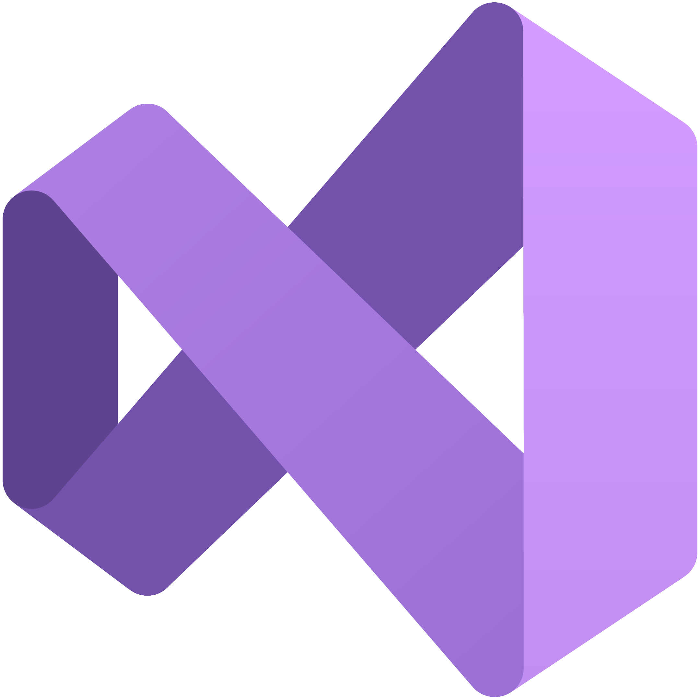
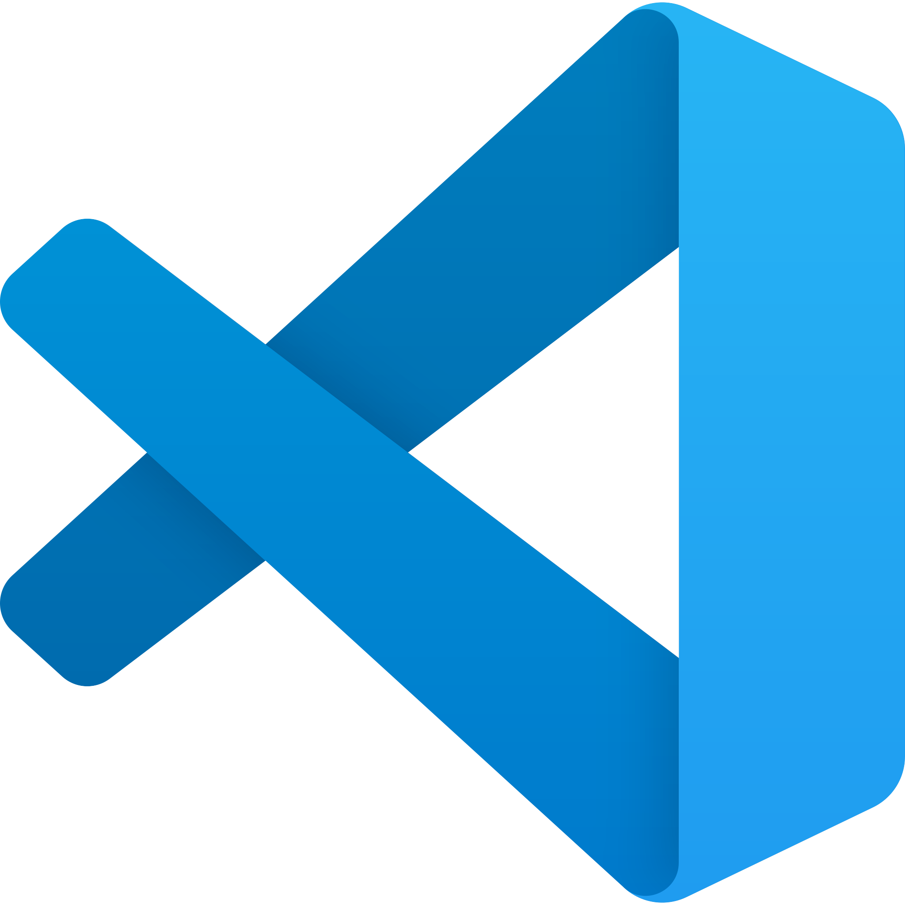
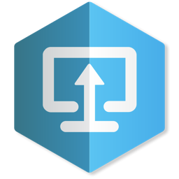
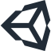

# 👋 Hello! I'm Zhangir
## Software Engineer | Engine & Tools | Gameplay | Unity | Unreal

🎓 I graduated from **Breda University of Applied Sciences** in Creative Media and Game Technologies.

💼 I'm currently seeking new job opportunities in the game industry!

I am a skilled in **Gameplay** and **Engine & Tools** with strong experience in **C++, Unreal Engine, Unity, and custom engine development**. I enjoy designing gameplay mechanics, building robust systems, and creating tools that streamline development for programmers, designers, and artists. I’m passionate about solving complex technical challenges, optimizing performance, and developing maintainable gameplay systems, while continuously improving my skills and collaborating across disciplines.

Proficient in C++. Additional experience with Unreal, Unity, and Godot.

Hobbies: writing stories, calisthenics, designing in Photoshop.

# ⚙️ Skills

  

    
    

      C++ 
      9 years of experience with C++, specializing in Object-Oriented Programming, Memory Management, Data Structures, Algorithms, and Performance Optimization.
    

  

  

    
    

      Visual Studio 
      5 years of experience with Visual Studio, focusing on Advanced Debugging, Performance Profiling, Memory Diagnostics, CMake, and Build System Configuration.
    

  

  

    
    

      Visual Studio Code 
      5 years of experience 5 years of experience with Visual Studio Code, focusing on C++/C# Development, Debugging, Git Integration, Task Automation, and Development Environment Configuration.
    

  

  

    
    

      Github   
      4 years of experience. Experienced with its pipelines and used them in a team environment, including reviews, automated checks, and managing branches.
    

  

  

    
    

      Perforce   
      3 years of experience with Perforce and P4V in a collaborative team environment, including active participation in code reviews.
    

  

  

    
    

      Unreal Engine  
      4 years of experience of Unreal Engine's Blueprints, C++, Gameplay Framework, Gameplay Ability System, Artificial Intelligence.
    

  

  

    
    

      Unity C#  
      5 years of experience with Unity and C#, specializing in Custom Editor Tools, Gameplay Systems, Editor Scripting, AI, and Performance Optimization.
    

  

# 💼 Professional Experience

A few roles where I helped teams ship by building tools, improving workflows, and solving practical technical problems.

  
  
    
      

        
          
        

        
          <h2>{{ job.role }}</h2>
        

        <h2>
          <a href="{{ job.url }}" class="project-title-link">{{ job.title }}</a>
        </h2>

        {% assign now_ts = "now" | date: "%s" %}
        {% assign start_ts = job.start_date | date: "%s" %}
        {% assign end_ts = job.end_date | default: job.start_date | date: "%s" %}

        
          
<strong>Date:</strong>
            Starts {{ job.start_date | date: "%B %-d, %Y" }}
             - {{ job.end_date | date: "%B %-d, %Y" }}
          

        
          
<strong>Date:</strong>
            {{ job.start_date | date: "%B %-d, %Y" }}
            -
            
              Present
            
              {{ job.end_date | date: "%B %-d, %Y" }}
            
              Present
            
          

        

        
<a href="{{ job.url }}" class="read-more-link">Read more →</a>

        
          
<strong>My Contributions:</strong> {{ job.contributions }}

        

        
          
<strong>Tools:</strong> {{ job.tools }}

        

        
          
<strong>Duration:</strong> {{ job.duration }}

        
      

    
  

 

# 🌟 Featured Projects

A small selection of projects I am most proud of, chosen for clear impact, strong engineering, and polished presentation.

  
  
    
      

        
          
        

        
          <h2>{{ project.role }}</h2>
        

        <h2>
          <a href="{{ project.url }}" class="project-title-link">{{ project.title }}</a>
        </h2>

        
<strong>Date:</strong> {{ project.date | date: "%B %-d, %Y" }}

        
          
{{ project.description }}

        
        
        
<a href="{{ project.url }}" class="read-more-link">Read more →</a>

        
          
<strong>My Contributions:</strong> {{ project.contributions }}

        

        
          
<strong>Engine/Tools:</strong> {{ project.tools }}

        

        
          
<strong>Team Size:</strong> {{ project.team_size }}

        

        
          
<strong>Platforms:</strong> {{ project.platforms }}

        

        
          
<strong>Duration:</strong> {{ project.duration }}

        

      

    
  

 

# 🧩 Other Projects

Earlier work and experiments, kept here for extra context and range.

 
  
    
      

        
          
        

        <h2>
          <a href="{{ project.url }}" class="project-title-link">{{ project.title }}</a>
        </h2>

        
<strong>Date:</strong> {{ project.date | date: "%B %-d, %Y" }}

        
          
{{ project.description }}

        
        
        
<a href="{{ project.url }}" class="read-more-link">Read more →</a>

        
          
<strong>My Contributions:</strong> {{ project.contributions }}

        

        
          
<strong>Engine/Tools:</strong> {{ project.tools }}

        

        
          
<strong>Team Size:</strong> {{ project.team_size }}

        

        
          
<strong>Platforms:</strong> {{ project.platforms }}

        

        
          
<strong>Duration:</strong> {{ project.duration }}

        

      

    
  

